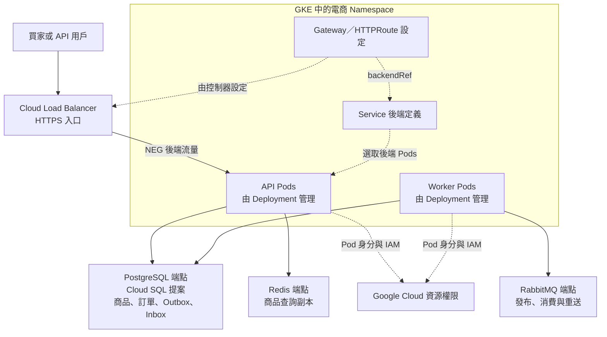

# 雲端部署與維運知識地圖：Docker、Kubernetes 與 GKE

| 項目 | 內容 |
| --- | --- |
| 版本 | 0.1 |
| 日期 | 2026-10-08（Asia/Taipei） |
| 狀態 | 待討論的內容規劃；尚未建立 K8s／GKE 範例或雲端環境 |
| 目的 | 用同一個 .NET 電商案例學會容器、編排、雲端整合、交付與維運，也提供可獨立查閱的知識文章 |
| 整體架構 | [DevWiki 全面知識架構](E_COMMERCE_KNOWLEDGE_ARCHITECTURE.md) |
| 應用先備 | [C#／.NET 深入學習地圖](CSHARP_DOTNET_LEARNING_MAP.md)，原有十個領域與 P0／P1 維持原定義 |
| 官方資料確認 | 2026-10-08；實作文章另記錄實際工具、叢集、API 與服務版本 |

## 1. 在 Wiki 中的角色

這份地圖解決「程式寫完後，如何部署並持續運作」的問題。Kubernetes 先學跨平台的物件、控制器與操作模型；GKE 再學 Google Cloud 上的平台模式、網路、身分及外部服務整合。

同一份電商案例分別有三種閱讀方式：

| 入口 | 組織方式 | 讀者能完成什麼 |
| --- | --- | --- |
| .NET 知識地圖 | 型別、框架、資料、Runtime 與工程領域 | 寫出可解釋、可驗證的後端與背景程序 |
| 雲端知識地圖 | 容器、K8s、GKE、交付與維運領域 | 說明程序在哪裡執行、如何連線、取得權限與恢復 |
| 電商專題 | 商品、下單、通知、部署與運作情境 | 沿著一套系統理解需求、設計與平台責任如何串接 |

技術文章提供概念、最小範例與取捨；情境篇描述電商需求；實作指南提供環境和命令。讀者可以先理解 Pod 或 Workload Identity，而不需先建立叢集。

## 2. 九大學習領域

以下為新增的雲端學習提案。「核心」是首次可重現部署所需，「深入」在具備基本部署能力後補充，「選修」依後續案例問題引入。它們與原本 .NET 的 P0／P1 分開記錄。

| 領域 | 核心必學 | 深入或選修 | 完成條件 |
| --- | --- | --- | --- |
| C01 容器與執行環境 | Image／Container、Dockerfile、multi-stage、Registry、Port、環境變數、程序與停止 | Linux 權限、CPU 架構、映像大小與安全維護、檔案系統 | 說明同一版 API／Worker 映像的建立、設定與執行 |
| C02 網路與協定基礎 | IP／Port、DNS、HTTP／HTTPS、TLS、L4／L7、入口與出口 | VPC、CIDR、路由、NAT、防火牆、私有連線 | 畫出外部請求與 API 存取資料服務的完整路徑 |
| C03 Kubernetes 模型與工作負載 | API、期望狀態、控制器、Node、Pod、Deployment、ReplicaSet、Namespace、Labels、kubectl | Job／CronJob、DaemonSet、StatefulSet、排程與節點拓樸 | 分辨宣告、排程、程序啟動與實際服務狀態 |
| C04 Kubernetes 服務、設定與安全 | Service、DNS、Gateway API、ConfigMap、Secret、ServiceAccount、RBAC、基本 securityContext | Ingress 比較、NetworkPolicy、憑證與 Secret 更新、政策管理 | 解釋服務探索、設定供應、流量路徑與存取權限 |
| C05 資源、儲存與可靠性 | requests／limits、探針、終止流程、rolling update、排錯、暫存與持久資料 | PV／PVC／StorageClass／CSI、PDB、拓樸分散、有狀態服務與恢復 | 能重現未就緒、資源不足與更新中的行為 |
| C06 GCP 與 GKE 平台 | Project、區域／可用區、IAM、VPC、Artifact Registry、GKE 模式、費用與版本 | Standard 節點池、ComputeClasses、排程、升級與平台限制 | 區分應用、叢集與雲端平台各自負責的設定 |
| C07 GKE 與外部服務整合 | Gateway／Load Balancer、TLS、Workload Identity、Cloud SQL、Redis／RabbitMQ 端點 | Secret Manager、Cloud Storage、私有網路、自管訊息及資料服務 | 逐層核對網路、雲端權限、服務登入與應用設定 |
| C08 自動化交付與 IaC | CI/CD、OIDC、映像 tag／digest、環境設定、部署檢查、資料庫更新與回復 | Kustomize、Helm、Terraform、state／drift；GitOps 選修 | 從程式版本追溯映像、環境、部署與資料變更 |
| C09 觀測、擴縮與日常維運 | 應用／Pod 指標、日誌、Trace、HPA、容量、SLO、告警、Runbook、成本 | VPA／節點擴縮、佇列指標、備份恢復、升級、RPO／RTO；多區域選修 | 以證據判斷瓶頸、服務品質與恢復結果 |

### C01 容器與執行環境

- 先以單一程序說明 Image、Container、檔案系統、網路及設定，再容器化 API 與 Worker。
- 區分 SDK 建置階段與 runtime 執行階段，解釋哪些檔案進入最終映像。[Docker multi-stage build](https://docs.docker.com/build/building/multi-stage/)。
- 補上非 root 執行、可寫目錄、容器 Port、CPU 架構、映像版本、SIGTERM 與 .NET Host 停止的關係。
- Compose 負責第一套可重現的多程序環境；資料 Volume 的保留及刪除在指南中說明。
- 例子：同一版商品 API 在開發機與容器中回傳相同資料；停止 Worker 時能說明尚未完成的訊息會如何處理。

### C02 網路與協定基礎

- 基礎知識篇解釋 IP、Port、DNS、HTTP status、TLS、憑證、L4／L7 及服務端點。
- 先畫主機與 Compose 的請求路徑，再比較 Pod IP、Service 名稱與外部負載平衡。
- GCP 深入篇解釋 VPC、子網、路由、防火牆、NAT 及資料服務的私有連線；實作時依選定區域及網路方案記錄設定。
- 每個連線案例分別辨識 DNS、TCP／TLS、雲端身分、服務認證與應用授權，避免把所有失敗都稱為「連不上」。
- 例子：買家呼叫商品 API；API 連到 PostgreSQL、Redis 與 RabbitMQ，這是不同方向、不同權限的連線。

### C03 Kubernetes 模型與工作負載

- 先說明宣告期望狀態、控制器持續協調實際狀態的模型，再介紹控制平面與 Node 的責任。[Kubernetes 概念總覽](https://kubernetes.io/docs/concepts/overview/)。
- 主要起步物件是 Namespace、Pod、Deployment、ReplicaSet、Labels／Selectors，配合 kubectl 觀察狀態與 Events。[Deployment](https://kubernetes.io/docs/concepts/workloads/controllers/deployment/)。
- Job 用於可結束的工作，CronJob 用於排程；DaemonSet、StatefulSet 放在各自的使用問題中介紹。
- 本機指南採 kind 為主要提案，明確指定叢集名稱與 context，說明映像如何載入及資源如何清除。[kind 起步指南](https://kind.sigs.k8s.io/docs/user/quick-start/)。
- 例子：API 與 Worker 各有 Deployment；API 更新與 Worker 更新的完成條件分別驗證。

### C04 Kubernetes 服務、設定與安全

- Service 與叢集 DNS 解釋穩定端點；API 的公開入口另由 Gateway／負載平衡處理。Worker 消費訊息的流程說明它如何主動連到 broker。
- 新篇以 Gateway API 為主要入口模型，介紹 GatewayClass、Gateway、HTTPRoute；Ingress 作為既有系統的比較。Ingress API 已凍結，官方建議採 Gateway API。[Ingress 官方說明](https://kubernetes.io/docs/concepts/services-networking/ingress/)。
- Gateway API 的物件與實際控制器分開解釋；本機與 GKE 的控制器、負載平衡與 TLS 設定需要各自指南。
- ConfigMap 用於一般設定；Secret 的供應、存取、輪替與避免進入日誌另有完整篇章。比較環境變數、掛載檔案與外部 Secret 服務的更新方式。
- ServiceAccount、RBAC、securityContext 與 NetworkPolicy 分別解釋程序身分、K8s API 權限、程序限制與網路政策；不把買家登入權限混在這裡。

### C05 資源、儲存與可靠性

- 解釋 CPU／Memory requests 與 limits、排程、限流與 OOM，連到 .NET 的 ThreadPool、GC、記憶體配置和診斷。
- startup、readiness、liveness 各有獨立目的；readiness 影響是否承接服務流量，liveness 失敗可導致重啟。[Kubernetes 探針](https://kubernetes.io/docs/tasks/configure-pod-container/configure-liveness-readiness-startup-probes/)。
- 依用例選擇依賴健康判定：商品查詢若允許 Redis 故障時回源，探針與降級策略要反映這項規則。
- 把 SIGTERM、停止 token、terminationGracePeriod、尚未完成的請求／訊息、ACK 與重送放在同一張時間線。
- 比較 rolling update、部署回復、PDB 與節點維護，說明各自處理的中斷情境。
- 先分辨暫存與持久資料；PV、PVC、StorageClass、CSI 與 StatefulSet 再用資料服務範例深化，另外規劃備份與恢復。

### C06 GCP 與 GKE 平台

- 共通前置篇解釋 Project、Billing、API 啟用、區域／可用區、VPC、IAM 與 Artifact Registry，並畫出資源關係。
- 首次部署以 Autopilot 叢集為主要提案；需要節點池與更細排程控制時，再深入 Standard。
- 目前 Standard 叢集也能透過 ComputeClasses 執行 Autopilot 工作負載。因此模式篇分別說明叢集選擇與工作負載管理，對照平台管理範圍、限制及費用。[GKE 模式選擇](https://docs.cloud.google.com/kubernetes-engine/docs/concepts/choose-cluster-mode)。
- 版本篇解釋 release channel、控制平面／節點版本與升級條件；寫指南時確認該區域實際可用版本。[GKE release channels](https://docs.cloud.google.com/kubernetes-engine/docs/concepts/release-channels)。
- 平台故障與應用故障分開診斷，例如叢集權限、映像拉取、排程與應用例外。

### C07 GKE 與外部服務整合

- GKE Gateway 控制器依 Gateway API 設定 Google Cloud 負載平衡；圖示中的實際流量經過負載平衡與後端，Gateway 物件表示設定。[GKE Gateway API](https://docs.cloud.google.com/kubernetes-engine/docs/concepts/gateway-api)。
- 使用 Workload Identity Federation for GKE 說明 Pod 如何存取 Google Cloud 資源。啟用功能之後仍須對指定身分配置所需 IAM 權限。[GKE Workload Identity](https://docs.cloud.google.com/kubernetes-engine/docs/concepts/workload-identity)。
- Cloud SQL PostgreSQL 為資料庫整合的主要提案；比較網路、Cloud SQL Auth Proxy、雲端權限、資料庫登入與應用連線池。Proxy sidecar 與 API 程序的關係要有圖及連線設定。[Cloud SQL 連接 GKE](https://docs.cloud.google.com/sql/docs/postgres/connect-kubernetes-engine)。
- Redis 比較自管實例與代管方案；逐項核對版本、資料型別、持久化與失效假設。既有本機 AOF／WAITAOF 示範需依產品能力重新設計與驗證。
- RabbitMQ 起步先選一個可存取的 broker 端點；深入篇再比較代管 RabbitMQ 與 GKE 中的 Cluster Operator、StatefulSet、儲存及維運。[RabbitMQ Kubernetes Cluster Operator](https://www.rabbitmq.com/kubernetes/operator/operator-overview)。
- Google Pub/Sub 可作後續訊息服務比較，另說明模型、契約與處理語意；共同案例的 RabbitMQ 知識仍完整保留。
- 商品圖片若擴充，再加入 Cloud Storage；Secret Manager 則用於設定供應與身分整合的深入篇。

### C08 自動化交付與 IaC

- 先讓手動部署的輸入與結果可重現，再把建置、驗證、映像發布、部署、檢查與回復串成 CI/CD。
- 區分映像 tag 的命名與 digest 的版本識別；記錄程式 commit、映像、環境設定及部署時間。
- GitHub Actions 到 Google Cloud 採 OIDC／Workload Identity Federation 為主要提案；這個 CI 身分與執行中 Pod 的 GKE 身分有不同信任及權限設定。[部署管線 Workload Identity Federation](https://docs.cloud.google.com/iam/docs/workload-identity-federation-with-deployment-pipelines)。
- 工具順序是基本 YAML → Kustomize 管理環境差異 → Helm 讀懂與安裝套件 → Terraform 管理雲端資源；GitOps 在需要持續調和部署設定時作選修。
- Terraform 篇包含 plan／apply、state、鎖定、敏感資訊與環境責任，使用工具前先交代它管理哪些資源。
- Migration 作為獨立的資料更新流程，規劃 Job、重複執行、互斥、權限及新舊程式的資料相容。應用 Deployment 回復與資料庫恢復有不同條件。
- 部署演練包含映像拉取失敗、readiness 未通過、更新中停止 Worker，以及回到相容版本。

### C09 觀測、擴縮與日常維運

- 應用指標、結構化日誌與 Trace 延續現有文章；新增 Pod／Node／叢集觀察，比較 Cloud Logging／Monitoring、OpenTelemetry 與 Prometheus 的資料責任。
- HPA 先學資源指標、requests 與副本調整，再比較 VPA、節點擴縮及平台管理範圍。自訂或外部指標需有對應的指標供應與 adapter。[HPA](https://kubernetes.io/docs/concepts/workloads/autoscaling/horizontal-pod-autoscale/)。
- API 以延遲、錯誤率與吞吐量評估擴縮；Worker 以積壓、最舊訊息等待時間及處理率評估。佇列指標的 adapter 或 KEDA 作深入選項，分別記錄前置條件。
- 擴縮前先量測資料庫連線、鎖與查詢、broker 流量、Redis 與外部服務容量；增加 Pod 的效果由端到端結果驗證。
- SLI／SLO、error budget、告警與 Runbook 用於表達服務目標、可採取的行動與事件追查；平台 SLA 與應用達成的品質分開說明。
- 恢復篇訂定 RPO／RTO，分別驗證資料庫、broker、設定與應用恢復；有備份之後還需檢查實際還原結果。
- 成本篇涵蓋預算類型與告警、支出限制的適用範圍、資源與用量、閒置資源及清理核對；價格在實作時按區域和服務查核。[Google Cloud 預算](https://docs.cloud.google.com/billing/docs/how-to/budgets)。

## 3. 第一套雲端案例的目標拓樸

此圖為方案提案，尚未建立或驗證。首次部署優先學無狀態程序和外部依賴整合；Redis／RabbitMQ 的供應方式在實作前選定。

實線表示請求或依賴連線，虛線表示設定、後端選擇與身分。GKE Gateway 使用 NEG 組織後端端點，圖中區分 Service 設定與實際流量。[GKE Gateway 部署](https://docs.cloud.google.com/kubernetes-engine/docs/how-to/deploying-gateways)。

Gateway 的範例需另補控制器、後端健康檢查與政策。資料庫連線圖在 Cloud SQL 文章中展開，標示 Proxy、網路與資料庫驗證。讀者能沿著一筆商品查詢和一筆訂單通知分別追查資料路徑。

API 和 Worker 的業務模組先維持現有規模。初期可以各一份執行；需要多份 Worker 時，先處理 Outbox 競爭，再安排擴縮與故障驗證。

## 4. .NET 與平台之間的責任接點

| 既有概念 | 加入多 Pod 後需要說明 | 預定檢查點 |
| --- | --- | --- |
| Singleton／Scoped／Transient | DI 的生命週期屬於程序與 scope；每個 Pod 有自己的服務實例 | 兩份 API 能說明各自的記憶體狀態與共同資料來源 |
| lock／SemaphoreSlim | 原有程序內同步如何與資料庫並行控制、跨程序協調分工 | 多份 API 同時下單時庫存與訂單結果符合規則 |
| DbContext／Connection Pool | 每個程序與 provider 的連線池，以及全部副本的連線容量 | 擴縮與更新時核對池設定、資料庫連線及錯誤 |
| Cache-Aside | 多份 API 回填、失效及降級時的資料一致性問題 | 改價與 Redis 故障下，讀取與下單各自符合規則 |
| Outbox Publisher | 多份發布者可能競爭同一筆待送資料，需要領取／租約／鎖與恢復策略 | 兩份發布程序同時與中途停止時，事件可恢復且業務效果符合冪等規則 |
| RabbitMQ Consumer／Inbox | prefetch、處理並行、訊息重送與 Inbox 唯一約束一起設計 | Worker 更新或縮容後，未完成訊息可重送，通知結果符合規則 |
| CancellationToken／IAsyncDisposable | 平台終止訊號、Host 停止、未完成工作與 ACK 時點 | 正常停止和強制終止分別觀察處理結果 |
| GC／ThreadPool／Profiling | CPU／Memory 限制、配置量、等待、飢餓與 Pod 指標共同判讀 | 使用固定工作負載比較程序與容器指標 |
| Authentication／Authorization | 買家身分、K8s RBAC、Google IAM／Pod 身分、CI 身分各有不同用途 | 每類身分都能指出可操作的資源與拒絕原因 |
| Migration／部署版本 | 新舊 Pod 可能同時執行，資料結構需滿足相容條件 | 更新中讀寫正常，回復版本仍能使用現存資料 |

現有實驗未提供多發布者的 Outbox 領取與擴縮驗證。若初期以同一個 Worker 程序執行發布和消費，先維持單一發布實例；消費擴縮可再規劃為獨立角色，或完成安全領取後才擴大整個 Worker。這是新增的應用工作，不只是調高 Deployment replicas。

資料庫連接容量需要考慮所有使用者和工作：API、Worker、更新期間新舊副本、Migration 與維運連線。每個程序的池上限設定連到整體容量估算，並以實際量測核對。

## 5. 四層環境與實作指南

| 環境 | 本層目標 | 前置資訊 | 完成判定 |
| --- | --- | --- | --- |
| L1 主機／Compose | 看懂程序與依賴的互動 | 原始碼、.NET、Docker、服務設定、程序執行位置 | 商品查詢、改價、建立訂單與背景通知能依指南觀察 |
| L2 本機 kind | 學 K8s 共通物件與排錯 | 叢集名稱、context、Namespace、映像、網路與控制器 | API／Worker、探針、設定、更新與停止有明確檢查點 |
| L3 GKE | 學 Google Cloud 平台整合 | Project、區域、計費、權限、網路、叢集模式與依賴方案 | TLS API、資料存取、身分、日誌與清理逐項核對 |
| L4 自動化交付 | 重現版本和環境變更 | CI 信任與權限、Registry、IaC、資料更新、部署策略 | 能追溯版本，重現部署、相容更新及回復演練 |

每份指南的固定結構：

1. 本次做什麼：功能、資料、部署拓樸與完成條件。
2. 已完成哪個檢查點：來源版本、起始資料與必要先讀內容。
3. 要準備什麼：工具／CPU 架構、服務、權限、計費及版本。
4. 命令在哪裡執行：目錄、終端機、程序、context、Namespace、Project、區域與身分。
5. 每個步驟改變什麼：目標物件、輸入、可觀察結果與失敗判定。
6. 如何排錯：先辨識程序、K8s 或 Google Cloud 層級，再核對證據。
7. 如何停止及清理：保留哪些資料，移除哪些資源，如何核對剩餘資源。

儲存庫捷徑先顯示其實際呼叫的工具與檔案；YAML 同時介紹物件類型、重要欄位、作用對象與版本。雲端指南以明確占位符說明 Project、區域、Namespace、Registry 和端點，避免讀者把範例值當成自己的環境。

本機 API／Worker 容器化完成後，才建立 K8s 實作。GKE 的部署與破壞性故障演練需要獨立的實驗環境規劃；目前本文件只定義內容與完成條件。

## 6. 文章組織與優先篇名

### 主要知識篇與情境篇的配對

| 主要技術文章（擬定） | 對應電商情境 | 實作環境 |
| --- | --- | --- |
| Image、Container 與 .NET multi-stage build | 商品 API 和通知 Worker 如何重現執行？ | L1 |
| Pod、Deployment 與宣告式控制 | 程序退出後，平台如何維持服務？ | L2 |
| Service、DNS 與 Gateway API | 一筆商品查詢如何找到正確的 API？ | L2；GKE 差異在 L3 |
| ConfigMap、Secret 與設定供應 | 開發與雲端環境如何使用不同連線設定？ | L2／L3 |
| startup、readiness、liveness | API 還沒啟動完成時，能接受流量嗎？ | L2 |
| requests、limits 與 .NET 資源診斷 | API 變慢或 Worker 被終止時如何定位？ | L2，L3 再核對 |
| GKE 模式、平台身分與 IAM | 誰可以部署，Pod 又如何存取 Cloud SQL？ | L3 |
| GKE Gateway、TLS 與 Cloud SQL | 買家請求從網際網路到資料庫經過哪些層？ | L3 |
| HPA、容量與多副本處理 | 大量下單與通知積壓時如何擴縮？ | L2／L3 |
| CI/CD、映像版本與資料相容更新 | 訂單服務如何持續改版？ | L4 |
| SLO、告警與恢復演練 | 如何判斷服務品質並恢復故障？ | L3／L4 |

每個篇名代表主要問題，實際寫作再依篇幅拆分。官方工具用法、教學專案輔助程式與案例規則各自交代；知識篇不要求讀者先跑完整專案。

### 需要一起補上的先備知識

| 知識 | 放置位置 | 串接用途 |
| --- | --- | --- |
| HTTP、REST、狀態碼、JSON／序列化、API 契約與版本 | ASP.NET Core／後端基礎 | 請求路徑、錯誤與新舊版本相容 |
| SQL、約束、索引、查詢計畫、Isolation 與並行 | 資料存取 | 下單一致性、容量與雲端資料庫診斷 |
| Linux 程序、權限、訊號、檔案與網路 | 容器與執行環境 | 容器啟停、設定、檔案掛載與排錯 |
| 輸入驗證、Secret、身分、最小權限、映像維護 | 各主要技術篇與工程實務 | API、叢集與雲端的安全責任 |
| Trace／Correlation ID、事件版本與時間語意 | 測試與觀測、通訊與 .NET | 串起 API、背景工作、資料與日誌 |

基本安全、測試與觀測隨各篇加入。更深入的安全分析、負載測試、災難恢復和平台治理再提供獨立路徑。

## 7. 實作與驗證的關鍵情境

| 情境 | 預定觀察 | 判定重點 |
| --- | --- | --- |
| ImagePullBackOff／CrashLoopBackOff／Pending | Events、映像、程序日誌、資源與排程 | 能定位發生在哪一層與下一個核對點 |
| API 啟動慢、readiness 失敗 | 探針、端點與請求結果 | 啟動、是否接流量、是否重啟各自說明 |
| Redis 或資料庫不可用 | API 結果、依賴錯誤、回源／拒絕與恢復 | 符合當篇明定的降級與一致性規則 |
| Pod 收到停止訊號或強制終止 | Host 停止、未完成工作、ACK、重送與 Inbox | 能解釋各故障窗口與業務結果 |
| API／Worker 增加副本 | 延遲、吞吐、積壓、連線、資料競爭 | 擴縮前後功能正確，容量提升有證據 |
| 權限不足或資料登入失敗 | IAM、RBAC、網路與服務驗證結果 | 能區分 Pod／CI 身分、K8s API 權限與服務權限 |
| 更新應用與資料結構 | 映像版本、新舊副本與資料相容性 | 提交、檢查及回復條件明確 |
| 備份還原與雲端清理 | 資料核對、耗時、資源清單與計費 | 恢復結果和 RPO／RTO 可說明，清理範圍可核對 |

這些是內容與未來實作的驗收情境。每篇記錄實際跑過的環境，區分示意、已實作與已驗證；既有 Compose 故障測試不能直接宣稱是 GKE、高可用或代管服務的驗證。

## 8. 目前基礎與建議補寫順序

| 現有基礎 | 可以沿用 | 需要新增 |
| --- | --- | --- |
| Wiki 靜態網站 Dockerfile／Compose／CI | 容器和建置工具的最小背景 | .NET API／Worker 映像、後端容器環境與停止驗證 |
| 商品查詢、Redis、訂單、Outbox／Inbox、RabbitMQ Worker | 具體資料與處理案例 | 完整購買主線、多發布者協調、容量與擴縮驗證 |
| .NET Hosting、連線池、Migration | 程序啟停與資料連線概念 | K8s 設定、探針、資源與更新整合 |
| 商業行為／真實服務測試、指標與追蹤文章 | 既有驗證思路與可觀察結果 | 容器／本機 K8s／GKE 分層檢查、平台觀測與 CI/CD |
| 資料存取中的 Cloud SQL Proxy 說明 | Proxy、連線池與資料庫鎖的背景 | 電商 PostgreSQL 在 GKE 的網路、IAM、Proxy 與登入指南 |

補寫順序建議：

1. 先改善 Redis／RabbitMQ 的網站閱讀背景，確認「情境 → 知識 → 實作」形式，並補共同電商導讀。
2. 原有 .NET P0 深入缺口與購買主線持續補齊；同步加入必要的 HTTP、SQL、網路及 Linux 先備。
3. 容器化 API／Worker，完成 Compose 中的啟動、查詢、通知與停止。
4. 建立本機 kind 路徑：Deployment／Service → 設定／探針／資源 → 更新與故障觀察。
5. 建立 GKE 路徑：平台與費用 → Registry／身分 → Gateway／TLS → Cloud SQL 與依賴端點 → 清理。
6. 完成多 Pod 的應用一致性與容量條件，再補擴縮、CI/CD、IaC、Migration 與回復。
7. 深化可觀測性、SLO、告警、備份恢復、版本升級、成本及有狀態服務維運。
8. 依需求擴充多商家、前端、GitOps、微服務、多區域與 Service Mesh。

第一組雲端內容試行可採「商品 API 容器化 → 本機 Deployment／Service → 探針與停止」；完成後再加入 Worker 和 GKE。每組都有完整可閱讀內容與明確檢查點，再發布入口。

## 9. 內容完成標準

- 九個領域都有主要知識、先備與深入方向，跨領域用連結維持單一主要概念來源。
- .NET 的原有十個領域和 P0／P1 保留；雲端領域與案例章節另有映射。
- 只讀網站就能理解程序、資料、流量、身分及平台責任，跟做時再進入對應環境。
- Kubernetes 共通原理與 GKE 實作差異清楚；控制器、API 版本及產品能力都記錄查核依據。
- 基本設定、探針、停止、權限、測試與觀測在首次部署中出現，進階工具有獨立問題和前置條件。
- 擴縮以端到端容量和業務結果驗證，資料與訊息的可靠性有具體故障窗口與恢復流程。
- 指南中的部署、資料更新、回復、清理各有執行位置、作用對象與可觀察結果。
- 實作版本、驗證環境、未涵蓋項目與雲端費用前提可查閱，規劃與已完成內容分別標示。
