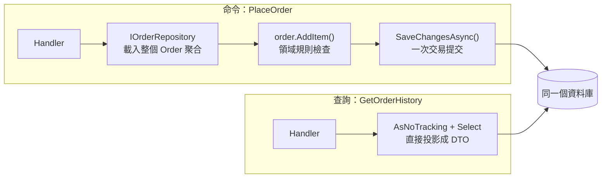

## 這是什麼

應用層的用例（例如「建立訂單」）需要載入聚合、改變狀態、存回去。這幾個名詞描述的是「資料怎麼進出」：

- **Repository**：像一個裝聚合的集合，提供「依 ID 取得訂單」「加入一筆新訂單」這種以業務為單位的操作，藏起 SQL 的細節。
- **Unit of Work**：把一次用例裡所有的變更收集起來，最後一次提交，要嘛全部成功，要嘛全部不生效。
- **CQRS**（命令查詢責任分離）：把「改資料」（命令）和「讀資料」（查詢）分成兩條路徑，各自用最合適的方式實作。

EF Core 的 `DbContext` 本身就同時扮演了 Unit of Work（`SaveChanges` 一次提交）和 Repository（`DbSet<T>`）。所以問題不是「要不要做這些模式」，而是「要不要在 EF Core 上面再包一層」。

## 運作原理



**命令**需要規則檢查，所以載入完整的聚合、透過領域方法修改，再由 Unit of Work 提交。

**查詢**不改資料、不需要規則，直接用 `Select` 只取畫面需要的欄位，加上 `AsNoTracking()` 省去變更追蹤的成本。兩條路徑讀寫同一個資料庫，這就是「輕量 CQRS」。

## 常見錯誤與正確寫法

### 1. 泛用 Repository 把 IQueryable 開放出去

```csharp
// 錯：什麼都能查，等於沒有邊界；呼叫端仍需要懂 EF Core 的查詢行為
public interface IRepository<T>
{
    IQueryable<T> Query();
    void Add(T entity);
}
```

這一層沒有藏起任何東西，卻多了一層要維護。要包一層，就以聚合為單位，只提供用例真的需要的操作：

```csharp
public interface IOrderRepository
{
    Task<Order?> GetAsync(Guid orderId, CancellationToken ct);
    void Add(Order order);
}

internal sealed class OrderRepository(ShopDbContext db) : IOrderRepository
{
    public Task<Order?> GetAsync(Guid orderId, CancellationToken ct) =>
        db.Orders.Include(o => o.Lines).SingleOrDefaultAsync(o => o.Id == orderId, ct);

    public void Add(Order order) => db.Orders.Add(order);
}
```

`SaveChangesAsync` 由用例在最後呼叫一次，而不是每個 Repository 方法各自提交。

### 2. 查詢畫面也載入完整聚合

訂單列表頁只需要訂單編號、日期、總額，卻透過 Repository 載入每張訂單和全部明細，再在記憶體裡轉成 DTO。資料庫多傳了很多欄位，EF Core 還要追蹤每個實體的變更。

查詢直接投影：

```csharp
public sealed class GetOrderHistoryHandler(ShopDbContext db)
{
    public Task<List<OrderSummaryDto>> HandleAsync(Guid buyerId, CancellationToken ct) =>
        db.Orders.AsNoTracking()
            .Where(o => o.BuyerId == buyerId)
            .OrderByDescending(o => o.PlacedAt)
            .Select(o => new OrderSummaryDto(o.Id, o.PlacedAt, o.TotalAmount)) // 成立時存下的總額快照
            .Take(20)
            .ToListAsync(ct);
}
```

`Select` 會被翻譯成只取這三個欄位的 SQL；結果是 DTO，不是實體，所以也不會被變更追蹤。

### 3. 還沒有需要就拆成兩個資料庫

完整的 CQRS 可能讓查詢端使用另一個資料庫或搜尋引擎，由事件同步。代價是查詢資料會落後、同步可能失敗、要多維護一套儲存。只有在查詢量或查詢形式（例如全文搜尋）已經是單一資料庫解決不了的瓶頸時，才值得付這個代價。

### 4. 在共用的 pipeline 裡替所有請求開交易

用 MediatR 這類函式庫的 pipeline 自動替每個請求包一個交易，連純查詢也開交易，延長了連線持有時間。交易只包住命令，而且以一次 `SaveChangesAsync` 為主；跨多次 `SaveChanges` 的情況才需要明確的交易，見 [交易](/data-access/transactions/)。

## 使用邊界

- 小型服務直接在用例裡使用 `DbContext` 完全沒問題。包一層 Repository 的好處是把聚合的載入方式集中管理，並讓用例測試可以替換資料存取。
- Repository 以聚合為單位，不是以資料表為單位；訂單明細沒有自己的 Repository。
- 查詢端越過 Repository 直接讀資料庫是刻意的設計，不是破壞分層。
- `DbContext` 不是執行緒安全的，同一個請求內不要平行使用；生命週期見 [EF Core 查詢](/data-access/ef-core/)。
