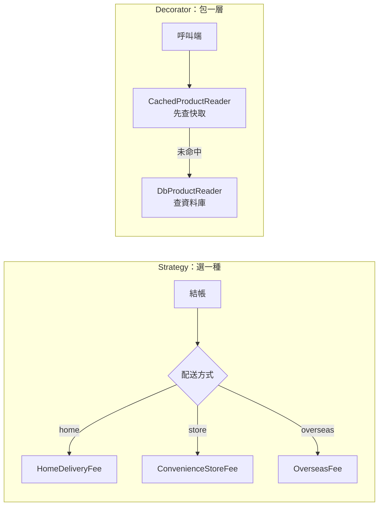

## 這是什麼

電商的運費一開始只有宅配。後來加了超商取貨，再加了海外配送。如果每加一種就在同一個方法裡多一個 `if/else`，這個方法會越來越長，每次修改都可能弄壞舊的規則。

- **Strategy（策略）**：把每一種運費算法做成獨立的類別，實作同一個介面。執行時依情況選出其中一個。新增配送方式，只要新增一個類別。
- **Decorator（裝飾者）**：一個類別實作和原本一樣的介面，內部包著原本的實作，在呼叫前後加上額外行為。例如在商品查詢外面包一層快取，原本的查詢類別完全不用改。

## 運作原理



兩者都依賴介面：呼叫端只認識 `IShippingFeeCalculator` 或 `IProductReader`，不知道背後是哪個類別。組合的工作交給 DI 容器在啟動時完成。

## 常見錯誤與正確寫法

### 1. 每加一種規則就改同一個 switch

```csharp
// 錯：新增配送方式要改這個方法，也可能改壞既有規則
public decimal CalculateFee(Order order, string method) => method switch
{
    "home" => order.Total >= 1000 ? 0 : 100,
    "store" => 60,
    _ => throw new NotSupportedException(),
};
```

改成每種規則一個類別，用 .NET 8 起的 **Keyed Services** 依鍵值取得：

```csharp
public interface IShippingFeeCalculator
{
    Money Calculate(Order order);
}

public sealed class HomeDeliveryFee : IShippingFeeCalculator
{
    public Money Calculate(Order order) => order.Total.Amount >= 1000 ? new Money(0, "TWD") : new Money(100, "TWD");
}

// Program.cs：同一個介面，用不同的鍵註冊
builder.Services.AddKeyedSingleton<IShippingFeeCalculator, HomeDeliveryFee>("home");
builder.Services.AddKeyedSingleton<IShippingFeeCalculator, ConvenienceStoreFee>("store");

// 使用端：依配送方式取得對應的策略
public sealed class ShippingService(IServiceProvider services)
{
    public Money Calculate(Order order, string method) =>
        services.GetRequiredKeyedService<IShippingFeeCalculator>(method).Calculate(order);
}
```

鍵值來自使用者輸入時，先驗證是否在允許的清單內，再查詢服務，避免找不到服務時丟出例外變成 500。

### 2. 把快取寫進 Repository 裡

```csharp
// 錯：資料存取和快取混在一起，想關掉快取或換快取方式都要改這個類別
public async Task<Product?> GetAsync(int id, CancellationToken ct)
{
    var cached = await _cache.GetStringAsync($"product:{id}", ct);
    if (cached != null) return JsonSerializer.Deserialize<Product>(cached);
    var product = await _db.Products.FindAsync([id], ct);
    // ...寫入快取
}
```

改成 Decorator：快取類別包住原本的查詢類別，兩者實作同一個介面。

```csharp
// 套件：Microsoft.Extensions.Caching.Hybrid
public sealed class CachedProductReader(IProductReader inner, HybridCache cache) : IProductReader
{
    public async Task<ProductDto?> GetAsync(int id, CancellationToken ct) =>
        await cache.GetOrCreateAsync(
            $"product:{id}",
            async token => await inner.GetAsync(id, token), // 未命中才呼叫被包住的實作
            cancellationToken: ct);
}

// Program.cs：內建 DI 沒有 Decorate，用工廠手動組合
builder.Services.AddScoped<DbProductReader>();
builder.Services.AddScoped<IProductReader>(sp =>
    new CachedProductReader(sp.GetRequiredService<DbProductReader>(), sp.GetRequiredService<HybridCache>()));
```

`HybridCache` 結合了記憶體快取與分散式快取，並在多個請求同時查同一個鍵時只執行一次來源查詢。

### 3. 裝飾順序放錯

快取、重試、記錄耗時都做成 Decorator 時，包的順序決定行為。以「記錄耗時 → 快取 → 重試 → 資料庫」由外往內為例：

- 記錄耗時在最外層，量到的是呼叫端實際等待的時間，包含快取命中的情況。如果放到最內層，只量得到資料庫時間。
- 重試在快取裡面，只有快取未命中、真的查資料庫時才會重試；快取命中的請求不經過重試。

每加一層就寫下「誰包誰」，並在測試裡確認順序。

## 使用邊界

- 只有兩種、而且不太會再增加的分支，一個 `if` 比 Strategy 好讀。等到出現第三種、或各分支開始變複雜時再抽出。
- Decorator 適合「對同一個介面的所有呼叫都要做」的事。只有特定方法需要的行為，直接寫在該方法裡。
- 第三方函式庫（例如 Scrutor）可以提供 `Decorate` 註冊方法；手動工廠的寫法則不需要額外套件。
- 對整個請求管線都要做的事，例如記錄與例外處理，見 [橫切行為](/architecture/cross-cutting/)；快取本身的一致性問題見 [Cache-Aside](/infrastructure/redis/cache-aside/)。
