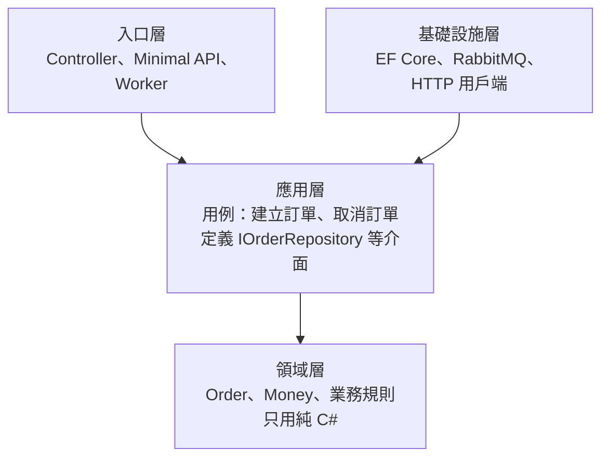

## 這是什麼

一個「建立訂單」的功能，會碰到 HTTP 請求、資料庫、訊息佇列，以及「庫存不足不能下單」這類業務規則。如果全部寫在同一個 Controller 裡，規則就和框架、資料庫綁在一起：要測規則就得啟動資料庫，要換資料庫就得改規則。

**Clean Architecture** 把程式分成幾圈，最裡面是業務規則，外面是技術細節，並規定**相依只能從外往內**：外層可以使用內層，內層不知道外層的存在。

## 運作原理



| 層 | 負責 | 不應該出現 |
| --- | --- | --- |
| 領域層 | 實體、值物件、業務規則 | EF Core、HTTP、JSON 的型別 |
| 應用層 | 一個用例的流程：載入、呼叫領域方法、儲存、發事件；定義需要的介面 | SQL、具體的訊息佇列用戶端 |
| 基礎設施層 | 實作應用層定義的介面：資料庫、快取、外部 API | 業務規則 |
| 入口層 | 把 HTTP 或訊息轉成用例的輸入，再把結果轉成回應 | 業務規則 |

關鍵在**相依反轉**：應用層需要「存訂單」，但不直接用 EF Core，而是定義一個 `IOrderRepository` 介面；基礎設施層去實作它。執行時由 DI 把兩者接起來，所以應用層編譯時完全不依賴 EF Core。

## 常見錯誤與正確寫法

### 1. 領域層引用了框架

```csharp
// 錯：領域實體帶著 EF Core 與 JSON 的屬性，領域專案必須引用這些套件
[Table("orders")]
public class Order
{
    [JsonPropertyName("total")] public decimal Total { get; set; }
}
```

資料表對應寫在基礎設施層的 `IEntityTypeConfiguration<Order>`，JSON 格式寫在入口層的 DTO。領域專案的 `.csproj` 不應該有 EF Core 或 ASP.NET Core 的套件參考：

```csharp
// 基礎設施層：資料表對應集中在這裡
internal sealed class OrderConfiguration : IEntityTypeConfiguration<Order>
{
    public void Configure(EntityTypeBuilder<Order> builder)
    {
        builder.ToTable("orders");
        builder.HasKey(o => o.Id);
        builder.Navigation(o => o.Lines).UsePropertyAccessMode(PropertyAccessMode.Field);
    }
}
```

### 2. 每個功能都硬套四層，改一個欄位要動十個檔案

全系統只有一種分法（按技術分成 Controllers、Services、Repositories 資料夾），一個小功能也要跨四個專案、加三個介面和兩次物件轉換。

**垂直切片**是另一種組織方式：按功能分資料夾，一個功能需要的請求、處理邏輯、資料存取放在一起。規則複雜的核心（訂單、庫存）用完整分層；規則簡單的查詢（商品列表）在同一個切片內直接查詢回傳。

```text
Features/
  Orders/PlaceOrder/        ← 規則多：領域模型 + 用例 + Repository
  Orders/GetOrderHistory/   ← 純查詢：直接投影成 DTO
  Catalog/ListProducts/
```

### 3. 底層例外直接冒到 API 回應

`DbUpdateConcurrencyException` 或 `NpgsqlException` 的訊息直接回給用戶端，既洩漏內部資訊，也讓入口層依賴資料庫的例外型別。基礎設施層把技術例外轉成應用層定義的例外（例如 `ConcurrencyConflictException`），入口層再統一轉成 HTTP 409 等回應，見 [HTTP 契約](/frameworks/aspnet-core/http-contracts/)。

## 使用邊界

- **分層的成本是真的。** 每一層都多一份型別、一次轉換、一個要維護的介面。小型服務或規則很少的系統，一個專案加上清楚的資料夾就夠了。
- 物件轉換用手寫或 source generator 都可以；使用 AutoMapper 這類執行期映射函式庫前，確認授權條款與效能需求，並知道錯誤會在執行期才出現。
- 專案之間的參考方向可以用 `dotnet list <專案> reference` 檢查；更嚴格的做法是寫架構測試，在 CI 中擋住錯誤的相依。
- 模組之間怎麼溝通，見 [通訊方式的選擇](/architecture/communication-boundaries/)；分層後的測試策略見 [商業行為測試](/engineering/business-tests/)。
