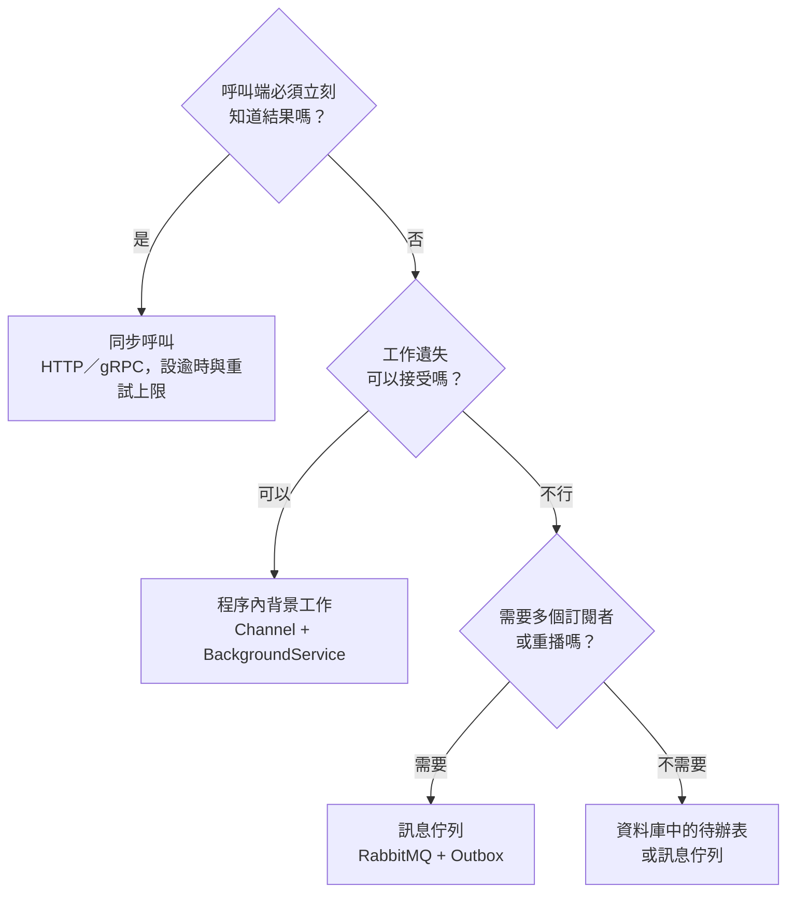

## 這是什麼

買家按下「下單」，系統要做很多事：確認庫存、建立訂單、扣款、寄確認信、更新推薦系統。這些事不需要用同一種方式完成。

- **同步呼叫**（HTTP、gRPC）：呼叫端等對方做完才繼續，適合「沒有結果就不能往下」的事，例如確認庫存。
- **程序內背景工作**（`Channel`、`BackgroundService`）：丟到同一個程序的背景處理，不讓買家等；程序重啟就會遺失。
- **訊息佇列**（RabbitMQ）：交給 broker 保存，由其他程序處理；可以重試、可以有多個訂閱者，程序重啟也不會遺失。

選錯方式的代價很具體：寄信服務慢，下單 API 就跟著慢；背景工作在部署時遺失，買家就收不到通知。

## 運作原理

用三個問題決定：



**同步呼叫的連鎖反應。** 下單 API 同步呼叫庫存、付款、通知三個服務，任何一個變慢，下單就變慢；任何一個停機，下單就失敗。每多一個同步依賴，整體可用性就是各服務可用性的乘積，越乘越低。

**領域事件與整合事件。** 兩者都叫「事件」，範圍不同：

| | 領域事件 | 整合事件 |
| --- | --- | --- |
| 範圍 | 同一個服務、同一個交易內 | 跨服務、跨程序 |
| 例子 | 訂單成立後，同一交易內扣減庫存保留量 | 通知其他服務「訂單已成立」 |
| 傳遞方式 | 記憶體內分派 | 經 Outbox 寫入，再發布到訊息佇列 |
| 失敗時 | 跟著交易回滾 | 交易已提交，要能重送 |

## 常見錯誤與正確寫法

### 1. 下單流程同步呼叫所有下游

```csharp
// 錯：寄信服務慢 3 秒，買家就多等 3 秒；寄信服務停機，下單就失敗
await _inventory.ReserveAsync(order, ct);
await _payments.AuthorizeAsync(order, ct);
await _email.SendConfirmationAsync(order, ct);
await _recommendation.RecordPurchaseAsync(order, ct);
```

只把「沒有結果就不能成立訂單」的步驟留在同步路徑，其餘變成事件：

```csharp
await _inventory.ReserveAsync(order, ct);           // 必須知道結果
order.Place();                                      // 產生「訂單已成立」事件
_db.Orders.Add(order);
_db.OutboxMessages.Add(OutboxMessage.From(order.DomainEvents)); // 和訂單同一個交易
await _db.SaveChangesAsync(ct);
// 寄信、推薦由各自的 Consumer 從 RabbitMQ 收到事件後處理
```

### 2. 在交易中直接發布整合事件

在 `SaveChangesAsync` 之前就把訊息發到 RabbitMQ，交易失敗回滾時，訊息已經送出去了，其他服務會處理一張不存在的訂單。反過來先提交再發布，程序在中間當掉，事件就遺失了。這個問題的標準解法是 Outbox，見 [Outbox 與 Inbox](/architecture/outbox-inbox/)。

### 3. 同步呼叫沒有逾時

`HttpClient` 預設逾時是 100 秒。下游卡住時，每個請求都佔著執行緒和連線等 100 秒。同步呼叫一定要設定比呼叫端可接受時間更短的逾時，並限制重試次數，見 [HTTP 彈性策略](/frameworks/aspnet-core/http-resilience/)。

## 使用邊界

- **不是越非同步越好。** 非同步讓流程變長、狀態變多：買家下單後要能查到「通知還沒寄出」這種中間狀態，除錯也要跨多個程序追蹤。
- 需要立即回覆、但處理時間很長的工作（例如產生大型報表），可以先回 202 Accepted 和查詢網址，讓用戶端稍後查詢結果。
- 程序內背景工作只適合遺失可接受的事，例如更新記憶體中的統計；不能遺失的工作要持久化。
- 訊息佇列的路由、確認與重試，見 [RabbitMQ 路由](/infrastructure/rabbitmq/routing/)與 [重試與冪等](/infrastructure/rabbitmq/retries-idempotency/)。
