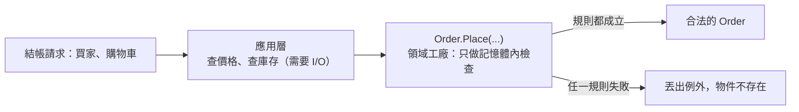

## 這是什麼

一張合法的訂單至少要有買家、至少一項商品、每項數量大於零。如果 `Order` 有公開的無參數建構子，任何人都能 `new Order()` 建出一張空訂單，再忘記補上買家。規則只能靠每個呼叫端自己記得檢查。

建立型的設計模式把「怎麼建出一個合法物件」集中在一個地方：

- **Factory（工廠）**：一個專門負責建立物件的方法或類別。它檢查規則，不合法就拒絕建立。
- **Builder（建造者）**：一步一步設定很多選項，最後呼叫 `Build()` 一次建出物件；在 `Build()` 時做最後檢查。

## 運作原理



分工的重點是：**需要查資料的檢查放在應用層，純規則的檢查放在工廠。** 應用層先查好商品價格與庫存，把結果交給工廠；工廠只根據傳進來的資料判斷是否合法，不碰資料庫、不呼叫外部服務。這樣工廠可以在單元測試裡直接測試，不需要準備資料庫。

## 常見錯誤與正確寫法

### 1. 公開建構子，讓呼叫端自己組裝

```csharp
// 錯：可以建出沒有買家、沒有明細的訂單
var order = new Order();
order.BuyerId = request.BuyerId;
foreach (var item in request.Items) order.Lines.Add(new OrderLine { ... });
```

改成靜態工廠方法，名稱表達業務意圖，建構子設為私有：

```csharp
public class Order
{
    private readonly List<OrderLine> _lines = new();
    private Order() { } // 給 EF Core 使用

    public static Order Place(Guid buyerId, IReadOnlyCollection<PricedItem> items, DateTimeOffset now)
    {
        if (buyerId == Guid.Empty) throw new ArgumentException("缺少買家", nameof(buyerId));
        if (items.Count == 0) throw new ArgumentException("訂單至少要有一項商品", nameof(items));

        var order = new Order { Id = Guid.CreateVersion7(), BuyerId = buyerId, PlacedAt = now, Status = OrderStatus.PendingPayment };
        foreach (var item in items)
        {
            order.AddLine(item.ProductId, item.UnitPrice, item.Quantity); // 每一行也各自檢查
        }
        return order;
    }
    // ...
}
```

`now` 由呼叫端傳入，而不是在裡面呼叫 `DateTimeOffset.UtcNow`，測試時就能控制時間。`Guid.CreateVersion7()`（.NET 9 起）產生依時間排序的 ID，對資料庫索引比較友善，見 [分散式識別碼](/platforms/dotnet/identifiers/)。

### 2. 工廠裡注入 DbContext 去查資料

```csharp
// 錯：領域工廠依賴資料庫，測試要準備資料庫，也看不出這個方法會做 I/O
public class OrderFactory(ShopDbContext db)
{
    public async Task<Order> CreateAsync(Guid buyerId, ...) { var stock = await db.Stocks...; }
}
```

查價格、查庫存屬於應用層的用例流程。工廠只接收已經查好的結果（例如 `PricedItem`）。

### 3. 測試資料散落在每個測試裡

每個測試都要手動組出一張合法訂單，欄位一改，幾十個測試都要改。用 Test Data Builder 提供合理的預設值，測試只寫它關心的部分：

```csharp
public sealed class OrderBuilder
{
    private Guid _buyerId = Guid.NewGuid();
    private readonly List<PricedItem> _items = new() { new(Guid.NewGuid(), new Money(100, "TWD"), 1) };

    public OrderBuilder WithItem(decimal price, int quantity)
    {
        _items.Add(new(Guid.NewGuid(), new Money(price, "TWD"), quantity));
        return this;
    }

    // Build 時走真正的工廠，確保測試資料也符合規則
    public Order Build() => Order.Place(_buyerId, _items, new DateTimeOffset(2026, 1, 1, 0, 0, 0, TimeSpan.Zero));
}
```

## 使用邊界

- **DI 容器的工廠和領域工廠是兩回事。** `IHttpClientFactory`、`AddScoped(sp => ...)` 是在解決「物件的相依怎麼取得」；領域工廠是在解決「業務物件怎麼合法地誕生」。
- 欄位少、沒有規則的物件（例如 DTO）直接用建構子或物件初始設定式就好，不需要工廠。
- Builder 適合選項很多、或測試資料；正式程式碼中如果物件只有三四個必填欄位，靜態工廠方法比 Builder 清楚。
- 建立之後的行為怎麼替換或擴充，見 [Strategy 與 Decorator](/architecture/behavior-patterns/)。
