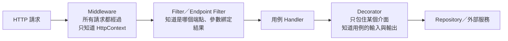

## 這是什麼

記錄日誌、量測耗時、驗證輸入、處理例外、重試……這些事每個功能都需要，但它們不是「建立訂單」或「查詢商品」本身的業務。它們像一條橫線，穿過所有功能，所以叫**橫切行為**（cross-cutting concerns）。這種把共通行為集中處理的做法，常被稱為 AOP（剖面導向程式設計）。

如果每個 Service 方法都自己寫一次 `try/catch`、記一次耗時，程式碼會重複，也容易漏掉。ASP.NET Core 提供了幾個「掛勾點」，讓你把橫切行為寫一次、套用到很多地方。

## 運作原理

一個 HTTP 請求由外往內經過三種掛勾點，每一層知道的資訊越來越多、涵蓋的範圍越來越小：



| 位置 | 適合 | 例子 |
| --- | --- | --- |
| Middleware | 和端點無關、每個請求都要做 | 例外轉回應、請求日誌、追蹤、CORS |
| Filter | 需要知道是哪個端點或參數 | 依端點的權限檢查、輸入驗證、稽核特定操作 |
| Decorator | 只和某個服務介面有關 | 商品查詢的快取、外部呼叫的重試 |

## 常見錯誤與正確寫法

### 1. 每個方法都手寫相同的記錄與 try/catch

```csharp
// 錯：每個方法都重複，漏寫一個就少一筆紀錄
public async Task<OrderDto> PlaceAsync(PlaceOrder cmd, CancellationToken ct)
{
    var sw = Stopwatch.StartNew();
    try { /* 業務 */ }
    catch (Exception ex) { _logger.LogError(ex, "下單失敗"); throw; }
    finally { _logger.LogInformation("下單耗時 {Ms}", sw.ElapsedMilliseconds); }
}
```

請求層級的耗時與追蹤交給 ASP.NET Core 內建的指標與 OpenTelemetry（`http.server.request.duration`），不必手寫，見 [指標與追蹤](/engineering/metrics-tracing/)。只有特定用例需要的額外紀錄，做成 Decorator 或 Endpoint Filter：

```csharp
// Endpoint Filter：只套用在需要稽核的端點
public sealed class AuditFilter(ILogger<AuditFilter> logger) : IEndpointFilter
{
    public async ValueTask<object?> InvokeAsync(EndpointFilterInvocationContext context, EndpointFilterDelegate next)
    {
        var result = await next(context);
        logger.LogInformation("稽核：{User} 呼叫 {Endpoint}",
            context.HttpContext.User.Identity?.Name, context.HttpContext.GetEndpoint()?.DisplayName);
        return result;
    }
}

app.MapPut("/products/{id}/price", UpdatePrice).AddEndpointFilter<AuditFilter>();
```

### 2. 在 Filter 裡吞掉例外，自己回 JSON

```csharp
// 錯：例外被吞掉，外層的追蹤與錯誤指標看不到失敗；各端點的錯誤格式也不一致
public void OnException(ExceptionContext context)
{
    context.Result = new JsonResult(new { error = context.Exception.Message });
    context.ExceptionHandled = true;
}
```

例外一律往上冒，由全域的例外處理器統一轉成 RFC 9457 的 Problem Details 回應，並且不把內部訊息回給用戶端：

```csharp
public sealed class DomainExceptionHandler : IExceptionHandler
{
    public async ValueTask<bool> TryHandleAsync(HttpContext http, Exception ex, CancellationToken ct)
    {
        if (ex is not DomainRuleViolationException rule) return false; // 其他例外交給預設處理

        http.Response.StatusCode = StatusCodes.Status422UnprocessableEntity;
        await http.Response.WriteAsJsonAsync(new ProblemDetails
        {
            Status = 422,
            Title = "訂單不符合規則",
            Detail = rule.Message, // 這是給使用者看的業務訊息，不含內部細節
        }, ct);
        return true;
    }
}

builder.Services.AddExceptionHandler<DomainExceptionHandler>();
builder.Services.AddProblemDetails();
app.UseExceptionHandler();
```

## 使用邊界

- **能用內建的就不要自己做。** 請求日誌、HTTP 指標、追蹤、Problem Details 都有內建支援。
- 執行期產生代理（例如 `DispatchProxy` 或動態代理函式庫）可以做到「自動攔截所有方法」，但除錯困難，也和 Native AOT 不相容。優先使用明確的 Decorator。
- Middleware 的順序會影響結果：例外處理要放在最前面，才能接住後面所有元件的例外，見 [Middleware](/frameworks/aspnet-core/middleware/)。
- Filter 只在 MVC 或 Minimal API 的端點範圍內作用；在 Filter 之前就被 Middleware 短路的請求（例如靜態檔案、驗證失敗），不會經過 Filter，見 [Filter](/frameworks/aspnet-core/filters/)。
