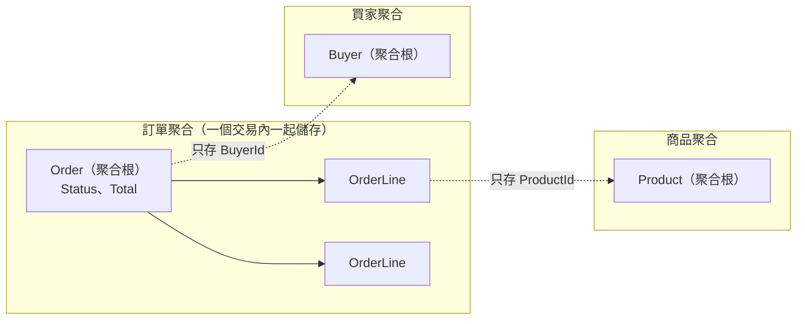

## 這是什麼

電商系統裡有很多「必須一直成立」的規則：訂單總額要等於明細加總、已出貨的訂單不能再加商品、金額不能是負數。這些規則叫**不變量**（invariant）。

如果訂單類別的每個屬性都是 `public get; set;`，任何程式碼都能直接改狀態，規則就只能散落在 Controller、Service、甚至前端各自檢查，漏一個地方就出錯。

**DDD（領域驅動設計）**的做法是：讓「訂單」這個物件自己負責守住規則。外部只能呼叫 `AddItem()`、`MarkAsPaid()` 這類表達業務意圖的方法，方法內部先檢查規則，通過了才改狀態。

## 運作原理

DDD 用三個概念組織模型：

| 概念 | 白話說明 | 電商例子 |
| --- | --- | --- |
| **Entity（實體）** | 有身分、會隨時間改變；兩筆資料內容一樣，只要 ID 不同就是不同的東西 | 訂單、商品、買家 |
| **Value Object（值物件）** | 沒有身分，只看值；建立後不可變，要改就換一個新的 | 金額、地址、數量 |
| **Aggregate（聚合）** | 一組必須一起保持一致的物件，外部只能透過「聚合根」操作 | 訂單（根）與訂單明細 |



聚合的邊界就是一致性的邊界：同一個聚合內的規則在一次交易裡全部成立；不同聚合之間只存對方的 ID，彼此的同步透過事件，接受短暫的不一致（最終一致性）。

## 常見錯誤與正確寫法

### 1. 所有屬性都是公開 setter

```csharp
// 錯：任何地方都能把總額改成負數、把狀態直接改成已出貨
public class Order
{
    public decimal TotalAmount { get; set; }
    public string Status { get; set; } = "";
    public List<OrderLine> Lines { get; set; } = new();
}
```

改成狀態只能透過方法改變。金額做成值物件，在建立時就檢查：

```csharp
// 值物件：用 sealed record（class），沒有「繞過建構子」的預設值
public sealed record Money
{
    public Money(decimal amount, string currency)
    {
        if (amount < 0) throw new ArgumentOutOfRangeException(nameof(amount), "金額不可為負數");
        Amount = amount;
        Currency = currency;
    }
    public decimal Amount { get; }
    public string Currency { get; }

    public Money Add(Money other) =>
        other.Currency == Currency ? new Money(Amount + other.Amount, Currency)
                                   : throw new InvalidOperationException("不同幣別不能直接相加");
}

public class Order
{
    private readonly List<OrderLine> _lines = new();
    private Order() { } // 給 EF Core 使用

    public Order(Guid id, Guid buyerId) => (Id, BuyerId, Status) = (id, buyerId, OrderStatus.PendingPayment);

    public Guid Id { get; private set; }
    public Guid BuyerId { get; private set; }           // 只存買家的 ID
    public OrderStatus Status { get; private set; }
    public IReadOnlyList<OrderLine> Lines => _lines;    // 外部只能讀

    public void AddItem(Guid productId, Money unitPrice, int quantity)
    {
        if (Status != OrderStatus.PendingPayment)
            throw new InvalidOperationException("只有待付款訂單可以修改明細");
        if (quantity <= 0)
            throw new ArgumentOutOfRangeException(nameof(quantity));
        _lines.Add(new OrderLine(productId, unitPrice, quantity));
    }

    public void MarkAsPaid()
    {
        if (Status != OrderStatus.PendingPayment || _lines.Count == 0)
            throw new InvalidOperationException("此訂單目前不能付款");
        Status = OrderStatus.Paid;
    }
}
```

值物件用 `sealed record` 而不是 `struct`：struct 的預設值（`default(Money)`）會跳過建構子，`Currency` 變成 null，等於繞過了檢查。

EF Core 可以透過 backing field 載入私有的 `_lines`，不需要公開 setter。

### 2. 聚合畫得太大

把「買家」設計成聚合根，底下掛著他所有的訂單、地址和購物車。買家只是改個手機號碼，EF Core 也可能載入上千筆歷史訂單；任何一筆訂單變動，都會和改手機號碼的請求搶同一個聚合的版本號，造成不必要的並行衝突。

聚合要以「必須一起成立的規則」來畫，越小越好。訂單和買家之間沒有必須在同一個交易裡成立的規則，就分成兩個聚合，訂單只存 `BuyerId`。

### 3. 在實體裡呼叫外部服務

`order.Cancel(emailSender)` 讓實體依賴寄信服務，測試時也要準備假的寄信服務。實體只負責改變自己的狀態並記錄「發生了什麼事」（領域事件），寄信由應用層在交易提交後處理，見 [Outbox 與 Inbox](/architecture/outbox-inbox/)。

## 使用邊界

- **規則很少的資料不需要 DDD。** 商品分類、系統設定這類「存進去、讀出來」的資料，用簡單的資料模型就好，不必包成聚合。
- 資料表不等於聚合。一張表可能屬於某個聚合的一部分，聚合的範圍由業務規則決定，而不是由外鍵決定。
- 聚合之間的一致性靠事件與重試，要接受短暫的不一致；如果業務真的要求兩者在同一瞬間一致，代表它們可能應該是同一個聚合。
- 聚合怎麼載入與儲存，見 [Repository 與 CQRS](/architecture/application-patterns/)；兩個請求同時改同一個聚合，見 [EF Core 樂觀並行](/data-access/concurrency/)。
