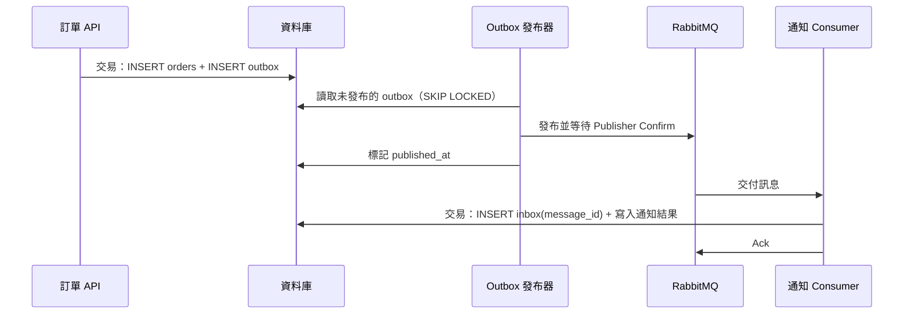

## 這是什麼

訂單成立後，要通知寄信服務。直覺的寫法是「先存訂單，再發一則訊息到 RabbitMQ」。問題是資料庫和 RabbitMQ 是兩個系統，沒有辦法放進同一個交易：

- 先存訂單再發訊息：存好了，程式在發訊息前當掉，**有訂單沒事件**，買家收不到通知。
- 先發訊息再存訂單：訊息發了，存訂單失敗，**有事件沒訂單**，寄信服務處理一張不存在的訂單。

**Outbox** 的解法是：不直接發訊息，而是把「要發的事件」寫進資料庫的一張 outbox 表，和訂單放在同一個交易。交易成功，兩者都在；失敗，兩者都不在。另一個背景程式再把 outbox 裡的事件送到 RabbitMQ。

**Inbox** 是消費端的對應做法：收到訊息時，先記下「這則訊息處理過了」，和處理結果放在同一個交易，重複收到時就能辨認並略過。

## 運作原理



注意每個箭頭之間都可能中斷：

- 發布器在「收到 Confirm」之後、「標記已發布」之前當掉，重啟後會再發一次。
- Consumer 在「交易提交」之後、「Ack」之前斷線，RabbitMQ 會把訊息再交付一次。

所以 Outbox 保證的是「**至少送一次**」，不是「只送一次」。重複交給 Inbox 處理：Inbox 表對 `(consumer 名稱, message_id)` 建唯一約束，重複的訊息在寫入 Inbox 時就會被擋下。

## 常見錯誤與正確寫法

### 1. 用分散式交易硬把兩者綁在一起

想用 `TransactionScope` 把資料庫和 RabbitMQ 放進同一個交易，但 RabbitMQ 不支援分散式交易（XA／2PC），.NET 在跨平台環境也不提供這種協調。即使可行，兩階段提交也會讓任一系統變慢時拖住另一個。用 Outbox。

### 2. 多個發布器同時讀到同一筆 outbox

API 部署了三個 Pod，每個都跑發布器，同時查詢「未發布的事件」，三個都拿到同一筆，於是同一個事件被發三次。

用 `FOR UPDATE SKIP LOCKED`：每個發布器鎖住自己拿到的那幾筆，其他發布器自動跳過被鎖住的資料。

```sql
-- 在一個交易內：取出最多 50 筆未發布事件，並鎖住它們
SELECT id, type, payload
FROM outbox
WHERE published_at IS NULL
ORDER BY id
LIMIT 50
FOR UPDATE SKIP LOCKED;
```

發布並收到 Confirm 後，在同一個交易裡更新 `published_at` 再提交。交易持有期間包含網路往返，所以批次不要太大，並設定發布逾時。

### 3. Consumer 先 Ack 再處理

先 Ack 再寫資料庫，寫入失敗時訊息已經從佇列移除，工作就遺失了。正確順序是：處理並提交交易，然後才 Ack。

```csharp
await using var tx = await db.Database.BeginTransactionAsync(ct);
try
{
    db.InboxMessages.Add(new InboxMessage("notification-consumer", message.MessageId));
    db.Notifications.Add(Notification.ForOrder(message.OrderId));
    await db.SaveChangesAsync(ct);   // 重複的 MessageId 會在這裡違反唯一約束
    await tx.CommitAsync(ct);
}
catch (DbUpdateException ex) when (IsUniqueViolation(ex))
{
    // 已經處理過：視為成功，直接 Ack
}
await channel.BasicAckAsync(deliveryTag, multiple: false, ct);
```

`IsUniqueViolation` 依資料庫判斷，例如 PostgreSQL 的錯誤碼 `23505`。

## 使用邊界

- **outbox 表會一直長大。** 已發布的事件要定期封存或刪除，並在 `published_at IS NULL` 上建立合適的索引，避免發布器每次都掃整張表。
- 發布器輪詢的間隔是延遲與資料庫負擔的取捨；也可以用 PostgreSQL 的 LISTEN／NOTIFY 或 CDC（變更資料擷取）工具取代輪詢。
- Inbox 只能防止「同一則訊息」被處理兩次。不同的訊息代表同一件業務事情時（例如兩個不同 ID 的「訂單已成立」），還要靠業務唯一條件，例如通知表對 `order_id` 建唯一約束。
- 外部系統（例如真的寄信）無法放進你的資料庫交易；要依賴對方提供的冪等鍵或查詢結果的 API，接受「可能寄兩次」的風險並降低它。
- RabbitMQ 端的確認機制見 [Ack 與 Publisher Confirm](/infrastructure/rabbitmq/acknowledgements/)。
