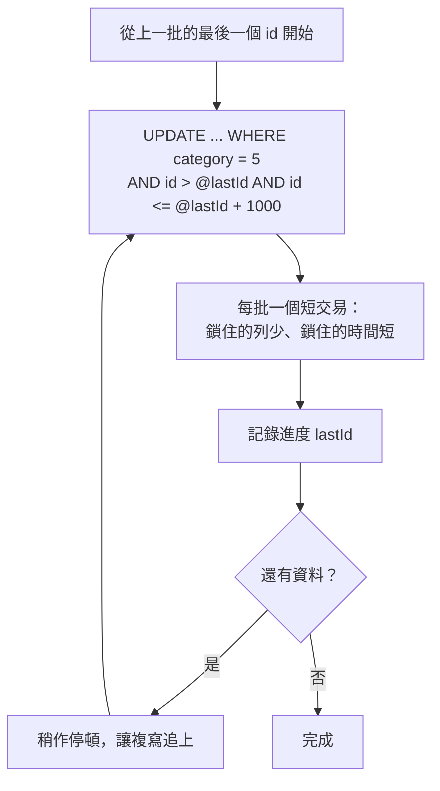

## 這是什麼

週年慶前，要把某個分類下的十萬件商品打九折。用 EF Core 最直覺的寫法是：查出十萬件商品、在迴圈裡改價格、呼叫 `SaveChanges`。這會把十萬筆資料搬進記憶體、建立十萬份追蹤快照，再送出十萬句 `UPDATE`。

**ExecuteUpdateAsync** 讓 EF Core 直接產生一句 `UPDATE ... WHERE ...` 送到資料庫執行，資料不必搬到應用程式。但一句 SQL 更新十萬筆，又會帶來另一個問題：這句 SQL 執行期間，十萬列全被鎖住。所以大量更新的做法是「直接在資料庫執行」加上「分批」。

## 運作原理



一次更新太多列會造成：

- **鎖等待**：其他請求要改同一批商品（例如有人下單扣庫存），必須等這句 UPDATE 結束。
- **日誌暴增**：資料庫要為每一列寫變更日誌（PostgreSQL 的 WAL、MySQL 的 binlog／redo log），磁碟和讀副本的複寫都要處理這些日誌。
- **讀副本延遲**：主庫一次產生大量變更，讀副本要花時間套用，讀副本上的資料會落後。

依主鍵範圍分批（keyset），每批只鎖少量資料、交易很快結束，中途失敗也能從記錄的進度繼續。

## 常見錯誤與正確寫法

### 1. 把所有資料載入記憶體再修改

```csharp
// 錯：十萬筆搬進記憶體並追蹤，送出十萬句 UPDATE
var products = await db.Products.Where(p => p.CategoryId == 5).ToListAsync(ct);
foreach (var p in products) p.Price *= 0.9m;
await db.SaveChangesAsync(ct);
```

### 2. 一句 SQL 更新全部

```csharp
// 也不好：一句更新十萬筆，執行期間這些列全部被鎖住
await db.Products.Where(p => p.CategoryId == 5)
    .ExecuteUpdateAsync(s => s.SetProperty(p => p.Price, p => p.Price * 0.9m), ct);
```

### 3. 正確：依主鍵分批，每批一個短交易

```csharp
const int batchSize = 1000;
long lastId = await progress.LoadAsync("discount-2026-anniversary", ct); // 可續跑：從上次的進度開始

while (true)
{
    // 先找出這一批的主鍵上限
    var ids = await db.Products.AsNoTracking()
        .Where(p => p.CategoryId == 5 && p.Id > lastId)
        .OrderBy(p => p.Id)
        .Select(p => p.Id)
        .Take(batchSize)
        .ToListAsync(ct);
    if (ids.Count == 0) break;

    var upper = ids[^1];
    await db.Products
        .Where(p => p.CategoryId == 5 && p.Id > lastId && p.Id <= upper)
        .ExecuteUpdateAsync(s => s.SetProperty(p => p.Price, p => p.Price * 0.9m), ct); // 每批自動是一個交易

    lastId = upper;
    await progress.SaveAsync("discount-2026-anniversary", lastId, ct);
    await Task.Delay(TimeSpan.FromMilliseconds(200), ct); // 讓線上流量和讀副本喘口氣
}
```

不要用 `OFFSET` 分批：資料在處理過程中被更新或刪除，`OFFSET` 會跳過或重複某些列，越後面的批次也越慢。

## 使用邊界

- **ExecuteUpdate 繞過變更追蹤。** 同一個 `DbContext` 中已經被追蹤的實體不會被更新，它們手上的值是舊的；`SaveChanges` 攔截器、領域事件、自動更新的並行權杖都不會觸發。需要這些行為的修改，仍然用載入、修改、存檔。
- 「打九折」重跑兩次會變成打八一折。可續跑的作業要讓每一批都能安全重複執行，例如改成「設定為某個價格」，或以處理紀錄避免重複。
- 匯入新資料、清理歷史資料這類更大量的作業，見 [大量寫入與保留](/data-access/bulk-retention/)。

## 雲端排查

### 叢集層（GKE 與 EKS 相同）

```bash
# 批次作業以 Job 執行時，確認它的進度與是否被重啟
kubectl get job -n shop price-adjust
kubectl logs -n shop job/price-adjust --tail=20
```

### 託管服務層

#### 兩邊相同：誰在等誰的鎖

```sql
-- PostgreSQL：被擋住的連線，以及擋住它的連線
SELECT blocked.pid AS blocked_pid, left(blocked.query, 60) AS blocked_query,
       blocking.pid AS blocking_pid, left(blocking.query, 60) AS blocking_query
FROM pg_stat_activity blocked
JOIN pg_stat_activity blocking ON blocking.pid = ANY(pg_blocking_pids(blocked.pid));
```

批次作業期間，如果下單的 `UPDATE stock` 一直出現在 `blocked_query`，就把批次調小或延長停頓。

#### GKE

在 Cloud Monitoring 看讀副本的 `cloudsql.googleapis.com/database/replication/replica_lag`（秒）。批次作業開始後延遲一路上升，代表主庫產生變更的速度超過副本套用的速度，要拉長批次之間的停頓。

#### EKS

CloudWatch `AWS/RDS` 的 `ReplicaLag`（讀副本延遲，秒）與 `WriteIOPS`。PostgreSQL 執行個體還可以看 `TransactionLogsDiskUsage`，確認交易日誌佔用的空間沒有失控。

### 應用程式層

批次作業把每一批的筆數、耗時與目前的 `lastId` 寫進日誌；作業中斷時，從最後一筆紀錄就知道要從哪裡繼續，也能估算剩餘時間。
