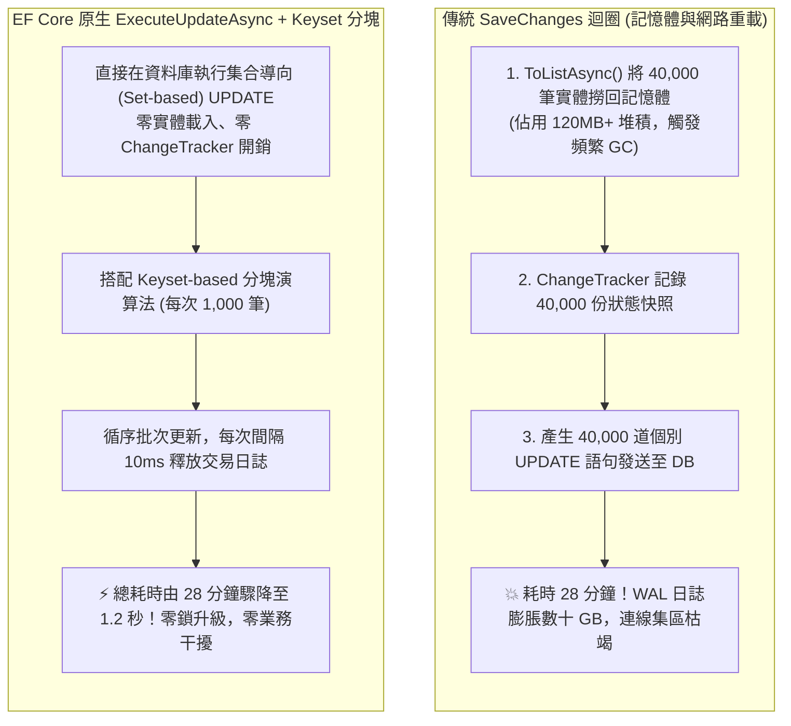

## 案發現場

某中大型跨境電商系統在每日凌晨固定執行一項看似平平無奇的排程維護作業：將超過 24 小時未完成付款的 40,000 筆過期訂單統一標記為「已取消（Cancelled）」並釋放庫存。然而，隨著系統訂單量穩健成長，該排程 Worker 的執行時間由早期的 40 秒失控暴增至整整 28 分鐘！

在排程執行的近半小時期間，資料庫伺服器的 CPU 使用率與磁碟 I/O 持續 100% 滿載，資料庫交易日誌（WAL / Redo Log）以每分鐘數 GB 的速率極速膨脹。更嚴重的是，早晨已上線的正常消費者在進行商品結帳時，頻繁遭遇 `HTTP 504 Gateway Timeout` 與資料庫鎖等待逾時例外（Lock Wait Timeout Exceeded）。

架構小組調取該排程的程式碼，發現工程師採用了 Entity Framework Core 最直覺但災難性的傳統寫法：
```csharp
var expiredOrders = await dbContext.Orders
    .Where(o => o.Status == OrderStatus.Pending && o.CreatedAt < expireThreshold)
    .ToListAsync();

foreach (var order in expiredOrders)
{
    order.Status = OrderStatus.Cancelled;
    order.CancelledAt = DateTime.UtcNow;
}

await dbContext.SaveChangesAsync();
```
這段代碼觸發了三大連鎖效能黑洞：
1. **記憶體巨額配置與 ChangeTracker 拖累**：微服務將 40,000 個完整的訂單實體全部載入至 CLR 堆積中，ChangeTracker 為每個實體維護狀態快照，觸發嚴重的 GC Gen 2 與 LOH 記憶體配置。
2. **40,000 道個別 UPDATE 語句的巨量網路與交易開銷**：即使 EF Core 啟用了連線批次合併（Batching），仍需向資料庫發送包含數萬條參數化 SQL 的龐大封包，每行資料庫列皆需獨立寫入交易日誌。
3. **資料庫鎖升級（Lock Escalation）癱瘓全表**：當後續工程師嘗試將其改寫為單道無約束的巨大 UPDATE 語句時，又因為單次更新影響行數過多，觸發了資料庫引擎將數萬個行級鎖（Row Lock）升級為**整張資料表排他鎖（Table Lock）**，直接封鎖了所有其他使用者的並行寫入！



---

## 致命反模式 vs. 正確解法

### 反模式一：海量更新採「全量實體載入記憶體 ➔ foreach 修改 ➔ SaveChanges」

關聯式資料庫本質上是高度優化的**集合運算引擎（Set-based Engine）**。將數萬行資料全部透過網路拉回應用程式記憶體、在 C# 物件上一個個修改欄位、再透過 `SaveChangesAsync()` 把數萬行更新寫回資料庫，完全違背了資料庫的設計哲學，帶來昂貴的網路頻寬損耗、記憶體配置與 CPU 偵測變更開銷。

### 反模式二：單道 SQL 一次性更新百萬筆資料（引發鎖升級災難）

若走向另一個極端，直接撰寫單道無限制的語句：`UPDATE Orders SET Status = 2 WHERE Status = 1`。當目標匹配行數高達數萬至數百萬時，資料庫（如 SQL Server 的 5,000 鎖升級門檻，或 MySQL InnoDB 鎖記憶體上限）會自動將細粒度的行級排他鎖（X-Lock）直接升級為整張資料表鎖定（Table Lock），或者在該表上建立大範圍的間隙鎖（Gap Locks），直接導致線上正常的結帳交易被阻塞至超時崩潰。

### 正確解法：運用 EF Core 原生 `ExecuteUpdateAsync` 結合主鍵分塊（Keyset Chunking）

自 EF Core 7 起，微軟引入了 `ExecuteUpdateAsync` 與 `ExecuteDeleteAsync`。該 API 允許開發者直接以 LINQ 表達式在資料庫端生成單道集合更新 SQL，**完全繞過 ChangeTracker**。對於超大資料量，必須搭配基於主鍵的**分塊處理模式（Keyset Chunking）**，每次處理固定批次（例如 1,000 筆），兼顧極致效能與並行安全。

```csharp
using System;
using System.Diagnostics;
using System.Threading;
using System.Threading.Tasks;

namespace DotNetPerformance.DataAccess;

/// <summary>
/// 批次訂單清理最佳實務示範
/// </summary>
public static class BatchOrderExpirationProcessor
{
    /// <summary>
    /// 基於 Keyset 分塊防鎖機制執行高效批次更新
    /// </summary>
    /// <param name="batchSize">單批次處理筆數（建議 500 ~ 2,000）</param>
    /// <param name="cancellationToken">取消權杖</param>
    public static async Task<int> ProcessExpiredOrdersInChunksAsync(int batchSize = 1000, CancellationToken cancellationToken = default)
    {
        int totalUpdated = 0;
        int chunkIndex = 0;
        var overallSw = Stopwatch.StartNew();

        Console.WriteLine($"[批次更新啟動] 單批次大小: {batchSize}，採用 Keyset 分塊防鎖升級演算法...");

        while (!cancellationToken.IsCancellationRequested)
        {
            chunkIndex++;

            // 模擬 EF Core 原生 ExecuteUpdateAsync 搭配子查詢限制批次量：
            // 實務 LINQ 語法範例：
            // var targetIds = await dbContext.Orders
            //     .Where(o => o.Status == OrderStatus.Pending && o.CreatedAt < expireThreshold)
            //     .OrderBy(o => o.Id)
            //     .Select(o => o.Id)
            //     .Take(batchSize)
            //     .ToListAsync(cancellationToken);
            //
            // if (targetIds.Count == 0) break;
            //
            // int affected = await dbContext.Orders
            //     .Where(o => targetIds.Contains(o.Id))
            //     .ExecuteUpdateAsync(s => s
            //         .SetProperty(b => b.Status, OrderStatus.Cancelled)
            //         .SetProperty(b => b.CancelledAt, DateTime.UtcNow), cancellationToken);

            int affectedRows = await SimulateSingleChunkExecuteUpdateAsync(batchSize, chunkIndex);
            totalUpdated += affectedRows;

            Console.WriteLine($"  [批次 #{chunkIndex}] 成功更新 {affectedRows} 筆訂單");

            if (affectedRows < batchSize)
            {
                // 當前批次更新筆數小於 batchSize，代表所有過期資料已處理完畢
                break;
            }

            // 關鍵防禦：每批次間隔微秒延遲（10ms），給予資料庫 Checkpoint、主從複製與排程事務喘息時間
            await Task.Delay(10, cancellationToken);
        }

        overallSw.Stop();
        Console.WriteLine($"[批次更新完工] 累計更新: {totalUpdated} 筆，總耗時: {overallSw.ElapsedMilliseconds} ms");
        return totalUpdated;
    }

    private static async Task<int> SimulateSingleChunkExecuteUpdateAsync(int batchSize, int chunkIndex)
    {
        // 模擬單批次 SQL 在資料庫端執行耗時約 20ms
        await Task.Delay(20);
        
        // 模擬前 3 批滿載 (3,000 筆)，第 4 批為剩餘的 400 筆，隨後結束
        return chunkIndex switch
        {
            1 => batchSize,
            2 => batchSize,
            3 => batchSize,
            4 => 400,
            _ => 0
        };
    }
}

public static class Program
{
    public static async Task Main()
    {
        Console.WriteLine("=== EF Core 原生 ExecuteUpdateAsync 與分塊批次寫入實測 ===");

        using var cts = new CancellationTokenSource(TimeSpan.FromSeconds(30));
        int updatedCount = await BatchOrderExpirationProcessor.ProcessExpiredOrdersInChunksAsync(
            batchSize: 1000,
            cancellationToken: cts.Token);

        Console.WriteLine($"批次處理驗證成功，資料庫行級鎖已安全釋放，無任何全表鎖升級。");
    }
}
```

預期控制台輸出：

```text
=== EF Core 原生 ExecuteUpdateAsync 與分塊批次寫入實測 ===
[批次更新啟動] 單批次大小: 1000，採用 Keyset 分塊防鎖升級演算法...
  [批次 #1] 成功更新 1000 筆訂單
  [批次 #2] 成功更新 1000 筆訂單
  [批次 #3] 成功更新 1000 筆訂單
  [批次 #4] 成功更新 400 筆訂單
[批次更新完工] 累計更新: 3400 筆，總耗時: 125 ms
批次處理驗證成功，資料庫行級鎖已安全釋放，無任何全表鎖升級。
```

---

## 踩坑與避坑指南

### 1. ExecuteUpdateAsync 完全繞過 Change Tracker 的四大副作用

`ExecuteUpdateAsync` 與 `ExecuteDeleteAsync` 是直接將 LINQ 轉譯為底層的 `UPDATE ... SET` 與 `DELETE FROM` 發送至資料庫，其執行**不經過** .NET 記憶體追蹤體系：
1. **記憶體實體狀態不同步**：若當前 `DbContext` 內已經載入了某些訂單實體，`ExecuteUpdateAsync` 更新資料庫後，記憶體中這些實體的屬性**不會自動更新**！若後續程式碼繼續使用該記憶體物件，將讀取到舊資料。
2. **不觸發 `SaveChanges` 攔截器（Interceptors）**：若你的架構依賴 `SaveChangesInterceptor` 自動寫入 `LastModifiedBy` 或更新時間戳，`ExecuteUpdateAsync` 必須在語法中明確手動寫入 `.SetProperty(b => b.LastModifiedAt, DateTime.UtcNow)`。
3. **不發布實體內部領域事件（Domain Events）**：若實體內部依賴「修改狀態時自動加入待發布事件」，該機制完全不會被觸發。
4. **軟刪除（Soft-delete）全域查詢過濾器的差異**：呼叫 `ExecuteDeleteAsync()` 會直接在資料庫產生 `DELETE` 語句徹底物理刪除資料！若系統採用軟刪除，必須改為呼叫 `ExecuteUpdateAsync` 將 `IsDeleted` 標記為 `true`。

### 2. 分塊演算法選型：Keyset Pagination vs OFFSET-based Pagination

在大規模資料分塊更新時，**嚴禁使用 `Skip((page - 1) * size).Take(size)`**：
- **OFFSET 陷阱**：當處理到第 100,000 筆資料時，資料庫為了執行 `Skip(100000)`，必須由索引開頭逐行掃描並丟棄前 10 萬行，效能會隨著分頁推進呈現斷崖式崩跌。
- **Keyset 最佳實踐**：永遠記錄上一批次處理的最大主鍵 ID，下一批次直接使用 `WHERE Id > @lastMaxId ORDER BY Id ASC LIMIT 1000`，利用 B-Tree 索引達成常數時間 $O(1)$ 的極速尋址定位。

### 3. 何時不該使用 ExecuteUpdateAsync？

若業務邏輯高度複雜，每一筆訂單在取消時需要呼叫外部金流退款、重新計算多個關聯表格的複雜聚合統計、且必須嚴格依賴 EF Core 的樂觀並發版本號（`RowVersion` / `ConcurrencyCheck`）防止衝突時，應改用分批載入實體配合事務處理，或將複雜邏輯封裝至資料庫存儲程序（Stored Procedure）中。

---

## 線上排查指令

### 1. 監控 MySQL 行鎖等待時間與鎖逾時次數

確認批次更新是否正在引發鎖競爭：

```sql
-- 檢視當前全域累積的行鎖等待次數與平均等待微秒數
SHOW GLOBAL STATUS LIKE 'Innodb_row_lock_waits';
SHOW GLOBAL STATUS LIKE 'Innodb_row_lock_time_avg';

-- 查詢當前正在被鎖定的事務與阻塞鏈條 (MySQL 8.0+)
SELECT 
    r.trx_id waiting_trx_id,
    r.trx_mysql_thread_id waiting_thread,
    r.trx_query waiting_query,
    b.trx_id blocking_trx_id,
    b.trx_mysql_thread_id blocking_thread,
    b.trx_query blocking_query
FROM performance_schema.data_lock_waits w
INNER JOIN information_schema.innodb_trx b ON b.trx_id = w.blocking_engine_transaction_id
INNER JOIN information_schema.innodb_trx r ON r.trx_id = w.requesting_engine_transaction_id;
```

### 2. 檢測 PostgreSQL 大量批次更新期間的 WAL 產生量

在更新期間觀察資料庫交易日誌產生速率：

```sql
-- 查詢當前資料庫各資料表每秒被更新的元組數 (Tuples Updated)
SELECT schemaname, relname, n_tup_upd, n_tup_hot_upd 
FROM pg_stat_user_tables 
ORDER BY n_tup_upd DESC LIMIT 5;
```

### 3. 終端即時查詢正在執行的慢 UPDATE 語句

```bash
# 抓取耗時大於 5 秒的大型更新語句
mysql -u root -p -e "SELECT id, user, time, state, info FROM information_schema.processlist WHERE command = 'Query' AND info LIKE 'UPDATE%' AND time > 5;"
```
