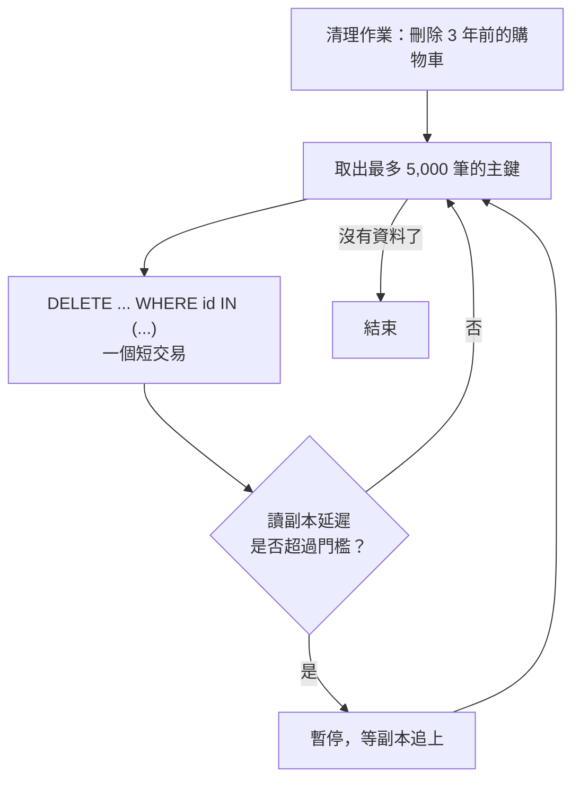

## 這是什麼

電商系統除了線上交易，還有很多「一次處理大量資料」的工作：

- **匯入**：供應商每天提供十萬件商品的價格檔。
- **回填**：新增欄位後，要把舊資料的值補上。
- **清理**：三年前的購物車紀錄、過期的冪等鍵、已發布的 outbox 事件，要定期刪除。

這些工作的共同風險是：一次做太多，會鎖住線上交易需要的資料、塞滿讀副本的複寫、讓磁碟空間暴增。這篇說明如何讓它們**有上限**（每批量小、時間短）而且**可續跑**（中斷後從斷點繼續）。

## 運作原理



大量的寫入或刪除，都會在資料庫產生對應的變更日誌（PostgreSQL 的 WAL、MySQL 的 binlog），讀副本要逐一套用。一句 DELETE 刪掉一千萬筆，副本可能落後數十分鐘，這段期間從副本讀到的都是舊資料。

PostgreSQL 的 DELETE 也不會立刻釋放空間：被刪除的列變成 dead tuples，要等 autovacuum 清理後空間才能重複使用；大量刪除後，autovacuum 要做的工作也會暴增。

## 常見錯誤與正確寫法

### 1. 用 EF Core 逐筆新增大量資料

逐筆 INSERT 每筆都要一次往返，還有追蹤成本。PostgreSQL 用 `COPY`，MySQL 用 `MySqlBulkCopy`。MySQL 的批次匯入需要伺服器允許 `local_infile`，連線字串也要加上 `AllowLoadLocalInfile=true`：

```csharp
// 套件：MySqlConnector
await using var conn = await mySqlDataSource.OpenConnectionAsync(ct);
var bulk = new MySqlBulkCopy(conn) { DestinationTableName = "product_prices_staging" };
await bulk.WriteToServerAsync(priceTable, ct); // DataTable 或 IDataReader
```

匯入先寫進暫存表（staging），檢查資料正確後，再用一句 SQL 合併到正式表；匯入失敗時，正式表不受影響。PostgreSQL 的 COPY 寫法見 [C# 與 PostgreSQL](/data-access/postgresql-dotnet/)。

### 2. 一句 DELETE 清掉所有歷史資料

```sql
-- 錯：一個交易刪除數千萬筆，長時間持有鎖，複寫大幅落後
DELETE FROM carts WHERE updated_at < now() - interval '3 years';
```

分批刪除，每批都是獨立的短交易：

```sql
-- 每次執行刪除最多 5,000 筆；由程式重複呼叫，直到影響筆數為 0
DELETE FROM carts
WHERE id IN (
    SELECT id FROM carts
    WHERE updated_at < now() - interval '3 years'
    ORDER BY id
    LIMIT 5000
);
```

`updated_at` 上要有索引，否則每批都要掃描全表。如果資料是依時間分割儲存的，直接移除整個分割區比 DELETE 快得多，見 [分割與封存](/data-access/partitioning-sharding/)。

### 3. 建立索引時鎖住整張表

在大表上建立索引，PostgreSQL 用 `CREATE INDEX CONCURRENTLY`，建立期間仍可寫入。它失敗時會留下一個「無效」的索引，佔空間又會拖慢寫入，要先刪掉再重建：

```sql
-- 找出建立失敗、仍被標記為無效的索引
SELECT indexrelid::regclass AS index_name FROM pg_index WHERE NOT indisvalid;

DROP INDEX CONCURRENTLY IF EXISTS ix_orders_buyer_recent;
CREATE INDEX CONCURRENTLY ix_orders_buyer_recent ON orders (buyer_id, created_at DESC);
```

MySQL 8 的多數索引操作支援線上 DDL（`ALGORITHM=INPLACE, LOCK=NONE`），但仍要確認該操作是否真的不需要重建資料表。

## 使用邊界

- 大量作業放在離峰時段，並在作業本身設定「副本延遲超過門檻就暫停」的保護。
- 回填要能重複執行：寫成「只更新還沒回填的列」（例如 `WHERE new_column IS NULL`），中斷後重跑不會出錯。
- 刪除資料前確認法規與對帳需求；需要保留但很少查詢的資料，先匯出到 GCS 或 S3 再刪除。

## 雲端排查

### 叢集層（GKE 與 EKS 相同）

```bash
# 清理作業以 CronJob 執行：最近幾次的執行狀態與耗時
kubectl get cronjob -n shop cart-retention
kubectl get jobs -n shop -l app=cart-retention --sort-by=.status.startTime
```

### 託管服務層

#### 兩邊相同：索引建立進度與 dead tuples

```sql
-- PostgreSQL：CREATE INDEX CONCURRENTLY 的進度
SELECT phase, blocks_done, blocks_total, tuples_done, tuples_total
FROM pg_stat_progress_create_index;

-- 大量刪除後，dead tuples 與最近一次 autovacuum
SELECT relname, n_dead_tup, last_autovacuum FROM pg_stat_user_tables
WHERE relname IN ('carts', 'outbox') ;
```

#### GKE

讀副本延遲看 `cloudsql.googleapis.com/database/replication/replica_lag`；磁碟用量看 `database/disk/utilization`。大量刪除後磁碟用量沒有下降是正常的，空間會被之後的寫入重複使用。

#### EKS

CloudWatch `AWS/RDS` 的 `ReplicaLag` 與 `FreeStorageSpace`；PostgreSQL 執行個體還可以看 `TransactionLogsDiskUsage`，大量寫入期間它快速上升，代表交易日誌來不及處理。

### 應用程式層

每批都記錄處理筆數、耗時與最後處理的鍵值。作業中斷後依這個紀錄續跑；每批耗時逐漸變長，通常是查詢條件的索引失效或 dead tuples 累積。
