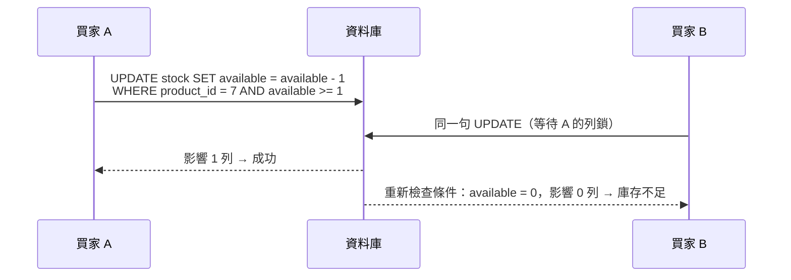

## 這是什麼

保溫杯剩 1 件，兩位買家同時按下購買。兩個請求各自讀到「庫存 1」，各自判斷「夠」，各自寫回「庫存 0」，結果賣出 2 件，超賣了。

這種「兩個請求同時讀、同時寫」的問題叫**並行衝突**。處理方式有兩類：

- **悲觀**：先鎖住，別人等我做完再說（`SELECT ... FOR UPDATE`）。
- **樂觀**：不先鎖，寫入時檢查「資料在我讀取之後有沒有被別人改過」，有就算衝突。

對庫存這種「只是加減一個數字」的情況，還有更直接的做法：**把檢查和修改合併成一句 SQL**。

## 運作原理



**條件更新**把「夠不夠」放進 `WHERE`。資料庫對同一列的更新會排隊執行，第二句執行時會看到第一句提交後的值，條件不成立就不更新。程式只要檢查「影響了幾列」：1 列代表成功，0 列代表庫存不足。

**樂觀並行權杖**用在修改整個聚合的情況（例如管理者編輯商品資訊）。實體上有一個版本欄位，EF Core 產生的 UPDATE 會帶上 `WHERE id = @id AND version = @原本的版本`。版本不符代表別人改過，影響 0 列，EF Core 丟出 `DbUpdateConcurrencyException`。

## 常見錯誤與正確寫法

### 1. 先讀庫存再判斷

```csharp
// 錯：讀和寫之間有時間差，兩個請求可能都讀到 1
var stock = await db.Stocks.SingleAsync(s => s.ProductId == productId, ct);
if (stock.Available < quantity) return OutOfStock();
stock.Available -= quantity;
await db.SaveChangesAsync(ct);
```

改成一句條件更新：

```csharp
var affected = await db.Stocks
    .Where(s => s.ProductId == productId && s.Available >= quantity)
    .ExecuteUpdateAsync(s => s.SetProperty(x => x.Available, x => x.Available - quantity), ct);

if (affected == 0) return OutOfStock(); // 條件不成立：庫存不足
```

### 2. 編輯整個商品卻沒有衝突偵測

兩位管理者同時開啟同一件商品的編輯頁，A 改了價格先存，B 改了描述後存，B 的存檔用舊價格把 A 的修改蓋掉了。加上版本欄位：

```csharp
public class Product
{
    public int Id { get; private set; }
    public decimal Price { get; private set; }
    public int Version { get; private set; } // 每次修改都加一

    public void ChangePrice(decimal price) { Price = price; Version++; }
}

builder.Property(p => p.Version).IsConcurrencyToken(); // UPDATE 時帶上 WHERE version = 原值
```

PostgreSQL 也可以用系統欄位 `xmin` 當作版本，不必自己維護，設定方式見 Npgsql 的文件。

### 3. 衝突後自動無限重試

```csharp
try
{
    await db.SaveChangesAsync(ct);
}
catch (DbUpdateConcurrencyException)
{
    // 不要自動重試覆蓋：告訴使用者資料已被別人修改，讓他看到最新內容後再決定
    return TypedResults.Problem(statusCode: 409, title: "商品已被其他人修改", detail: "請重新整理後再編輯");
}
```

衝突代表「你的修改是根據舊資料做的」。自動重試等於用舊資料硬蓋新資料。只有在修改本身與舊值無關時（例如「把狀態設為已讀」），才適合直接重試。

## 使用邊界

- **熱門商品的衝突很多時**，所有人排隊更新同一列，延遲會上升。可以把庫存拆成多個桶（例如 10 列各存一部分，隨機挑一列扣），或在流量入口限流，見 [限流](/frameworks/aspnet-core/rate-limiting/)。
- 悲觀鎖（`FOR UPDATE`）適合「讀出來之後要做較複雜的判斷才寫入」、而且衝突機率高的情況；代價是鎖持有期間其他人必須等待，交易要很短。
- 防止「同一個請求被送兩次」是另一個問題（冪等），見 [高併發 CRUD](/data-access/concurrent-crud/)。

## 雲端排查

### 叢集層（GKE 與 EKS 相同）

```bash
# 庫存不足與並行衝突在日誌中的比例
kubectl logs -n shop -l app=order-api --since=30m | grep -c "DbUpdateConcurrencyException"
```

### 託管服務層

#### 兩邊相同：稽核是否已經超賣

```sql
-- 可用量不應小於 0；出現就代表某條路徑沒有使用條件更新
SELECT product_id, available FROM stock WHERE available < 0;

-- 熱門商品的列鎖等待：同一個 product_id 的 UPDATE 大量排隊
SELECT count(*) AS waiting, left(query, 80) AS query
FROM pg_stat_activity
WHERE wait_event_type = 'Lock'
GROUP BY query ORDER BY waiting DESC;
```

#### GKE

Cloud SQL 的 `cloudsql.googleapis.com/database/postgresql/deadlock_count` 與 CPU 使用率；大促時熱門商品的鎖等待會讓連線數（`database/postgresql/num_backends`）跟著上升。

#### EKS

CloudWatch `AWS/RDS` 的 `DatabaseConnections` 隨著鎖等待上升；搭配上面的 `pg_stat_activity` 查詢確認是否集中在同一個商品。

### 應用程式層

EF Core 事件計數器 `optimistic-concurrency-failures-per-second` 直接顯示每秒的並行衝突次數：

```bash
dotnet-counters monitor --process-id 1 --counters Microsoft.EntityFrameworkCore
```

衝突數在某個時段暴增，通常是同一筆資料被批次作業與線上請求同時修改。
