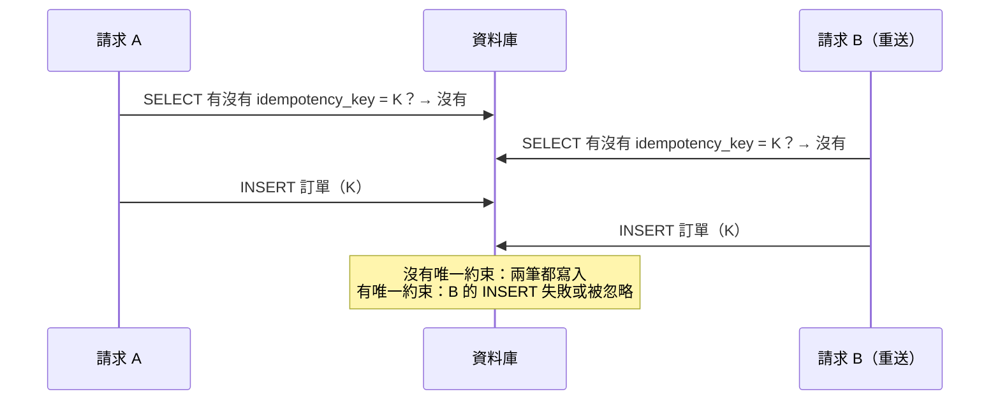

## 這是什麼

手機網路切換的瞬間，App 送出了下單請求但沒收到回應，於是自動重送；買家又著急地多按了一次。伺服器在幾毫秒內收到三個一模一樣的請求。如果每個都建立一張訂單，買家就被扣了三次款。

**冪等**（idempotent）指的是：同一個操作執行一次或很多次，結果都一樣。下單、付款、加值這類操作必須設計成冪等。關鍵是：判斷「這個請求處理過了沒」必須由資料庫保證，而不是由程式先查一下。

## 運作原理



「先查再寫」在兩個請求同時進來時一定會失敗：兩邊查詢時都還沒有資料。程式裡無論怎麼檢查，都有這段時間差；部署成多個 Pod 時，記憶體裡的鎖也擋不住。

**唯一約束**由資料庫在寫入時檢查，兩個 INSERT 一定會有一個違反約束。搭配 `INSERT ... ON CONFLICT`（PostgreSQL）或 `ON DUPLICATE KEY`（MySQL），可以在同一句 SQL 裡處理「已經存在」的情況。

## 常見錯誤與正確寫法

### 1. 用「先查再新增」防重複

在 `orders.idempotency_key` 建立唯一約束，並用一句 SQL 完成「不存在才新增」：

```csharp
// 套件：Dapper、Npgsql
public async Task<OrderSummary> CreateOrGetAsync(PlaceOrder cmd, CancellationToken ct)
{
    const string insert = """
        INSERT INTO orders (id, buyer_id, idempotency_key, amount, status, created_at)
        VALUES (@Id, @BuyerId, @IdempotencyKey, @Amount, 'Created', now())
        ON CONFLICT (idempotency_key) DO NOTHING
        RETURNING id, status;
        """;

    await using var conn = await dataSource.OpenConnectionAsync(ct);
    var created = await conn.QuerySingleOrDefaultAsync<OrderSummary>(new CommandDefinition(
        insert, new { Id = Guid.CreateVersion7(), cmd.BuyerId, cmd.IdempotencyKey, cmd.Amount }, cancellationToken: ct));

    // DO NOTHING 時不會回傳任何列：代表這個鍵已經處理過，讀出既有的結果回傳
    return created ?? await conn.QuerySingleAsync<OrderSummary>(new CommandDefinition(
        "SELECT id, status FROM orders WHERE idempotency_key = @IdempotencyKey",
        new { cmd.IdempotencyKey }, cancellationToken: ct));
}
```

同一個冪等鍵卻帶著不同的內容（例如金額不同），代表用戶端的錯誤；比對既有訂單的內容，不一致就回 422，見 [HTTP 契約](/frameworks/aspnet-core/http-contracts/)。

### 2. 直接加減餘額

```sql
-- 錯：逾時後重試，每執行一次就多加 100
UPDATE accounts SET balance = balance + 100 WHERE id = 1;
```

金額異動先寫一筆帶有唯一編號的**流水記錄**，同一個交易裡再更新餘額。重送時，流水記錄的唯一約束會擋下第二次：

```csharp
await using var conn = await dataSource.OpenConnectionAsync(ct);
await using var tx = await conn.BeginTransactionAsync(ct);
try
{
    await conn.ExecuteAsync(new CommandDefinition(
        "INSERT INTO account_entries (id, account_id, amount, source_ref) VALUES (@Id, @AccountId, @Amount, @SourceRef)",
        req, tx, cancellationToken: ct)); // source_ref 有唯一約束

    await conn.ExecuteAsync(new CommandDefinition(
        "UPDATE accounts SET balance = balance + @Amount WHERE id = @AccountId", req, tx, cancellationToken: ct));

    await tx.CommitAsync(ct);
}
catch (PostgresException ex) when (ex.SqlState == PostgresErrorCodes.UniqueViolation)
{
    // 這筆加值已經處理過：交易自動回滾，視為成功
}
```

餘額欄位是流水的彙總，可以隨時從流水重新計算核對。

### 3. 提交逾時就直接重試

`CommitAsync` 送出後連線中斷，你不知道交易到底提交了沒有。直接重試可能做兩次，直接回失敗可能讓已成功的訂單被當成失敗。正確做法是：用這次操作的業務鍵（訂單 ID、冪等鍵）查詢資料庫，存在就視為成功，不存在才重試。這也是為什麼每個寫入操作都應該有一個由用戶端或應用程式事先產生的唯一鍵。

## 使用邊界

- MySQL 的 `INSERT ... ON DUPLICATE KEY UPDATE` 在衝突時仍可能消耗自動遞增的 ID，頻繁衝突的表用 `BIGINT` 主鍵，或改用應用程式產生的 ID（例如 UUIDv7）。
- 冪等鍵要有保存期限與清理機制；保存期限至少要涵蓋用戶端可能重送的時間。
- 跨服務的重複處理（例如訊息重送）用 Inbox，見 [Outbox 與 Inbox](/architecture/outbox-inbox/)。

## 雲端排查

### 叢集層（GKE 與 EKS 相同）

```bash
# 冪等鍵衝突（重送被擋下）的次數；突然增加通常代表用戶端在大量重試
kubectl logs -n shop -l app=order-api --since=1h | grep -c "idempotency_key"
```

### 託管服務層

#### 兩邊相同：稽核重複與長交易

```sql
-- 不應該有重複的業務資料；有就代表某條寫入路徑沒有唯一約束保護
SELECT idempotency_key, count(*) FROM orders GROUP BY 1 HAVING count(*) > 1;
SELECT source_ref, count(*) FROM account_entries GROUP BY 1 HAVING count(*) > 1;

-- 持有交易超過 2 秒的連線
SELECT pid, now() - xact_start AS age, state, left(query, 80)
FROM pg_stat_activity
WHERE xact_start IS NOT NULL AND now() - xact_start > interval '2 seconds'
ORDER BY age DESC;
```

#### GKE

Cloud SQL Query Insights 中，`INSERT INTO orders` 的執行次數明顯多於實際成立的訂單數，代表用戶端重送很多；搭配 `cloudsql.googleapis.com/database/postgresql/num_backends` 觀察是否同時造成連線壓力。

#### EKS

CloudWatch `AWS/RDS` 的 `DatabaseConnections` 與 `CPUUtilization` 在重試風暴時會同步上升；逐句統計用 `pg_stat_statements` 比較 INSERT 次數與成功建立的訂單數。

### 應用程式層

為「冪等命中」（請求是重送、回傳既有結果）建立計數指標。它的比例突然升高，往往是用戶端的重試策略或網路出了問題，而不是伺服器端的錯誤。
