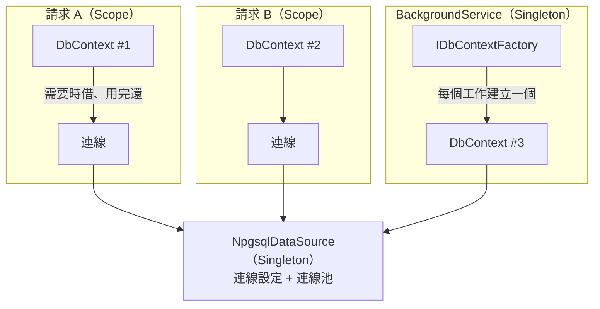

## 這是什麼

C# 存取資料庫會用到幾個物件，它們的生命週期各不相同：

- **DataSource**（`NpgsqlDataSource`、`MySqlDataSource`）：保存連線設定，並擁有這組設定的連線池。整個應用程式一組設定只需要一個。
- **連線**（`DbConnection`）：從 DataSource 借出，用完立刻歸還，存活時間越短越好。
- **DbContext**（EF Core）：一個「工作單元」：追蹤這次載入的實體，最後一次存檔。在 Web API 中，通常一個請求一個。

生命週期設錯，輕則浪費資源，重則多個請求共用同一個 `DbContext`，讀到彼此的資料或丟出執行緒錯誤。

## 運作原理



`DbContext` 並不會在整個生命週期都佔著連線。它在執行查詢或 `SaveChanges` 時才打開連線，做完就歸還；只有在明確開啟交易時，才會一直持有同一條連線直到交易結束。

## 常見錯誤與正確寫法

### 1. 每次都用連線字串 new 一個連線

```csharp
// 錯：設定散落各處，每處都可能用到不同的設定；也無法集中設定日誌、TLS 或密碼更新
await using var conn = new NpgsqlConnection(configuration.GetConnectionString("Shop"));
```

建立一個 DataSource 並註冊為 Singleton，所有地方都從它取得連線：

```csharp
// 套件：Npgsql.DependencyInjection、Npgsql.EntityFrameworkCore.PostgreSQL
builder.Services.AddNpgsqlDataSource(builder.Configuration.GetConnectionString("Shop")!);
builder.Services.AddDbContext<ShopDbContext>((sp, options) =>
    options.UseNpgsql(sp.GetRequiredService<NpgsqlDataSource>())); // EF Core 也用同一個 DataSource
```

需要直接寫 SQL 的地方注入 `NpgsqlDataSource`，用 `await using var conn = await dataSource.OpenConnectionAsync(ct);`。MySQL 以 MySqlConnector 的 `MySqlDataSource` 做同樣的事。

### 2. 背景服務注入 DbContext

`BackgroundService` 是 Singleton，直接注入 Scoped 的 `DbContext` 會形成 [Captive Dependency](/frameworks/aspnet-core/dependency-injection/)。用 `IDbContextFactory`，每個工作建立一個新的 `DbContext`：

```csharp
builder.Services.AddDbContextFactory<ShopDbContext>((sp, options) =>
    options.UseNpgsql(sp.GetRequiredService<NpgsqlDataSource>()));

public sealed class ExpireReservationsWorker(IDbContextFactory<ShopDbContext> factory) : BackgroundService
{
    protected override async Task ExecuteAsync(CancellationToken stoppingToken)
    {
        using var timer = new PeriodicTimer(TimeSpan.FromMinutes(1));
        while (await timer.WaitForNextTickAsync(stoppingToken))
        {
            await using var db = await factory.CreateDbContextAsync(stoppingToken); // 每一輪一個新的
            await db.Reservations.Where(r => r.ExpiresAt < DateTimeOffset.UtcNow)
                .ExecuteDeleteAsync(stoppingToken);
        }
    }
}
```

### 3. DbContext 池化後殘留上一個請求的狀態

`AddDbContextPool` 會在請求結束後重設 `DbContext` 並放回池中重複使用。如果你在 `DbContext` 上加了自訂欄位（例如目前的租戶 ID），重設時不會清除，下一個請求就可能用到上一個請求的值。池化的 `DbContext` 不要保存請求相關的狀態；需要時用 EF Core 提供的方式在每次取出時設定。

## 使用邊界

- 連線字串裡的密碼可能會更新（輪替、IAM token 過期）。DataSource 支援密碼提供者，可以定期取得新的密碼而不需重啟，見 [EKS 資料服務](/platforms/eks/data-services/)的 IAM 驗證範例。
- 同一個應用程式連兩個資料庫（例如主庫與讀副本），就建立兩個 DataSource，分別命名註冊。
- MySQL 與 PostgreSQL 的連線字串選項不同，見 [C# 與 MySQL](/data-access/mysql-dotnet/)與 [C# 與 PostgreSQL](/data-access/postgresql-dotnet/)。

## 雲端排查

### 叢集層（GKE 與 EKS 相同）

```bash
# 確認 Pod 拿到的連線設定來源（環境變數或掛載的 Secret），不要直接印出密碼
kubectl get deployment order-api -n shop -o jsonpath='{.spec.template.spec.containers[0].env[*].name}'
```

### 託管服務層

#### 兩邊相同：連線來自哪些 Pod

```sql
-- 以 Application Name 區分來源；在連線字串設定 Application Name=order-api
SELECT application_name, client_addr, count(*)
FROM pg_stat_activity
WHERE datname = 'shop'
GROUP BY application_name, client_addr
ORDER BY count(*) DESC;
```

在連線字串加上 `Application Name`，資料庫端就能分辨連線來自哪個服務。

#### GKE

使用 Cloud SQL Auth Proxy sidecar 時，應用程式連的是 Pod 內的 `127.0.0.1`，`client_addr` 會顯示 Proxy 的來源位址。Proxy 的日誌可以確認 IAM 授權是否成功：

```bash
kubectl logs -n shop <pod-name> -c cloud-sql-proxy --tail=50
```

#### EKS

使用 RDS Proxy 時，連線字串的主機是 Proxy 的端點，不是資料庫執行個體的端點。`aws rds describe-db-proxies --db-proxy-name shop-proxy --query 'DBProxies[0].Endpoint'` 可以查到正確的端點。

### 應用程式層

開發環境開啟 `ValidateScopes`，讓 Singleton 抓住 `DbContext` 的錯誤在啟動時就出現；正式環境出現「A second operation was started on this context instance」的例外，代表同一個 `DbContext` 被平行使用，通常就是生命週期設錯。
