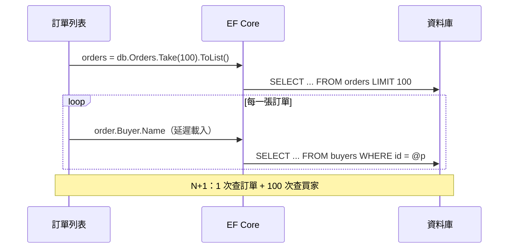

## 這是什麼

EF Core 是 .NET 的 ORM（物件關聯對應）：你用 C# 的 LINQ 寫查詢，它翻譯成 SQL 送到資料庫，再把結果轉回 C# 物件。寫起來很方便，但「C# 看起來只有一行」不代表「資料庫只做了一件事」。

訂單列表頁顯示 100 張訂單和各自的買家名稱。如果寫法不對，EF Core 會先查一次訂單，再為每張訂單各查一次買家，總共 101 句 SQL。每句只要 2 毫秒，加起來也是 200 毫秒，再加上 101 次網路往返。這篇說明這類問題怎麼發生、怎麼避免。

## 運作原理



EF Core 只會在你**列舉**查詢時才送出 SQL（`ToListAsync`、`FirstAsync`、`foreach` 等）。導覽屬性（例如 `order.Buyer`）如果沒有在查詢時一起載入，啟用了延遲載入就會在第一次讀取時各自查詢一次；沒啟用延遲載入則會是 null。

查詢有兩種方式取得關聯資料：

- **Include**：把關聯實體一起載入，回傳完整的實體。
- **Select 投影**：只取需要的欄位，直接組成 DTO，EF Core 會翻譯成一句 JOIN 查詢。

預設情況下，查出的實體會被**變更追蹤**：EF Core 保存一份快照，`SaveChanges` 時比對哪些欄位改了。唯讀的查詢不需要這個成本。

## 常見錯誤與正確寫法

### 1. 在迴圈裡讀取導覽屬性（N+1）

```csharp
// 錯：每張訂單各查一次買家
var orders = await db.Orders.OrderByDescending(o => o.PlacedAt).Take(100).ToListAsync(ct);
var rows = orders.Select(o => new OrderRow(o.Id, o.Buyer.Name, o.TotalAmount)).ToList();
```

列表頁直接投影，一句 SQL 拿到所有需要的欄位：

```csharp
var rows = await db.Orders
    .OrderByDescending(o => o.PlacedAt)
    .Take(100)
    .Select(o => new OrderRow(o.Id, o.Buyer.Name, o.TotalAmount)) // 翻譯成 JOIN，只取三個欄位
    .ToListAsync(ct);
```

投影的結果是 DTO，不會被追蹤，也不需要 `AsNoTracking`。

### 2. 唯讀查詢載入完整實體又被追蹤

需要完整實體但不會修改時（例如組一份報表），加上 `AsNoTracking()`，省下快照與追蹤的記憶體與 CPU：

```csharp
var products = await db.Products.AsNoTracking().Where(p => p.IsListed).ToListAsync(ct);
```

### 3. 一次 Include 兩個集合，資料量暴增

```csharp
// 錯：每張訂單有 10 筆明細、5 筆付款紀錄，JOIN 後每張訂單變成 50 列
var orders = await db.Orders.Include(o => o.Lines).Include(o => o.Payments).ToListAsync(ct);
```

同一句 SQL 同時 JOIN 兩個一對多集合，結果是兩者的乘積，這叫**笛卡兒爆炸**。改用 `AsSplitQuery()`，讓 EF Core 分成三句查詢，各自載入：

```csharp
var orders = await db.Orders
    .Include(o => o.Lines)
    .Include(o => o.Payments)
    .AsSplitQuery()
    .ToListAsync(ct);
```

分割查詢的代價是多次往返，而且各句之間沒有一致的快照（中間如果有人修改，結果可能不完全一致）。只在確實載入多個集合時使用。

可以在開發環境把多集合 Include 的警告升級成例外，提早發現：

```csharp
options.UseNpgsql(connectionString)
    .ConfigureWarnings(w => w.Throw(RelationalEventId.MultipleCollectionIncludeWarning));
```

### 4. 同一個 DbContext 平行查詢

```csharp
// 錯：DbContext 不是執行緒安全的，同時執行兩個查詢會丟出 InvalidOperationException
await Task.WhenAll(db.Orders.CountAsync(ct), db.Products.CountAsync(ct));
```

依序 await；真的需要平行，就用 `IDbContextFactory<T>` 各自建立 `DbContext`。

## 使用邊界

- `AddDbContextPool` 會重複使用 `DbContext` 實例，省下建立成本，適合每秒大量請求的服務；但 `DbContext` 裡不能有每個請求不同的狀態（例如在建構子注入目前租戶）。
- 寫入的用例需要追蹤：載入實體、修改、`SaveChangesAsync`。追蹤的成本與大量資料的處理見 [變更追蹤](/data-access/tracking/)。
- 無法用 LINQ 表達的查詢，用 `FromSql` 或 Dapper；但要確認參數化，不要拼接字串。
- 查詢本身為什麼慢、索引有沒有用上，見 [SQL 查詢基礎](/data-access/sql-foundations/)。

## 雲端排查

### 叢集層（GKE 與 EKS 相同）

```bash
# 找出 CPU 或記憶體異常的 API Pod
kubectl top pod -n shop -l app=order-api
```

N+1 通常不會讓 API Pod 的 CPU 很高，而是請求延遲高、資料庫查詢次數暴增；所以要同時看資料庫端。

### 託管服務層

#### 兩邊相同：找出執行次數異常多的查詢

```sql
-- 同一個查詢被執行了非常多次，而每次只回傳一兩筆，是 N+1 的典型樣子
SELECT calls, rows, round(mean_exec_time::numeric, 2) AS mean_ms, left(query, 120) AS query
FROM pg_stat_statements
ORDER BY calls DESC
LIMIT 10;
```

#### GKE

Cloud SQL Query Insights 依查詢摘要列出執行次數；某個「依 ID 查詢」的次數是其他查詢的數十倍，就回頭檢查呼叫它的程式。

#### EKS

CloudWatch `AWS/RDS` 的 `CPUUtilization` 不一定很高，但查詢次數暴增時資料庫的連線與 CPU 會同步上升；逐句統計用 `pg_stat_statements` 或 Performance Insights。

### 應用程式層

EF Core 內建事件計數器，可以觀察每秒查詢數與 `SaveChanges` 次數。在容器裡執行診斷工具的方式見參考來源中的官方文件；連上程序後：

```bash
dotnet-counters monitor --process-id 1 --counters Microsoft.EntityFrameworkCore
```

`queries-per-second` 遠大於 API 每秒請求數，代表每個請求送出了很多句查詢，搭配追蹤找出是哪個端點。
