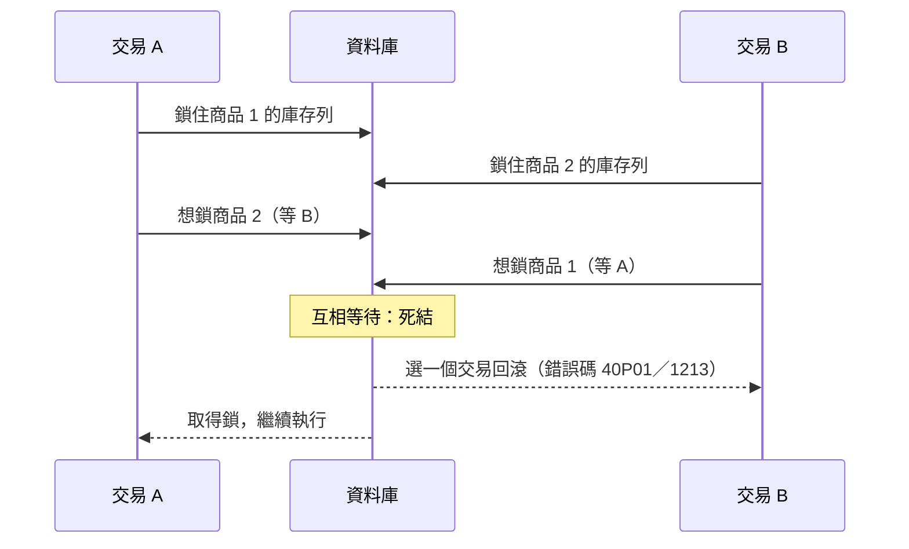

## 這是什麼

兩個交易同時在跑時，一個交易能看到另一個交易多少變更？這由**隔離等級**決定。隔離越嚴格，越不容易讀到不一致的資料，但等待與衝突也越多。

常見的兩個等級：

- **Read Committed**：每一句 SQL 都看到「這句開始時已經提交」的資料。同一個交易裡查兩次，結果可能不同。
- **Repeatable Read**：整個交易看到同一份快照，查幾次結果都一樣。

PostgreSQL 預設 Read Committed，MySQL（InnoDB）預設 Repeatable Read。不只預設值不同，兩者在 Repeatable Read 下的鎖定行為也不同。同一段程式換一種資料庫，衝突與等待的情況就會改變。

## 運作原理



**死結**：兩個交易各自持有對方需要的鎖。資料庫會偵測到，並強制回滾其中一個。被回滾的交易所做的一切都不算數，所以要**整個交易重新執行**，而不是只重送失敗的那一句。

**序列化失敗**：PostgreSQL 在 Repeatable Read 或 Serializable 下，如果你要修改的列在快照之後被別人改過，會回傳錯誤碼 `40001`，同樣要重試整個交易。

**MySQL 的 next-key lock**：InnoDB 在 Repeatable Read 下，鎖定讀取（`SELECT ... FOR UPDATE`）與更新不只鎖住符合的列，還會鎖住索引上的「間隙」，防止其他交易插入新資料。條件沒有走索引時，掃描過的列都會被鎖，範圍可能大到整張表。

## 常見錯誤與正確寫法

### 1. 遇到死結就回錯誤給使用者

死結與序列化失敗都是暫時性的，重試通常就會成功。EF Core 的 PostgreSQL provider 開啟重試策略後，會把這類錯誤當作暫時性錯誤，在執行策略內整段重試：

```csharp
options.UseNpgsql(dataSource, npgsql => npgsql.EnableRetryOnFailure(maxRetryCount: 3));

// 交易要放在執行策略內，重試時整段重新執行
var strategy = db.Database.CreateExecutionStrategy();
await strategy.ExecuteAsync(async () =>
{
    await using var tx = await db.Database.BeginTransactionAsync(ct);
    // ... 讀取、修改、SaveChanges
    await tx.CommitAsync(ct);
});
```

重試的內容不能包含外部副作用（例如寄信、呼叫付款），否則會做兩次。

### 2. 多筆更新的順序不一致

一張訂單有多個商品，有的請求先鎖商品 1 再鎖商品 2，有的反過來，就會死結。所有交易都依同一個順序（例如商品 ID 由小到大）鎖定：

```csharp
foreach (var line in order.Lines.OrderBy(l => l.ProductId)) // 固定順序，避免交叉等待
{
    var affected = await db.Stocks
        .Where(s => s.ProductId == line.ProductId && s.Available >= line.Quantity)
        .ExecuteUpdateAsync(s => s.SetProperty(x => x.Available, x => x.Available - line.Quantity), ct);
    if (affected == 0) throw new OutOfStockException(line.ProductId);
}
```

### 3. 在沒有索引的欄位上鎖定

```sql
-- 錯：status 沒有索引，MySQL 會掃描並鎖住大量列（含間隙），擋住其他人的寫入
SELECT * FROM jobs WHERE status = 'pending' LIMIT 10 FOR UPDATE;
```

確保鎖定條件有索引；如果是「多個工作者搶工作」，加上 `SKIP LOCKED`，跳過已被別人鎖住的列，而不是等待：

```sql
SELECT id FROM jobs WHERE status = 'pending' ORDER BY id LIMIT 10 FOR UPDATE SKIP LOCKED;
```

## 使用邊界

- 大多數電商操作在預設隔離等級下，搭配條件更新與唯一約束就能正確運作，見 [樂觀並行](/data-access/concurrency/)。提高隔離等級會增加衝突與重試。
- Serializable 提供最強的保證，但衝突時一定要重試，而且在高衝突的情境下效能下降明顯。
- 從 MySQL 換到 PostgreSQL（或反過來）時，重新檢查所有依賴「同一個交易內重複讀取結果不變」或依賴間隙鎖的邏輯。

## 雲端排查

### 叢集層（GKE 與 EKS 相同）

```bash
# 死結與序列化失敗的錯誤次數
kubectl logs -n shop -l app=order-api --since=1h | grep -c -E "40P01|40001|Deadlock"
```

### 託管服務層

#### 兩邊相同：誰在等誰、最近一次死結

```sql
-- PostgreSQL：被擋住的連線與擋住它的連線
SELECT pid, pg_blocking_pids(pid) AS blocked_by, wait_event_type, left(query, 80) AS query
FROM pg_stat_activity WHERE cardinality(pg_blocking_pids(pid)) > 0;

-- PostgreSQL：各資料庫累計的死結次數
SELECT datname, deadlocks FROM pg_stat_database WHERE datname = 'shop';
```

```sql
-- MySQL：最近一次偵測到的死結（看輸出中的 LATEST DETECTED DEADLOCK）
SHOW ENGINE INNODB STATUS;

-- MySQL 8：目前的鎖等待
SELECT * FROM performance_schema.data_lock_waits;
```

#### GKE

Cloud SQL for PostgreSQL 的 `cloudsql.googleapis.com/database/postgresql/deadlock_count` 可以設定告警；死結次數在某次發布後增加，檢查新程式的鎖定順序。

#### EKS

RDS PostgreSQL 以上面的 `pg_stat_database.deadlocks` 追蹤累計次數；開啟 `log_lock_waits` 參數後，等待鎖超過 `deadlock_timeout` 的語句會寫進資料庫日誌，可發布到 CloudWatch Logs 查詢。

### 應用程式層

在追蹤中為交易重試加上事件或計數；重試率突然上升，代表衝突變多，通常和熱門商品、批次作業與線上流量同時修改同一批資料有關。
