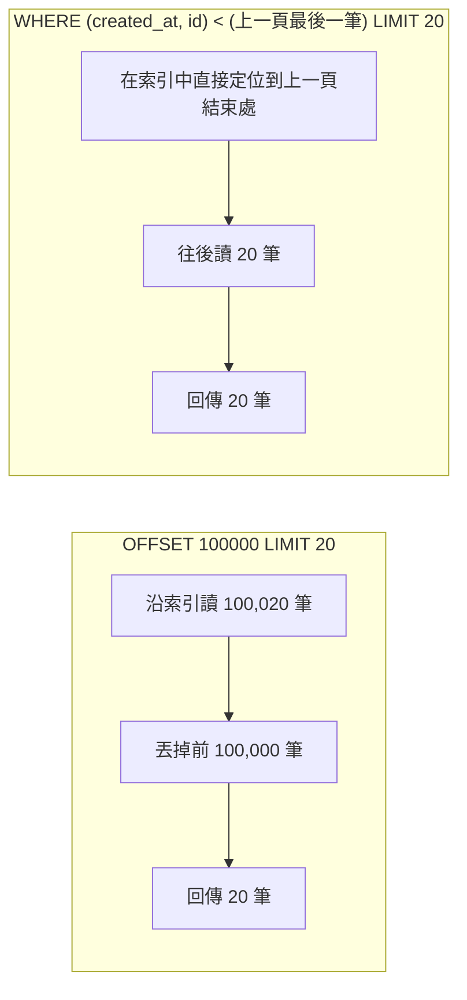

## 這是什麼

訂單表累積到一億筆。資料量小的時候寫得很順的查詢，現在開始變慢：訂單列表翻到第 5,000 頁要好幾秒、某個報表把磁碟讀取量拉滿。

大表的查詢原則只有一個：**讓資料庫只讀它真正需要的那幾筆**。做法是正確的分頁方式、欄位順序合理的複合索引，以及只取需要的欄位。

## 運作原理



**OFFSET 分頁**：資料庫要先讀過並丟掉前面所有的列，頁數越後面越慢。而且翻頁過程中有新資料寫入，結果會位移，造成重複或漏掉。

**Keyset 分頁**：記住上一頁最後一筆的排序值，下一頁從那裡接著查。只要排序欄位有索引，每一頁的成本都一樣。排序欄位要能唯一決定順序，所以通常是「時間 + 主鍵」。

**複合索引的欄位順序**：索引 `(buyer_id, created_at)` 先依買家排序、同一個買家內再依時間排序。查「某買家最近的訂單」可以直接定位；但只查「最近的訂單」（沒有買家條件），這個索引就幫不上忙。原則是：**等值條件的欄位放前面，範圍條件或排序欄位放後面。**

**覆蓋索引**：如果查詢需要的欄位都在索引裡，資料庫只讀索引就能回答，不必再回到資料表讀整列（回表）。PostgreSQL 可以用 `INCLUDE` 把額外欄位附在索引上。

## 常見錯誤與正確寫法

### 1. 用 OFFSET 翻頁

```csharp
// 錯：第 5000 頁要跳過 10 萬筆
var page = await db.Orders.Where(o => o.BuyerId == buyerId)
    .OrderByDescending(o => o.CreatedAt).ThenByDescending(o => o.Id)
    .Skip(pageIndex * 20).Take(20).ToListAsync(ct);
```

改成 keyset：前端傳回上一頁最後一筆的 `(CreatedAt, Id)`，下一頁從那裡接著查。

```csharp
var page = await db.Orders.AsNoTracking()
    .Where(o => o.BuyerId == buyerId)
    .Where(o => o.CreatedAt < cursor.CreatedAt
             || (o.CreatedAt == cursor.CreatedAt && o.Id < cursor.Id)) // 同一時間以 Id 決定先後
    .OrderByDescending(o => o.CreatedAt).ThenByDescending(o => o.Id)
    .Select(o => new OrderRow(o.Id, o.CreatedAt, o.TotalAmount))
    .Take(20)
    .ToListAsync(ct);
```

搭配索引 `(buyer_id, created_at DESC, id DESC)`。代價是不能直接跳到「第 5,000 頁」，只能「下一頁」；對訂單列表、無限捲動來說這正好符合需求。

### 2. 查詢取出所有欄位

```sql
-- 錯：只顯示三個欄位，卻讀出整列，包含很大的 JSON 與備註欄位
SELECT * FROM orders WHERE buyer_id = $1 ORDER BY created_at DESC LIMIT 20;
```

只取需要的欄位，並讓索引涵蓋它們：

```sql
CREATE INDEX CONCURRENTLY ix_orders_buyer_recent
    ON orders (buyer_id, created_at DESC, id DESC) INCLUDE (total_amount, status);

SELECT id, created_at, total_amount, status
FROM orders WHERE buyer_id = $1 ORDER BY created_at DESC, id DESC LIMIT 20;
```

`EXPLAIN` 出現 `Index Only Scan`，代表不需要回表。

### 3. 排序欄位可以是 NULL

`created_at` 允許 NULL 時，`<` 比較遇到 NULL 的結果是「未知」，這些列在 keyset 分頁裡會被跳過。排序用的欄位設為 `NOT NULL`，或明確處理 NULL 的排序位置。

## 使用邊界

- 索引越多，寫入越慢、佔用空間越大。以實際的查詢模式決定索引，並定期找出沒被使用的索引（PostgreSQL 的 `pg_stat_user_indexes.idx_scan`）。
- 「歷史訂單」很少被查，卻和熱資料放在同一張表裡，會讓索引與快取變大。資料量繼續成長時，考慮依時間分割或封存，見 [分割與封存](/data-access/partitioning-sharding/)。
- 需要隨機跳頁的後台報表，讓它去讀副本或資料倉儲，不要和線上查詢搶主庫的資源。

## 雲端排查

### 叢集層（GKE 與 EKS 相同）

```bash
# 慢查詢通常表現為某個端點的延遲升高；先看是哪個 Pod、哪個路徑
kubectl logs -n shop -l app=order-api --since=15m | grep -E "elapsed|duration" | sort -t= -k2 -n | tail
```

### 託管服務層

#### 兩邊相同：執行計畫與沒被使用的索引

```sql
-- BUFFERS 顯示讀了多少資料頁；shared read 很大代表從磁碟讀了大量資料
EXPLAIN (ANALYZE, BUFFERS)
SELECT id, created_at, total_amount FROM orders WHERE buyer_id = '...' ORDER BY created_at DESC LIMIT 20;

-- 從未被使用的大索引：佔空間、拖慢寫入
SELECT relname, indexrelname, idx_scan, pg_size_pretty(pg_relation_size(indexrelid)) AS size
FROM pg_stat_user_indexes WHERE idx_scan = 0 ORDER BY pg_relation_size(indexrelid) DESC LIMIT 10;
```

#### GKE

Cloud SQL 的 `cloudsql.googleapis.com/database/disk/read_ops_count` 突然升高，對照 Query Insights 中同一時段耗時最高的查詢；大表的全表掃描會同時推高磁碟讀取與 CPU。

#### EKS

CloudWatch `AWS/RDS` 的 `ReadIOPS` 與 `ReadLatency`。`ReadIOPS` 接近儲存的 IOPS 上限時，所有查詢都會變慢，不只是那一句大查詢。

### 應用程式層

在 OpenTelemetry 的資料庫 span 上看每句 SQL 的耗時；同一個端點在翻到後面的頁數時延遲線性增加，就是 OFFSET 分頁的典型症狀。
