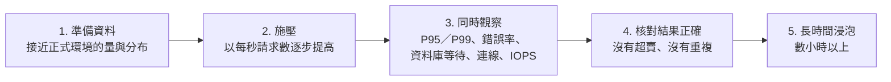

## 這是什麼

大促前要回答一個問題：「目前的資料庫與設定，撐得住預期的流量嗎？」容量驗證就是用模擬的負載找出答案。

壓測很容易得到「看起來很漂亮但沒有意義」的數字：在只有一千筆資料的空資料庫上測、只跑五分鐘、看平均回應時間。這篇說明怎麼設計測試，讓結果能真的拿來做決策。

## 運作原理



**資料量決定結果。** 一千筆的表，所有資料都在記憶體裡，查詢永遠很快。一億筆的表，工作集超過記憶體，查詢開始讀磁碟，行為完全不同。測試資料要接近正式環境的數量與分布（例如熱門商品集中、買家訂單數的長尾分布）。

**開放模型與封閉模型。** 封閉模型模擬「固定 100 個使用者，每人做完一件事才做下一件」：系統變慢時，使用者送出請求的速度也跟著變慢，壓力自動減輕，問題被掩蓋。真實的流量是開放模型：不管系統快慢，買家照樣以每秒 N 次的速度進來。所以要用**到達速率**施壓。

**看百分位數，不看平均。** 99% 的請求 50 毫秒、1% 的請求 5 秒，平均值大約 100 毫秒，看起來沒問題；但每 100 個買家就有一個等 5 秒。P95、P99 才反映使用者實際的體驗。

## 常見錯誤與正確寫法

### 1. 用固定使用者數施壓

```javascript
// k6：以「每秒 300 個請求」施壓，系統變慢時不會自動降低壓力
export const options = {
  scenarios: {
    place_orders: {
      executor: 'constant-arrival-rate',
      rate: 300,              // 每秒 300 次
      timeUnit: '1s',
      duration: '30m',
      preAllocatedVUs: 200,   // 預先準備的虛擬使用者
      maxVUs: 1000,           // 系統變慢時，k6 會開更多虛擬使用者來維持速率
    },
  },
  thresholds: {
    http_req_failed: ['rate<0.01'],     // 錯誤率低於 1%
    http_req_duration: ['p(99)<800'],   // P99 低於 800 毫秒
  },
};
```

k6 用光 `maxVUs` 還達不到設定的速率時會發出警告，代表系統已經無法承受這個流量。

### 2. 只跑幾分鐘

很多問題要時間才會出現：連線洩漏慢慢耗盡連線池、dead tuples 累積讓查詢變慢、雲端磁碟的突增額度用完後 IOPS 掉回基準值。正式的容量驗證除了尖峰測試，還要做數小時的**浸泡測試**（soak test），觀察指標是否隨時間惡化。

### 3. 只看速度，不看結果

壓測的訂單 API 回應都很快，但事後檢查發現庫存變成負數，或同一個冪等鍵建立了兩張訂單。每次測試結束都要用 SQL 核對業務不變量，見 [高併發 CRUD](/data-access/concurrent-crud/)。

### 4. 壓測機自己成了瓶頸

壓測機的 CPU 或網路滿了，請求送不出去，看起來像是伺服器變慢。觀察壓測機本身的資源用量；必要時把負載分散到多台機器，並讓壓測機和被測系統在同一個區域。

## 使用邊界

- 在與正式環境相同規格的隔離環境測試；在正式環境壓測要事先協調，並準備隨時停止的機制。
- 每次只改一個變因（池大小、機器規格、索引），記錄前後的結果；同時改好幾個，就不知道是哪個造成差異。記錄格式見 [資料庫專題](/projects/ecommerce/database-capacity/)。
- 測試結果要轉換成 SLO 與告警門檻，日常才能持續追蹤，見 [SLO 與告警](/engineering/slo-alerts/)。

## 雲端排查

### 叢集層（GKE 與 EKS 相同）

```bash
# 壓測期間 API 的擴縮與資源用量
kubectl get hpa -n shop -w
kubectl top pod -n shop -l app=order-api
```

HPA 已經擴到上限而 CPU 仍然很高，瓶頸在應用程式；Pod 的 CPU 不高但延遲很高，瓶頸多半在資料庫或下游。

### 託管服務層

#### 兩邊相同：資料庫在等什麼

```sql
-- 壓測期間每隔幾秒執行：連線在等哪一類資源
SELECT wait_event_type, wait_event, count(*)
FROM pg_stat_activity WHERE state = 'active'
GROUP BY 1, 2 ORDER BY 3 DESC;
```

`IO` 類等待居多代表在等磁碟；`Lock` 居多代表在等鎖；`LWLock` 居多常與高併發下的內部競爭有關。

#### GKE

Cloud SQL 的磁碟效能依磁碟大小與類型而定；看 `cloudsql.googleapis.com/database/disk/read_ops_count` 與 `write_ops_count` 是否接近該規格的上限，以及 `database/cpu/utilization`。

#### EKS

CloudWatch `AWS/RDS` 的 `ReadIOPS`、`WriteIOPS`、`DiskQueueDepth`。使用 gp2 儲存時看 `BurstBalance`：它在長時間測試中降到 0，IOPS 會掉回基準值，這正是短時間測試看不到的問題。

### 應用程式層

對照壓測的時間軸，看 API 的 `http.server.request.duration`（P99）與資料庫指標在什麼時間點開始一起惡化，那個時間點的每秒請求數，就是目前設定下的實際容量。
