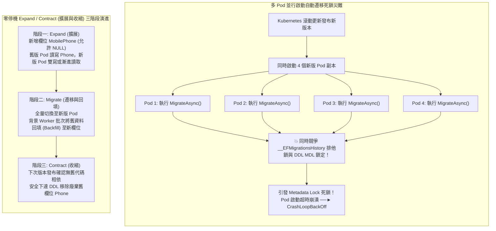

## 案發現場

某電商核心微服務在週末夜間進行 Kubernetes 滾動發布（Rolling Update）。發布啟動後僅僅 30 秒，維運監控警報狂響，所有新版本 Pod 紛紛進入 `CrashLoopBackOff` 死迴圈，全站對外服務隨之劇烈中斷！

排查小組調取新 Pod 的終端日誌，赫然看見了致命的 DDL 死鎖與資料表毀損紀錄：
`System.InvalidOperationException: The database operation failed due to a lock timeout or deadlock... Table '__EFMigrationsHistory' is locked.`
原因在於：開發者在 `Program.cs` 的頂層啟動代碼中，寫入了便利但在生產環境極端危險的指令：
```csharp
await dbContext.Database.MigrateAsync();
```
當 Kubernetes 依據滾動發布策略同時拉起 4 個新 Pod 時，這 4 個 Pod 幾乎在同一毫秒向資料庫發送了 `CREATE TABLE` 與 `ALTER TABLE` 語句，並試圖向遷移歷史表（`__EFMigrationsHistory`）插入紀錄。多個 Pod 的並行連線在資料庫元資料鎖（Metadata Lock）層級爆發了慘烈的死鎖，部分 Pod 逾時崩潰，導致資料庫結構處於半套用、半殘缺的不可逆損壞狀態！

雪上加霜的是隨後的「修復性事故」：該團隊本次改版包含了一項資料庫欄位重構——將會員表中的 `Phone` 欄位重新命名為 `MobilePhone`。在發布期間，由於 Kubernetes 滾動更新是逐步替換 Pod，線上環境必然存在「新版 Pod 與舊版 Pod 同時承接流量」的 10 分鐘過渡窗口。結果：新版 Pod 將資料寫入 `MobilePhone`，而仍在服務的舊版 Pod 卻在持續發送 `SELECT Phone FROM Members`，線上連續噴發數萬筆 `Column 'Phone' does not exist` 錯誤，大量消費者被強制登出且無法下單！

這起典型慘劇揭露了現代雲原生架構下資料庫架構演進的兩大核心死穴：**執行期多實例並行套用遷移的併發衝突**，以及**違反零停機發布（Zero-Downtime Deployment）向前相容原則的破壞性變更（Breaking Changes）**。



---

## 致命反模式 vs. 正確解法

### 反模式一：在多實例 Pod 啟動階段直接執行 `Database.Migrate()`

將資料庫結構變更（DDL）綁定在應用程式的啟動流程中，存在三大隱患：
1. **多節點死鎖與競爭條件**：多個 Pod 同時執行遷移，極易引發 DDL 死鎖與 `__EFMigrationsHistory` 寫入衝突。
2. **容器探針超時死鎖**：若遷移包含對數百萬行歷史大表新增索引，DDL 執行可能耗時數分鐘。在此期間，HTTP 伺服器尚未就緒，Kubernetes 的 Startup / Liveness 探針會判定容器超時並直接發送 SIGKILL，使資料庫停留在中斷的危險狀態。
3. **權限過大違背最小權限原則**：應用程式的連線帳號被迫擁有 `ALTER`、`CREATE`、`DROP` 等 DDL 高危權限，增加被 SQL 注入攻擊時的資料庫風險。

### 反模式二：在生產環境直接執行破壞性變更（如直接 Rename 或 Drop Column）

直接在單次發布中重新命名欄位（Rename Column）或刪除欄位（Drop Column），徹底破壞了向後相容性。在 Kubernetes 滾動發布、金絲雀發布（Canary）或發生故障需要緊急回滾（Rollback）時，舊版代碼將因欄位丟失而全數拋出異常。

### 正確解法：遷移與應用程式生命週期脫鉤，實踐 Expand/Contract 模式

1. **架構變更遵循 Expand/Contract 模式**：
   - **擴展（Expand）**：新增非破壞性欄位（允許 NULL 或具備預設值）。
   - **遷移（Migrate）**：全量部署新版代碼並在背景回填資料。
   - **收縮（Contract）**：確認無舊版依賴後，在後續獨立發布中刪除舊欄位。
2. **獨立遷移管線（Migration Bundles / CI/CD 冪等腳本）**：
   遷移一律由 CI/CD Pipeline、Kubernetes `InitContainer` 或獨立 `Job` 單點執行，絕不在業務 Pod 內部並行執行。

```csharp
using System;
using System.Diagnostics;
using System.Threading.Tasks;

namespace DotNetPerformance.DataAccess;

/// <summary>
/// 零停機 Expand / Contract 雙向過渡相容實體
/// </summary>
public sealed class UserProfileTransitionEntity
{
    public int UserId { get; set; }
    
    // 舊版欄位 (Phase 1/2 期間保留供向後相容)
    public string? Phone { get; set; }

    // 新版欄位 (Phase 1 新增之擴展欄位)
    public string? MobilePhone { get; set; }

    /// <summary>
    /// 取得有效聯絡電話（向下相容過渡屬性）
    /// </summary>
    public string GetEffectiveContactNumber()
    {
        // 優先讀取新版欄位，若尚未回填則優雅降級讀取舊版欄位
        return !string.IsNullOrWhiteSpace(MobilePhone) ? MobilePhone : (Phone ?? string.Empty);
    }
}

/// <summary>
/// 生產級安全遷移發布展示
/// </summary>
public static class ZeroDowntimeMigrationDemo
{
    public static void DisplayProductionStrategy()
    {
        Console.WriteLine("[零停機資料庫發布規範]");
        Console.WriteLine("  1. 生成冪等 SQL 腳本 (Idempotent Script)：");
        Console.WriteLine("     指令: dotnet ef migrations script --idempotent -o /ci/migrate.sql");
        Console.WriteLine("     優勢: 為每段 DDL 自動包裝 IF NOT EXISTS，支援重複執行與 DBA 審查。");

        Console.WriteLine("\n  2. 獨立單點執行 (Kubernetes InitContainer / CI Job)：");
        Console.WriteLine("     絕不讓 10 個應用程式 Pod 並行執行 DDL；由 InitContainer 單一執行確保無競爭死鎖。");

        Console.WriteLine("\n  3. 驗證過渡相容模型 (Expand/Contract)：");
        var user = new UserProfileTransitionEntity
        {
            UserId = 1001,
            Phone = "0912-345-678", // 舊欄位有值
            MobilePhone = null      // 新欄位尚未回填
        };

        Console.WriteLine($"     過渡期相容提取電話: {user.GetEffectiveContactNumber()} (舊版本完全正常工作)");

        user.MobilePhone = "+886-912345678"; // 完成回填
        Console.WriteLine($"     回填後相容提取電話: {user.GetEffectiveContactNumber()} (新版本完全生效)");
    }
}

public static class Program
{
    public static void Main()
    {
        Console.WriteLine("=== EF Core 資料庫遷移與零停機 Expand/Contract 實測 ===");

        ZeroDowntimeMigrationDemo.DisplayProductionStrategy();

        Console.WriteLine("\n遷移部署策略通過檢驗：已徹底杜絕多 Pod 並行 Migrate 死鎖與破壞性欄位下線。");
    }
}
```

預期控制台輸出：

```text
=== EF Core 資料庫遷移與零停機 Expand/Contract 實測 ===
[零停機資料庫發布規範]
  1. 生成冪等 SQL 腳本 (Idempotent Script)：
     指令: dotnet ef migrations script --idempotent -o /ci/migrate.sql
     優勢: 為每段 DDL 自動包裝 IF NOT EXISTS，支援重複執行與 DBA 審查。

  2. 獨立單點執行 (Kubernetes InitContainer / CI Job)：
     絕不讓 10 個應用程式 Pod 並行執行 DDL；由 InitContainer 單一執行確保無競爭死鎖。

  3. 驗證過渡相容模型 (Expand/Contract)：
     過渡期相容提取電話: 0912-345-678 (舊版本完全正常工作)
     回填後相容提取電話: +886-912345678 (新版本完全生效)

遷移部署策略通過檢驗：已徹底杜絕多 Pod 並行 Migrate 死鎖與破壞性欄位下線。
```

---

## 踩坑與避坑指南

### 1. 產生冪等 SQL 腳本（Idempotent Scripts）的 CI/CD 實踐

在自動化流水線中，切勿依賴環境中的 .NET 運行時動態執行遷移。使用以下命令產出純 SQL 腳本：

```bash
# 產出從第一版到最新版、且每個段落皆包含存在性檢查的冪等 SQL
dotnet ef migrations script --idempotent --output /artifacts/bundle.sql
```
生成的 SQL 範例：
```sql
IF NOT EXISTS (SELECT 1 FROM [__EFMigrationsHistory] WHERE [MigrationId] = '20261010_AddMobilePhone')
BEGIN
    ALTER TABLE [Members] ADD [MobilePhone] nvarchar(32) NULL;
    INSERT INTO [__EFMigrationsHistory] ([MigrationId], [ProductVersion]) VALUES ('20261010_AddMobilePhone', '10.0.0');
END;
```

### 2. PostgreSQL 事務性 DDL vs MySQL 非事務性 DDL 天坑

- **PostgreSQL 支援事務性 DDL（Transactional DDL）**：
  若某個 `ALTER TABLE` 語法在中途因約束違規失敗，PostgreSQL 會**完全回滾整筆事務**，資料庫結構完好無損，極具安全韌性。
- **MySQL 不支援事務性 DDL**：
  MySQL 的 DDL 指令會隱式提交（Implicit Commit）當前事務！一旦執行到第二道 `ALTER TABLE` 發生錯誤崩潰，第一道已變更的結構**永遠無法自動回滾**，資料庫會停留在殘缺的半成品狀態，迫使工程師手動下達 SQL 搶修。
- **防禦原則**：在 MySQL 環境執行遷移時，每個 Migration 應儘量維持微型化，並事先於 Staging 環境進行演練驗證。

### 3. 大表新增索引防鎖表：PostgreSQL `CONCURRENTLY` 實踐

在數千萬筆資料的歷史大表上新增索引時，預設的 `CREATE INDEX` 會阻斷所有並行寫入：
- 在 EF Core 遷移中，應宣告啟用並發無鎖建立：
  ```csharp
  migrationBuilder.CreateIndex(
      name: "IX_Orders_CustomerId",
      table: "Orders",
      column: "CustomerId")
      .Annotation("Npgsql:CreatedConcurrently", true); // PostgreSQL 並發無鎖建立索引
  ```

---

## 線上排查指令

### 1. 檢視 PostgreSQL 當前持有 DDL 排他鎖的連線

定位是哪條連線阻塞了結構遷移：

```sql
-- 查詢當前持有 AccessExclusiveLock（DDL 專屬排他鎖）的連線與查詢
SELECT 
    l.pid, 
    a.usename, 
    l.mode, 
    l.granted, 
    a.query_start, 
    a.query 
FROM pg_locks l 
JOIN pg_stat_activity a ON l.pid = a.pid 
WHERE l.mode = 'AccessExclusiveLock';
```

### 2. 檢測 MySQL 當前元資料鎖（Metadata Lock）等待狀況

排查 MySQL 的 DDL 是否被未提交的長查詢卡死：

```sql
-- 檢視正在等待元資料鎖的執行緒 (MySQL 8.0+)
SELECT 
    object_type, 
    object_schema, 
    object_name, 
    lock_type, 
    lock_status, 
    owner_thread_id 
FROM performance_schema.metadata_locks 
WHERE lock_status = 'PENDING';
```

### 3. 檢查 `__EFMigrationsHistory` 最新遷移紀錄

在資料庫終端驗證當前實際套用的遷移版本：

```sql
SELECT * FROM "__EFMigrationsHistory" ORDER BY "MigrationId" DESC LIMIT 5;
```
