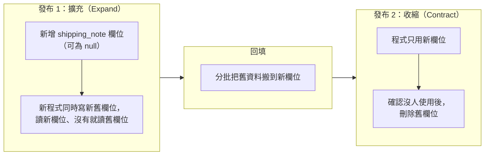

## 這是什麼

程式改版常常伴隨資料表結構的變更：加一個欄位、改欄位名稱、加一個索引。EF Core 的 **Migration** 會比對模型的變化，產生對應的 SQL（DDL），並在資料庫的 `__EFMigrationsHistory` 表記錄已經套用到哪一版。

問題在「怎麼套用到正式環境」。服務有好幾個 Pod，部署時新舊版本會同時存在一段時間；資料表很大時，一句 DDL 可能要鎖住表好幾分鐘。這篇說明如何在不停機的情況下改結構。

## 運作原理



rolling update 期間，舊版 Pod 和新版 Pod 同時連到同一個資料庫。所以任何結構變更都必須讓**舊程式**也能正常運作。直接改欄位名稱，舊版 Pod 會立刻因找不到欄位而出錯。

**Expand／Contract** 把一個破壞性變更拆成兩次發布：第一次只「加」，新舊程式都能運作；確認舊版完全下線、資料回填完成後，第二次才「刪」。

DDL 需要取得資料表的鎖。PostgreSQL 的 `ALTER TABLE` 要等表上所有進行中的交易結束，等待期間，後面所有讀寫這張表的請求也會排在它後面。一個長交易沒結束，整張表的流量就可能被卡住。

## 常見錯誤與正確寫法

### 1. 每個 Pod 啟動時自動 Migrate

```csharp
// 錯：十個 Pod 同時啟動，同時嘗試套用 migration；某個 Pod 失敗會反覆重啟
using var scope = app.Services.CreateScope();
scope.ServiceProvider.GetRequiredService<ShopDbContext>().Database.Migrate();
```

應用程式的帳號也因此需要 DDL 權限，權限過大。改成由部署流程在發布前執行一次。EF Core 可以產生**冪等的 SQL 腳本**（每一段都先檢查是否已套用），或產生一個可執行的 **migration bundle**：

```bash
# 冪等腳本：給 DBA 審核，或由 CI 執行
dotnet ef migrations script --idempotent --output migrate.sql

# 或產生單一執行檔，在 Kubernetes Job 中執行
dotnet ef migrations bundle --self-contained --runtime linux-x64 --output efbundle
./efbundle --connection "$MIGRATION_CONNECTION_STRING"
```

Kubernetes 上用一個 `Job` 執行 migration，成功後才更新 Deployment，見 [CI/CD](/engineering/ci-cd/)。

### 2. 直接改名或刪除欄位

```csharp
// 錯：舊版 Pod 還在查詢 note 欄位，立刻出錯
migrationBuilder.RenameColumn(name: "note", table: "orders", newName: "shipping_note");
```

照 Expand／Contract 分兩次發布：先加 `shipping_note`、程式雙寫、回填資料；下一次發布再刪 `note`。

### 3. 大表加索引鎖住寫入

PostgreSQL 一般的 `CREATE INDEX` 會擋住整張表的寫入直到建好。用 `CONCURRENTLY` 可以邊建邊允許寫入，但它不能在交易裡執行，所以要關閉 migration 的交易：

```csharp
protected override void Up(MigrationBuilder migrationBuilder)
{
    migrationBuilder.Sql(
        "CREATE INDEX CONCURRENTLY IF NOT EXISTS ix_orders_buyer_created ON orders (buyer_id, created_at DESC);",
        suppressTransaction: true);
}
```

`CONCURRENTLY` 失敗時會留下一個標記為無效的索引，要先刪掉再重建，見 [大量寫入與保留](/data-access/bulk-retention/)。

### 4. DDL 無限等待鎖，卡住所有流量

在 DDL 前設定鎖等待上限，等不到就失敗，稍後重試，而不是讓整張表的流量排在它後面：

```sql
SET lock_timeout = '5s';
ALTER TABLE orders ADD COLUMN shipping_note text;
```

MySQL 的 DDL 需要 metadata lock，長交易同樣會讓它等待；可以用 `lock_wait_timeout` 限制等待時間，並優先使用支援 `ALGORITHM=INPLACE, LOCK=NONE` 的線上 DDL。

## 使用邊界

- PostgreSQL 的 DDL 可以放在交易裡，失敗會整個回滾；MySQL 的 DDL 會隱含提交，一個 migration 中途失敗，前面的步驟已經生效，要手動處理。
- 加欄位並給預設值，在 PostgreSQL 11 以上不需要改寫整張表；但加 `NOT NULL` 約束、改欄位型別仍可能需要掃描或重寫，先在相同資料量的環境測試耗時。
- 回滾程式不會回滾資料表結構。發布前先確認：新結構下舊版程式還能不能跑。

## 雲端排查

### 叢集層（GKE 與 EKS 相同）

```bash
# migration Job 的狀態與輸出
kubectl get job -n shop db-migrate
kubectl logs -n shop job/db-migrate
```

Job 一直沒有完成，先看輸出是否停在某一句 DDL 上，再到資料庫查是誰擋住它。

### 託管服務層

#### 兩邊相同：DDL 在等誰

```sql
-- PostgreSQL：正在等待鎖的 DDL，以及擋住它的交易
SELECT pid, wait_event_type, now() - query_start AS waiting, left(query, 80) AS query,
       pg_blocking_pids(pid) AS blocked_by
FROM pg_stat_activity
WHERE query ILIKE 'ALTER TABLE%' OR query ILIKE 'CREATE INDEX%';
```

```sql
-- MySQL 8：metadata lock 的持有與等待
SELECT OBJECT_NAME, LOCK_TYPE, LOCK_STATUS, OWNER_THREAD_ID
FROM performance_schema.metadata_locks
WHERE OBJECT_SCHEMA = 'shop';
```

```sql
-- 已套用到哪一版 migration
SELECT "MigrationId", "ProductVersion" FROM "__EFMigrationsHistory" ORDER BY "MigrationId" DESC LIMIT 5;
```

#### GKE

Cloud SQL 會把資料庫日誌送到 Cloud Logging，可以查詢 migration 期間的錯誤：

```bash
gcloud logging read 'resource.type="cloudsql_database" AND severity>=ERROR' --freshness=1h --limit=20
```

#### EKS

CloudWatch `AWS/RDS` 的 `DatabaseConnections` 在 DDL 等待期間會快速上升（請求排隊、連線無法歸還）；RDS 的資料庫日誌可以發布到 CloudWatch Logs 查詢錯誤。

### 應用程式層

新版 Pod 啟動後出現「欄位不存在」的錯誤，代表程式比 migration 先上線；舊版 Pod 出現同樣錯誤，代表 migration 做了舊程式不相容的變更，要回頭檢查是否違反 Expand／Contract。
