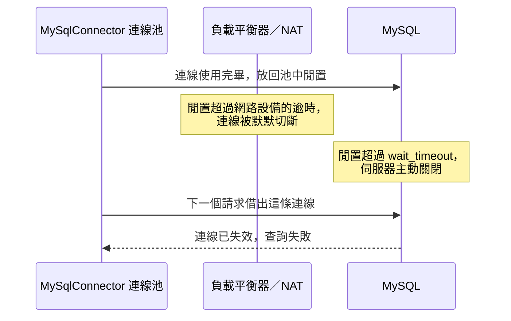

## 這是什麼

.NET 連 MySQL 有兩個常見的 driver：Oracle 的 `MySql.Data`（Connector/NET）與開源的 **MySqlConnector**。MySqlConnector 從頭以非同步 I/O 實作，`await` 時真的會把執行緒還回去；這對高併發的 Web API 很重要，見 [async/await](/languages/csharp/async-await/)。EF Core 的 MySQL provider（Pomelo）也是建立在 MySqlConnector 之上。

這篇說明用 MySqlConnector 連 MySQL 時，最常遇到的三個問題：連線無故斷開、取消請求後查詢還在跑、型別對應不如預期。

## 運作原理



連線池裡的閒置連線，可能被兩方切斷：

- **MySQL 伺服器**：閒置超過 `wait_timeout`（預設 8 小時）就關閉。
- **中間的網路設備**：負載平衡器、NAT、防火牆對閒置連線也有逾時，常常比 8 小時短很多。

MySqlConnector 用 `ConnectionIdleTimeout`（預設 180 秒）主動回收閒置太久的連線，借出連線時也會做重設檢查。只要池的回收時間短於網路與伺服器的逾時，就不容易借到已失效的連線。

**取消**：MySQL 的通訊協定在查詢執行時不能插話。MySqlConnector 收到取消時，會另外開一條連線送出 `KILL QUERY`，讓伺服器停止那句查詢。

## 常見錯誤與正確寫法

### 1. 使用同步 API 或舊 driver

```csharp
// 錯：同步呼叫佔住執行緒
using var conn = new MySqlConnection(cs);
conn.Open();
var count = (long)new MySqlCommand("SELECT COUNT(*) FROM orders", conn).ExecuteScalar()!;
```

改用 MySqlConnector 的 DataSource 與非同步 API：

```csharp
// 套件：MySqlConnector、MySqlConnector.DependencyInjection
builder.Services.AddMySqlDataSource(builder.Configuration.GetConnectionString("Shop")!);

public sealed class OrderCounter(MySqlDataSource dataSource)
{
    public async Task<long> CountAsync(CancellationToken ct)
    {
        await using var conn = await dataSource.OpenConnectionAsync(ct);
        await using var cmd = new MySqlCommand("SELECT COUNT(*) FROM orders", conn);
        return (long)(await cmd.ExecuteScalarAsync(ct))!;
    }
}
```

### 2. 沒有設定合理的連線選項

```text
Server=10.0.0.5;Database=shop;User ID=order_api;SslMode=VerifyFull;MaximumPoolSize=20;ConnectionIdleTimeout=60;DefaultCommandTimeout=10;ConnectionTimeout=5
```

| 選項 | 這裡的值 | 用途 |
| --- | --- | --- |
| `SslMode` | `VerifyFull` | 加密連線並驗證伺服器憑證 |
| `MaximumPoolSize` | 20 | 依連線預算計算，不要用預設的 100 |
| `ConnectionIdleTimeout` | 60 | 閒置 60 秒就回收，短於網路與伺服器的逾時 |
| `DefaultCommandTimeout` | 10 | 單一 SQL 最多執行 10 秒 |
| `ConnectionTimeout` | 5 | 建立連線最多等 5 秒 |

密碼不要寫在連線字串的設定檔裡，由 Secret 注入。

`MaximumPoolSize` 要和所有 Pod 的總數一起算，見 [連線池預算](/data-access/pool-capacity/)。

### 3. 取消請求，卻沒把 CancellationToken 傳下去

買家關掉頁面，但查詢沒有收到取消，MySQL 會繼續把它跑完，佔著 CPU 和連線。只要把 `CancellationToken` 傳給 `ExecuteReaderAsync`／`ExecuteScalarAsync`（EF Core 則是 `ToListAsync(ct)`），MySqlConnector 就會替你送出 `KILL QUERY`。

### 4. TINYINT(1) 被讀成 bool

MySqlConnector 預設 `TreatTinyAsBoolean=true`：`TINYINT(1)` 欄位會被讀成 `bool`。如果這個欄位其實存的是 0～9 的小數字（例如評分），讀出來會變成 true／false。小數字欄位用 `TINYINT UNSIGNED`（不加長度）或其他整數型別，或在連線字串關閉這個選項。

## 使用邊界

- MySQL InnoDB 預設隔離等級是 Repeatable Read，鎖的行為和 PostgreSQL 不同，見 [隔離與鎖](/data-access/isolation-locking/)。
- InnoDB 的效能很依賴 buffer pool（記憶體中的資料頁快取）；工作集超過 buffer pool 時，查詢會大量讀磁碟。託管資料庫的機器規格決定 buffer pool 的大小。
- 大量匯入用 `MySqlBulkCopy`，需要伺服器允許 `local_infile`，見 [大量寫入與保留](/data-access/bulk-retention/)。

## 雲端排查

### 叢集層（GKE 與 EKS 相同）

```bash
# 應用程式日誌中的連線中斷錯誤
kubectl logs -n shop -l app=order-api --since=30m | grep -i -E "connection.*(reset|closed|lost)" | tail
```

### 託管服務層

#### 兩邊相同：連線狀態與異常中斷

```sql
-- 被異常中斷的用戶端與連線
SHOW GLOBAL STATUS LIKE 'Aborted_%';

-- 目前連線，以及執行中的長查詢
SELECT id, user, host, command, time, state, left(info, 80) AS query
FROM information_schema.processlist
WHERE command <> 'Sleep' ORDER BY time DESC LIMIT 20;
```

`Aborted_clients` 持續增加，代表用戶端沒有正常關閉連線就斷了，常見原因是網路逾時切斷閒置連線。

#### GKE

Cloud SQL for MySQL 的連線數指標是 `cloudsql.googleapis.com/database/network/connections`；CPU 與記憶體看 `database/cpu/utilization`、`database/memory/utilization`。

#### EKS

CloudWatch `AWS/RDS` 的 `DatabaseConnections`、`CPUUtilization`、`FreeableMemory`。`FreeableMemory` 持續偏低，代表執行個體的記憶體不足以容納工作集，讀取會落到磁碟（`ReadIOPS` 同時上升）。

### 應用程式層

連線失效的錯誤集中在「長時間沒有流量之後的第一批請求」，就是閒置連線被網路切斷；把 `ConnectionIdleTimeout` 調短。錯誤分散在所有時段，則要看網路或資料庫本身的狀況。
