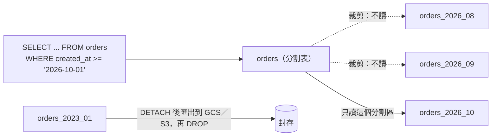

## 這是什麼

訂單表一年新增三千萬筆，三年後超過一億筆。問題會一個個出現：清理過期資料的 DELETE 越跑越久、索引大到記憶體放不下、備份與還原時間越來越長。這時有三種常見的做法，解決的問題不同：

- **表分割（partition）**：一張邏輯上的表，在資料庫內部依某個欄位（通常是時間）拆成很多小表。應用程式照樣查 `orders`，資料庫自動只讀相關的分割區。
- **封存（archive）**：把很少查詢的舊資料搬出線上資料庫，存到物件儲存（GCS、S3）或資料倉儲。
- **分片（shard）**：把資料拆到多個獨立的資料庫執行個體，每台只放一部分。

## 運作原理



**分割區裁剪（partition pruning）**：查詢條件包含分割鍵時，資料庫只讀相關的分割區。條件裡沒有分割鍵，就要掃描所有分割區，反而比不分割更慢。

**清理變成瞬間完成**：依月份分割後，刪除三年前的資料不再是一句刪除幾千萬筆的 DELETE，而是把整個分割區卸下（DETACH）再刪除（DROP），幾乎不產生變更日誌，也不會留下 dead tuples。

**分片**把資料分散到多台資料庫，每台的負擔變小；代價是跨分片的查詢、交易與唯一約束都要由應用程式自己處理。

## 常見錯誤與正確寫法

### 1. 用 DELETE 清理大表的歷史資料

依時間分割後，以分割區為單位處理：

```sql
-- 依月份分割的訂單表
CREATE TABLE orders (
    id uuid NOT NULL,
    buyer_id uuid NOT NULL,
    created_at timestamptz NOT NULL,
    total_amount numeric(12, 2) NOT NULL,
    PRIMARY KEY (id, created_at)          -- 分割表的主鍵與唯一約束必須包含分割鍵
) PARTITION BY RANGE (created_at);

CREATE TABLE orders_2026_10 PARTITION OF orders
    FOR VALUES FROM ('2026-10-01') TO ('2026-11-01');

-- 清理：先卸下（不再屬於 orders），確認已封存後再刪除
ALTER TABLE orders DETACH PARTITION orders_2023_10 CONCURRENTLY;
DROP TABLE orders_2023_10;
```

未來月份的分割區要事先建立；沒有對應分割區的資料寫入會失敗。用排程作業或擴充套件（例如 pg_partman）自動建立。

### 2. 查詢條件沒有分割鍵

```sql
-- 錯：只用訂單 ID 查，資料庫不知道在哪個分割區，只能每個都查
SELECT * FROM orders WHERE id = $1;
```

讓查詢帶上分割鍵。例如訂單 ID 使用依時間排序的 UUIDv7，前端或 API 同時保留建立時間，查詢時一併帶上：`WHERE id = $1 AND created_at = $2`。

### 3. 分片鍵選錯造成熱點

依「商家 ID」分片，結果某個大品牌的流量佔了全站的四成，它所在的那台資料庫永遠最忙。分片鍵要能讓資料與流量平均分散，而且大部分查詢只需要碰一個分片。電商常見的選擇是買家 ID，因為「我的訂單」「我的購物車」都只看一個買家。

## 使用邊界

- **順序：先優化查詢與索引，再考慮分割，最後才考慮分片。** 很多「大表很慢」的問題，加對索引或改用 keyset 分頁就解決了，見 [上億筆資料的查詢](/data-access/large-table-queries/)。
- 分割的價值主要在**維護**（清理、封存、vacuum 範圍變小），不一定讓單筆查詢更快。
- MySQL 的分割表有較多限制，例如 InnoDB 分割表不支援外鍵；採用前先核對官方的限制清單。
- 分片之後，跨分片的報表交給資料倉儲；跨分片的一致性交給事件與最終一致性，見 [Outbox 與 Inbox](/architecture/outbox-inbox/)。

## 雲端排查

### 叢集層（GKE 與 EKS 相同）

```bash
# 建立未來分割區的排程作業，最近一次是否成功
kubectl get cronjob -n shop orders-partition-maintenance
kubectl logs -n shop job/$(kubectl get jobs -n shop -l app=orders-partition-maintenance \
  --sort-by=.status.startTime -o jsonpath='{.items[-1].metadata.name}')
```

### 託管服務層

#### 兩邊相同：裁剪是否生效、各分割區大小

```sql
-- 執行計畫中只出現目標分割區，代表裁剪生效
EXPLAIN SELECT count(*) FROM orders WHERE created_at >= '2026-10-01' AND created_at < '2026-11-01';

-- 各分割區的大小，以及是否已建立下個月的分割區
SELECT c.relname, pg_size_pretty(pg_total_relation_size(c.oid)) AS size
FROM pg_inherits i JOIN pg_class c ON c.oid = i.inhrelid
WHERE i.inhparent = 'orders'::regclass ORDER BY c.relname DESC LIMIT 6;
```

#### GKE

卸下的分割區可以先匯出到 Cloud Storage 再刪除（`gcloud sql export csv` 搭配 `--query` 匯出指定的表）。磁碟用量看 `cloudsql.googleapis.com/database/disk/utilization`。

#### EKS

RDS 可以把快照中的資料表匯出到 S3（`aws rds start-export-task`），作為封存。磁碟用量看 CloudWatch `AWS/RDS` 的 `FreeStorageSpace`。

### 應用程式層

寫入出現「沒有符合的分割區」錯誤，代表下個月的分割區沒有建立；這是可以事先預防的，為維護作業的失敗設定告警。
