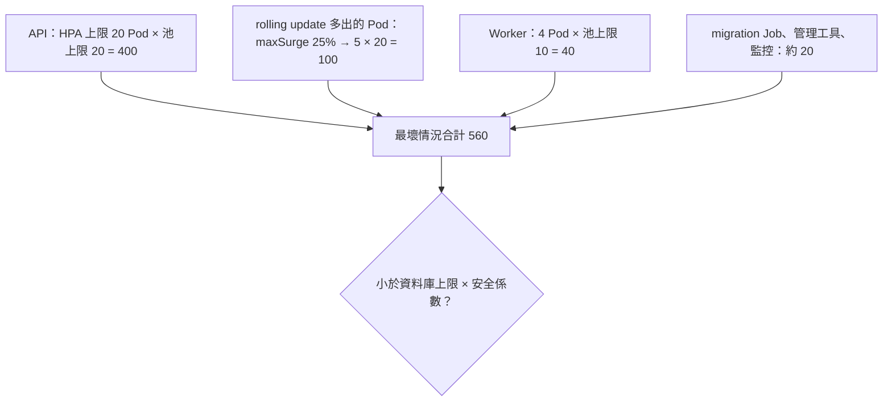

## 這是什麼

每個 API Pod 的 Npgsql 連線池上限是 50，看起來不多。但 HPA 在大促時把 API 擴到 20 個 Pod，加上 4 個 Worker、rolling update 期間多出來的 Pod，所有池子加起來可能要 1,300 條連線，而資料庫的上限只有 500。結果是新的連線被拒絕，或資料庫因為太多連線而變慢。

**連線池預算**就是把整個系統可能開出的連線總數算清楚，確保它在資料庫承受得住的範圍內。

## 運作原理

**需要多少連線：利特爾法則。** 系統中同時在處理的工作數 = 到達速率 × 每件工作停留的時間。套用到連線：

> 同時需要的連線數 ≈ 每秒資料庫操作數 × 每次操作佔用連線的秒數

每秒 2,000 次查詢、每次佔用 5 毫秒，同時只需要約 10 條連線。如果每次佔用 50 毫秒（例如交易裡做了太多事），就需要 100 條。縮短佔用時間，比加大池子更有效。

**最多會開出多少連線：**



資料庫的連線上限不是越大越好。PostgreSQL 每條連線一個程序，連線太多時記憶體與排程成本會拖慢所有查詢。託管資料庫的預設上限通常依機器規格決定。

## 常見錯誤與正確寫法

### 1. 每個服務用預設的池上限

Npgsql 和 MySqlConnector 的 `Maximum Pool Size` 預設都是 100。每個服務都不設定，系統一大就超過上限。依上面的算法，為每個服務明確設定池上限，並把算式寫在部署設定旁邊。

### 2. 讓所有請求都去搶連線

尖峰時，500 個請求同時進來，每個都去借連線。池滿了，後來的請求在池裡排隊，直到 `Timeout`（Npgsql 預設 15 秒）才失敗。這 15 秒裡，請求佔著執行緒和記憶體，用戶端也在等。

在應用程式入口限制同時處理的數量，超過就快速拒絕（回 503 或 429），讓用戶端稍後重試，而不是讓所有人一起慢：

```csharp
// 同時最多 64 個下單請求在處理，另外最多 100 個排隊；再多就直接回 503
builder.Services.AddRateLimiter(options =>
{
    options.RejectionStatusCode = StatusCodes.Status503ServiceUnavailable;
    options.AddConcurrencyLimiter("orders-db", limiter =>
    {
        limiter.PermitLimit = 64;
        limiter.QueueLimit = 100;
    });
});

app.UseRateLimiter();
app.MapPost("/orders", PlaceOrder).RequireRateLimiting("orders-db");
```

`Timeout` 也要調短（例如 3～5 秒），借不到連線就早點失敗，不要讓請求堆積。

### 3. 只算 API，忘了 rolling update

部署新版本時，Deployment 會先建立新 Pod，再刪除舊 Pod。`maxSurge` 決定最多多出幾個 Pod，這段時間的連線數會比平常高。預算要用「HPA 上限 + maxSurge」計算。

## 使用邊界

- Pod 數量大、而且隨流量大幅變動時，考慮在中間加連線池代理（RDS Proxy、PgBouncer），讓很多應用程式連線共用較少的資料庫連線。GKE 上的 Cloud SQL Auth Proxy 不提供連線共用，見 [連線池、交易與鎖](/data-access/pools-locks/)。
- 上面的計算是起點；實際的值要用接近真實的負載驗證，見 [容量驗證](/data-access/load-validation/)。
- HPA 的上限要和資料庫預算一起決定，見 [自動擴縮](/platforms/kubernetes/autoscaling/)。

## 雲端排查

### 叢集層（GKE 與 EKS 相同）

```bash
# 各服務目前與上限的 Pod 數：乘上各自的池上限，就是可能的最大連線數
kubectl get hpa -n shop
kubectl get deployment -n shop -o custom-columns=NAME:.metadata.name,READY:.status.readyReplicas,SURGE:.spec.strategy.rollingUpdate.maxSurge
```

### 託管服務層

#### 兩邊相同：連線上限與目前用量

```sql
-- PostgreSQL：上限、保留給管理者的連線，以及目前各服務的連線數
SHOW max_connections;
SHOW superuser_reserved_connections;
SELECT application_name, count(*) FROM pg_stat_activity GROUP BY 1 ORDER BY 2 DESC;
```

#### GKE

Cloud SQL 的 `cloudsql.googleapis.com/database/postgresql/num_backends` 對照 `max_connections` 設定告警，例如超過 80% 時通知。MySQL 執行個體看 `database/network/connections`。

#### EKS

CloudWatch `AWS/RDS` 的 `DatabaseConnections` 對照執行個體的連線上限設定告警；使用 RDS Proxy 時再看 `DatabaseConnectionsBorrowLatency`，它升高代表 Proxy 拿不到底層連線，見 [EKS 資料服務](/platforms/eks/data-services/)。

### 應用程式層

ASP.NET Core 的限流中介軟體提供 `aspnetcore.rate_limiting.*` 指標（例如被拒絕的請求數與排隊時間）。被拒絕的數量持續上升，代表入口限制比實際容量小，或資料庫操作的佔用時間變長了。
