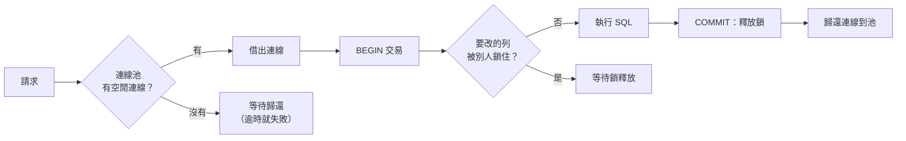

## 這是什麼

資料庫變慢時，最常聽到的建議是「把連線池開大一點」。這有時有效，有時讓情況更糟，因為慢的原因可能根本不是連線不夠。先分清三件事：

- **連線池**：建立資料庫連線很貴（TCP、TLS、登入），所以用完不關，放回池子給下一個請求用。它解決的是「建立連線的成本」。
- **交易**：決定哪些操作要一起提交或一起取消。它解決的是「資料一致性」。
- **鎖**：兩個交易要改同一筆資料時，讓後到的等前面的做完。它解決的是「同時修改的衝突」。

## 運作原理



注意圖中有兩個「等待」，原因完全不同：

- **等連線**：池子裡的連線都被借走了。原因可能是池太小，也可能是每條連線被佔用太久。
- **等鎖**：拿到了連線，但要改的資料被別的交易鎖住。這時加大連線池，只會讓更多連線一起卡在等鎖，還額外佔用資料庫的資源。

連線在整個交易期間都被佔用。交易越長（例如中間呼叫外部 API），連線被佔越久，池子越快見底；同時鎖也持有越久，其他人等越久。兩個問題常常是同一個原因造成的。

## 常見錯誤與正確寫法

### 1. 慢就加大連線池

先判斷在等什麼：資料庫端大量連線的 `wait_event_type` 是 `Lock`，代表在等鎖，要找的是「誰持有鎖太久」；應用程式端出現「無法從連線池取得連線」的錯誤，而資料庫端連線大多是 `idle`（閒置），代表連線沒有被正確歸還。

### 2. 連線沒有歸還（連線洩漏）

```csharp
// 錯：例外發生時沒有關閉連線，這條連線永遠不會回到池子
var conn = await dataSource.OpenConnectionAsync(ct);
var cmd = new NpgsqlCommand("SELECT ...", conn);
var result = await cmd.ExecuteScalarAsync(ct);
await conn.CloseAsync();
```

用 `await using`，不管成功或例外都會歸還：

```csharp
await using var conn = await dataSource.OpenConnectionAsync(ct);
await using var cmd = new NpgsqlCommand("SELECT price FROM products WHERE id = $1", conn)
{
    Parameters = { new() { Value = productId } },
};
var price = (decimal?)await cmd.ExecuteScalarAsync(ct);
```

使用 EF Core 時，`DbContext` 會自己管理連線，只要 `DbContext` 被正確釋放（由 DI 的 scope 管理）就不會洩漏。

### 3. 長交易同時拖垮連線池與鎖

交易中只放資料庫操作，外部呼叫移到交易之外，見 [交易](/data-access/transactions/)。這同時縮短連線佔用時間與鎖持有時間。

## 使用邊界

- **兩層池不要混淆。** EF Core 的 `AddDbContextPool` 重複使用的是 `DbContext` 物件，省的是建立物件的成本；資料庫連線池在 driver 層（Npgsql、MySqlConnector），兩者是不同的東西。
- **Cloud SQL Auth Proxy 不是連線池。** 它負責 IAM 授權與加密連線，每個應用程式連線都對應一條資料庫連線；池仍然在 driver 裡。**RDS Proxy** 則是真正的連線池，可以讓多個應用程式連線共用較少的資料庫連線，見 [EKS 資料服務](/platforms/eks/data-services/)。
- 池該設多大、所有 Pod 加起來會不會超過資料庫上限，見 [連線池預算](/data-access/pool-capacity/)。

## 雲端排查

### 叢集層（GKE 與 EKS 相同）

```bash
# 應用程式取不到連線時，Npgsql 會丟出連線池耗盡相關的逾時例外
kubectl logs -n shop -l app=order-api --since=15m | grep -i -E "pool|timeout" | tail -20
```

### 託管服務層

#### 兩邊相同：連線在做什麼

```sql
-- 依狀態與等待類型統計所有連線
SELECT state, wait_event_type, count(*)
FROM pg_stat_activity
WHERE datname = 'shop'
GROUP BY state, wait_event_type
ORDER BY count(*) DESC;
```

- `active` 且 `wait_event_type = 'Lock'` 很多：在等鎖，找出擋住它們的交易（`pg_blocking_pids`）。
- `idle in transaction` 很多：交易開著沒在做事，程式在交易中做了別的事或忘了提交。
- `idle` 很多、應用程式卻說取不到連線：應用程式的池上限太小，或連線被其他程序佔用。

#### GKE

Cloud SQL 的 `cloudsql.googleapis.com/database/postgresql/num_backends` 是目前的連線數。如果使用 Auth Proxy sidecar，記得每個 Pod 的連線都直接對應資料庫連線。

#### EKS

CloudWatch `AWS/RDS` 的 `DatabaseConnections`；使用 RDS Proxy 時，另外比較 Proxy 的 `ClientConnections`（應用程式連到 Proxy）與 `DatabaseConnections`（Proxy 連到資料庫）。

### 應用程式層

Npgsql 等待連線的時間上限由連線字串的 `Timeout` 決定（預設 15 秒）。請求在等連線時就逾時，日誌會出現連線池耗盡的訊息；這時對照資料庫端的連線狀態，判斷是池太小、連線洩漏，還是在等鎖。
