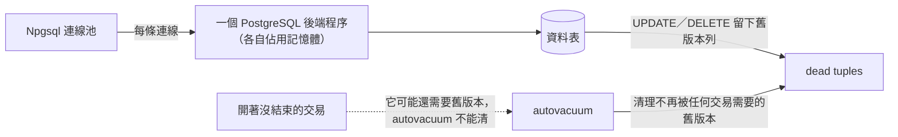

## 這是什麼

**Npgsql** 是 .NET 連 PostgreSQL 的 driver，EF Core 的 PostgreSQL provider 也建立在它上面。它從 7.0 起以 `NpgsqlDataSource` 為中心：一個 DataSource 擁有一組設定與一個連線池，見 [C# 連線設計](/data-access/csharp-connections/)。

PostgreSQL 有幾個和 MySQL 很不一樣的特性，會直接影響 C# 端的寫法：每條連線都是一個獨立的作業系統程序、更新資料時舊版本會留在表裡等待清理、而一個沒結束的交易會讓清理工作卡住。

## 運作原理



**每條連線一個程序。** PostgreSQL 為每條連線建立一個後端程序，每個程序都有自己的記憶體。幾百條連線就會佔用可觀的記憶體與 CPU 排程成本，所以 PostgreSQL 的連線數上限通常不能設得很大。

**MVCC 與 dead tuples。** PostgreSQL 更新一列時，不是原地修改，而是寫一個新版本，舊版本留著給還在讀的交易使用。不再被任何交易需要的舊版本叫 dead tuple，由 **autovacuum** 定期清理回收。

**長交易讓清理卡住。** 只要還有一個交易開著，它開始之後產生的舊版本就都不能清。一個忘了提交的交易開了幾小時，資料表會不斷膨脹、查詢變慢。

**交易 ID 回捲（XID wraparound）。** PostgreSQL 的交易 ID 有上限，autovacuum 會定期「凍結」舊資料來重複使用 ID。如果清理長期被擋住，資料庫會在接近上限時強制停止寫入以保護資料。這是要監控的嚴重風險。

## 常見錯誤與正確寫法

### 1. 交易開著不關

程式在交易中呼叫外部服務、等使用者輸入、或例外時沒有回滾，都會留下 `idle in transaction` 的連線。在資料庫或使用者層級設定逾時，讓它自動結束：

```sql
-- 對應用程式使用的帳號設定：交易中閒置超過 60 秒就終止該工作階段
ALTER ROLE order_api SET idle_in_transaction_session_timeout = '60s';
```

程式端則確保交易一定被提交或回滾：`await using var tx = ...` 在離開範圍時，沒提交的交易會自動回滾。

### 2. 連線字串沒有設定逾時與上限

```text
Host=127.0.0.1;Port=5432;Database=shop;Username=order_api;SSL Mode=VerifyFull;Maximum Pool Size=20;Timeout=5;Command Timeout=10;Application Name=order-api
```

| 選項 | 這裡的值 | 用途 |
| --- | --- | --- |
| `Maximum Pool Size` | 20 | 依連線預算計算（預設 100） |
| `Timeout` | 5 | 建立連線或等待池中空閒連線的上限（秒，預設 15） |
| `Command Timeout` | 10 | 單一命令的執行上限（秒，預設 30） |
| `Application Name` | order-api | 讓資料庫端分辨連線來源 |

### 3. 經過 PgBouncer 的交易模式卻使用工作階段狀態

PgBouncer 這類連線池代理在「交易模式」下，每個交易可能分配到不同的資料庫連線。在連線上 `SET` 的參數、建立的暫存表，下一個交易就不見了。Npgsql 的自動 prepared statement（`Max Auto Prepare`）也依賴同一條連線；較新的 PgBouncer 支援協定層級的 prepared statement，但需要對應設定。使用前依 Npgsql 的相容性文件調整，或在交易模式下關閉自動準備。

### 4. 大量匯入逐筆 INSERT

逐筆 INSERT 每筆都要一次往返。PostgreSQL 的 `COPY` 以串流方式寫入，Npgsql 提供 `BeginBinaryImportAsync`：

```csharp
await using var conn = await dataSource.OpenConnectionAsync(ct);
await using var writer = await conn.BeginBinaryImportAsync(
    "COPY products (id, name, price) FROM STDIN (FORMAT BINARY)", ct);
foreach (var p in products)
{
    await writer.StartRowAsync(ct);
    await writer.WriteAsync(p.Id, NpgsqlDbType.Integer, ct);
    await writer.WriteAsync(p.Name, NpgsqlDbType.Text, ct);
    await writer.WriteAsync(p.Price, NpgsqlDbType.Numeric, ct);
}
await writer.CompleteAsync(ct); // 沒有呼叫 Complete，整批會被回滾
```

## 使用邊界

- PostgreSQL 預設隔離等級是 Read Committed，和 MySQL 的 Repeatable Read 不同，見 [隔離與鎖](/data-access/isolation-locking/)。
- 連線數上限要靠「少量連線、短時間使用」來應對，不是一味調高 `max_connections`；Pod 數多時考慮連線池代理（RDS Proxy、PgBouncer）。
- autovacuum 的參數可以依表調整（例如更新頻繁的表更積極清理）；調整前先確認是長交易擋住，而不是參數太保守。

## 雲端排查

### 叢集層（GKE 與 EKS 相同）

```bash
# 找出持有長交易的 Pod：先從資料庫查出 application_name 與 client_addr，再對應 Pod IP
kubectl get pods -n shop -o wide | grep <client_addr>
```

### 託管服務層

#### 兩邊相同：長交易、dead tuples 與 XID 年齡

```sql
-- 閒置在交易中的連線
SELECT pid, application_name, now() - xact_start AS xact_age, state
FROM pg_stat_activity
WHERE state = 'idle in transaction' ORDER BY xact_age DESC;

-- dead tuples 最多、最久沒被清理的表
SELECT relname, n_live_tup, n_dead_tup, last_autovacuum
FROM pg_stat_user_tables ORDER BY n_dead_tup DESC LIMIT 10;

-- 每個資料庫的交易 ID 年齡（越接近 20 億越危險）
SELECT datname, age(datfrozenxid) FROM pg_database ORDER BY 2 DESC;
```

#### GKE

Cloud SQL 的 `cloudsql.googleapis.com/database/postgresql/transaction_id_utilization` 顯示交易 ID 的使用比例，持續上升要立刻找出擋住清理的長交易；連線數看 `database/postgresql/num_backends`。

#### EKS

CloudWatch `AWS/RDS` 的 `MaximumUsedTransactionIDs` 顯示最大的未凍結交易 ID；設定告警，接近危險範圍前就處理。記憶體壓力看 `FreeableMemory`，連線數看 `DatabaseConnections`。

### 應用程式層

`Application Name` 讓你從資料庫端的 `pg_stat_activity` 直接看出是哪個服務留下了長交易，再到那個服務的追蹤中找出交易期間做了什麼。
