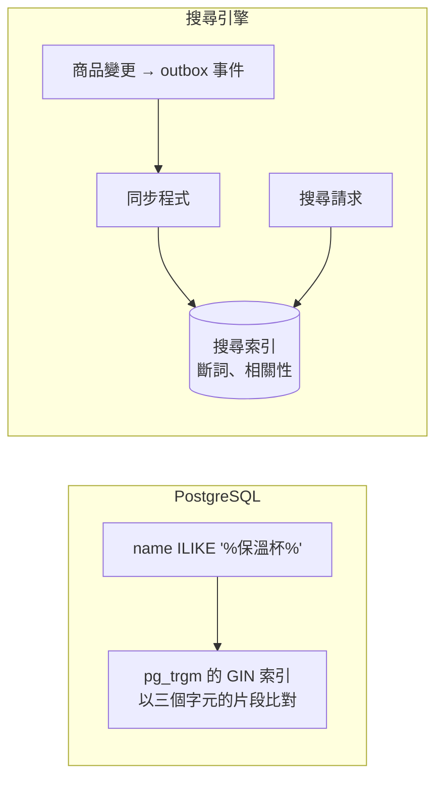

## 這是什麼

買家在搜尋框輸入「保溫杯」，要找出名稱或描述中包含這個詞的商品。最直覺的寫法是 `WHERE name LIKE '%保溫杯%'`，但開頭的 `%` 讓一般的 B-tree 索引用不上，資料庫只能逐筆比對，商品越多越慢，見 [SQL 查詢基礎](/data-access/sql-foundations/)。

商品搜尋有兩條路：

- **在 PostgreSQL 裡做**：用擴充功能建立適合模糊比對或全文檢索的索引。不需要新的系統，資料一致。
- **用搜尋引擎**：OpenSearch、Elasticsearch 這類系統專門處理斷詞、相關性排序、篩選面板（品牌、價格區間的數量統計）與大量查詢。功能強，但要多維運一個系統，並同步資料。

## 運作原理



**pg_trgm**：把文字切成三個字元一組的片段（trigram），並建立 GIN 索引。`ILIKE '%保溫杯%'` 這類查詢可以先用索引找出包含相同片段的候選，再精確比對。少於三個字元的搜尋詞無法有效利用 trigram 索引。

**全文檢索**（`tsvector`）：把文字拆成詞並正規化，支援詞的比對與相關性排序。但 PostgreSQL 內建的斷詞器是依空白與標點拆詞，不懂中文的詞界；中文斷詞需要額外的擴充，而託管資料庫（Cloud SQL、RDS）可安裝的擴充有限，常常無法使用。

**搜尋引擎**以自己的索引回答查詢，資料從資料庫非同步同步過去，所以搜尋結果可能比資料庫稍晚更新。

## 常見錯誤與正確寫法

### 1. 用沒有索引的 LIKE 做搜尋

先啟用 pg_trgm 並建立索引（Cloud SQL 與 RDS 都支援這個擴充）：

```sql
CREATE EXTENSION IF NOT EXISTS pg_trgm;
CREATE INDEX CONCURRENTLY ix_products_name_trgm ON products USING gin (name gin_trgm_ops);
```

EF Core 的 `EF.Functions.ILike` 會翻譯成 `ILIKE`，就能使用這個索引：

```csharp
var keyword = request.Keyword.Trim();
var results = await db.Products.AsNoTracking()
    .Where(p => p.IsListed && EF.Functions.ILike(p.Name, $"%{keyword}%"))
    .OrderBy(p => p.Name)
    .Select(p => new ProductHit(p.Id, p.Name, p.Price))
    .Take(20)
    .ToListAsync(ct);
```

使用者輸入中的 `%` 與 `_` 是萬用字元，要先跳脫，否則搜尋「100%」會比對到意外的結果。

### 2. 用全文檢索處理中文卻沒有斷詞

`to_tsvector('simple', '不鏽鋼保溫杯')` 會把整串中文當成一個詞，搜尋「保溫杯」比對不到。在託管資料庫上無法安裝中文斷詞擴充時，中文的模糊比對用 pg_trgm；需要真正的中文斷詞與相關性排序時，就是改用搜尋引擎的訊號。

### 3. 搜尋引擎與資料庫雙寫

商品更新時，程式先寫資料庫、再寫搜尋引擎；第二步失敗，搜尋結果就和實際商品不一致，而且沒有人知道。用 outbox：商品變更與「商品已更新」事件在同一個交易中寫入，由背景程式把事件同步到搜尋引擎，失敗會重試，見 [Outbox 與 Inbox](/architecture/outbox-inbox/)。定期全量比對兩邊的資料，修正遺漏。

## 使用邊界

- **商品數在數萬到數十萬、查詢量不大時，pg_trgm 通常就夠了**，而且沒有資料同步的問題。
- 需要中文斷詞、同義詞、拼字容錯、依相關性與銷量綜合排序、篩選面板的即時統計，或搜尋流量很大、不想影響交易資料庫時，改用搜尋引擎。AWS 有託管的 Amazon OpenSearch Service；GCP 上可以使用 Elastic 的託管服務或自建。
- 搜尋結果只用來「找到商品」；加入購物車與結帳時，價格與庫存一律重新從資料庫讀取。
- 大量的搜尋查詢可以導到讀副本，避免影響主庫，見 [讀副本與災難復原](/data-access/replication-recovery/)。

## 雲端排查

### 叢集層（GKE 與 EKS 相同）

```bash
# 搜尋端點的延遲與錯誤
kubectl logs -n shop -l app=catalog-api --since=30m | grep "/search" | tail -20
```

### 託管服務層

#### 兩邊相同：索引有沒有被使用

```sql
-- 執行計畫中出現 Bitmap Index Scan on ix_products_name_trgm，代表有用到 trigram 索引
EXPLAIN ANALYZE
SELECT id, name FROM products WHERE is_listed AND name ILIKE '%保溫杯%' LIMIT 20;

-- 擴充是否已安裝
SELECT extname, extversion FROM pg_extension WHERE extname = 'pg_trgm';
```

#### GKE

Cloud SQL 的 Query Insights 中，搜尋查詢的平均耗時與執行次數；`cloudsql.googleapis.com/database/cpu/utilization` 隨搜尋流量明顯上升時，考慮把搜尋導到讀副本或改用搜尋引擎。

#### EKS

RDS 的 `CPUUtilization` 與 `ReadIOPS`；使用 Amazon OpenSearch Service 時，在 CloudWatch 的 `AWS/ES` 命名空間觀察叢集狀態（`ClusterStatus.red`、`ClusterStatus.yellow`）與搜尋延遲（`SearchLatency`）。

### 應用程式層

記錄搜尋詞的長度、結果數與耗時；大量「零結果」的搜尋代表斷詞或比對方式不符合買家的用語，是改善搜尋的重要線索。
