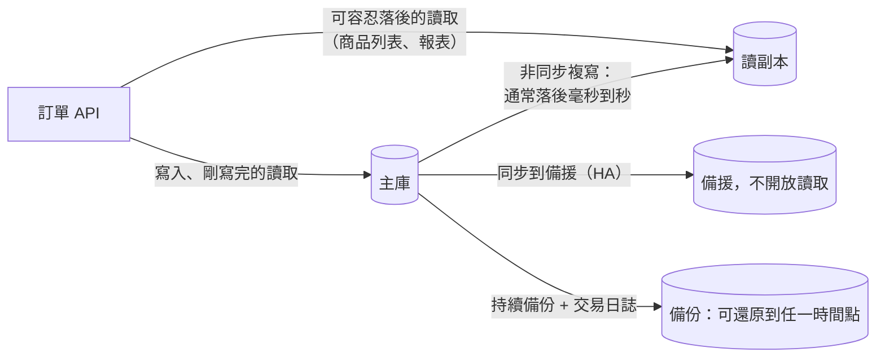

## 這是什麼

這篇談資料庫的兩件事：

- **讀副本**：主庫把變更持續複製到一或多台唯讀的副本，讀取流量可以分到副本上，減輕主庫負擔。
- **災難復原**：主庫故障時，切換到備援；資料被誤刪或損壞時，從備份還原到某個時間點。

兩者都和「時間差」有關。副本永遠比主庫慢一點；備份還原只能回到備份涵蓋的時間點。設計時要先接受這些時間差，再決定業務上怎麼處理。

## 運作原理



**讀副本是非同步複寫。** 買家下單後立刻跳到「我的訂單」頁面，如果這個查詢走到副本，訂單可能還沒複製過去，畫面上就看不到剛下的訂單。主庫有大交易或批次作業時，延遲可能從毫秒變成數分鐘。

**高可用（HA）與讀副本是兩回事。** HA 的備援通常不開放讀取，它的目的是主庫故障時接手。容錯移轉期間，既有的連線全部中斷，應用程式要重新連線：Cloud SQL 的 HA 移轉後 IP 不變；RDS Multi-AZ 移轉後端點的 DNS 會指向新的主庫，用戶端要重新解析 DNS。

**RPO 與 RTO。** RPO（復原點目標）是最多可以接受遺失多久的資料；RTO（復原時間目標）是最多可以接受停機多久。時間點還原（PITR）讓你可以還原到備份保留期間內的任一時間點，例如誤刪資料的前一分鐘。

## 常見錯誤與正確寫法

### 1. 所有查詢都導到讀副本

剛寫入就要讀的資料（下單後的訂單詳情、付款後的狀態）從主庫讀；容忍落後的查詢（商品列表、推薦、報表）才走副本。Npgsql 可以用多主機的 DataSource，依需求取得主庫或副本的連線：

```csharp
// 套件：Npgsql
var multiHost = new NpgsqlDataSourceBuilder(
        "Host=primary.internal,replica-1.internal;Database=shop;Username=order_api;SSL Mode=VerifyFull")
    .BuildMultiHost();

NpgsqlDataSource primary = multiHost.WithTargetSession(TargetSessionAttributes.Primary);
NpgsqlDataSource readOnly = multiHost.WithTargetSession(TargetSessionAttributes.PreferStandby);
```

兩個 DataSource 分別註冊，寫入與「讀自己剛寫的」用 `primary`，其他讀取用 `readOnly`。

### 2. 容錯移轉時應用程式整批失敗

主庫切換的幾十秒內，所有連線都會斷，進行中的交易失敗。要做到：

- 開啟 EF Core 或 driver 的暫時性錯誤重試，讓新的請求在切換後自動成功。
- 不要把資料庫的 IP 寫死；使用託管服務提供的端點名稱。RDS 的 DNS 會在移轉後改指向新主庫，JVM 等平台曾因 DNS 快取太久而連回舊主庫；.NET 不會無限期快取 DNS，但連線池中的舊連線要等失效才會被替換。
- 斷線時正在提交的交易結果不明，依 [高併發 CRUD](/data-access/concurrent-crud/)的方式用業務鍵查詢確認。

使用 RDS Proxy 可以縮短應用程式感受到的移轉時間，因為 Proxy 會替你接住連線，見 [EKS 資料服務](/platforms/eks/data-services/)。

### 3. 有備份但從沒還原過

備份檔存在，不代表還原得回來：可能少了某個權限、還原時間遠超過 RTO、或還原後應用程式的設定對不上。定期在隔離環境實際還原，量測花了多久、還原到哪個時間點，並核對訂單、outbox 與通知的資料是否一致。演練方式見 [還原演練與成本](/engineering/recovery-cost/)。

## 使用邊界

- 副本不是備份。誤刪資料會被複寫到副本上；要回到誤刪之前，只能靠時間點還原。
- 讀副本只分擔讀取；寫入量太大是主庫本身的容量問題，見 [分割與分片](/data-access/partitioning-sharding/)。
- 跨區域的副本可以支援區域級的災難，但延遲更高、成本也更高，要依 RPO／RTO 的需求決定。

## 雲端排查

### 叢集層（GKE 與 EKS 相同）

```bash
# 容錯移轉期間，API 的錯誤與重試
kubectl logs -n shop -l app=order-api --since=10m | grep -i -E "connection.*(refused|reset|terminat)|failover"
```

### 託管服務層

#### 兩邊相同：副本落後多少

```sql
-- 在副本上執行：最後套用的交易距今多久
SELECT now() - pg_last_xact_replay_timestamp() AS replication_delay;

-- 在主庫上執行：各副本的延遲
SELECT application_name, state, write_lag, replay_lag FROM pg_stat_replication;
```

#### GKE

副本延遲看 `cloudsql.googleapis.com/database/replication/replica_lag`。在測試環境演練 HA 移轉並確認備份：

```bash
gcloud sql instances failover shop-db-staging   # 觸發一次容錯移轉（只在測試環境）
gcloud sql backups list --instance=shop-db
```

#### EKS

副本延遲看 CloudWatch `AWS/RDS` 的 `ReplicaLag`。在測試環境以重新啟動觸發 Multi-AZ 移轉，並查看事件紀錄：

```bash
aws rds reboot-db-instance --db-instance-identifier shop-db-staging --force-failover
aws rds describe-events --source-type db-instance --source-identifier shop-db-staging --duration 60
```

### 應用程式層

記錄每次資料庫連線失敗的時間，與雲端的移轉事件對照，就能量出應用程式實際感受到的中斷時間；這個數字才是你的系統真正的 RTO。
