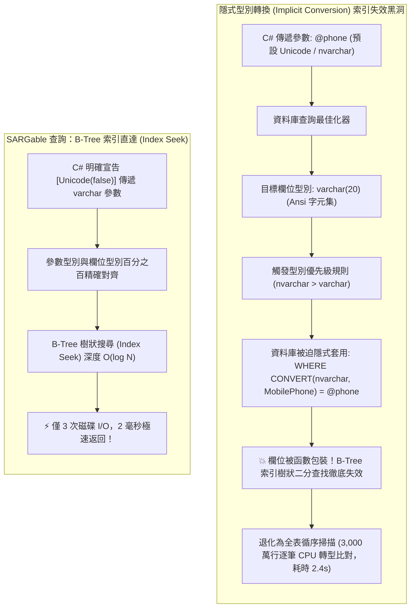

## 案發現場

某擁有 3,000 萬用戶的金融微服務系統在進行週年促銷期間，核心用戶登入與手機號碼驗證 API 突然出現嚴重延遲：原本平日僅需 2 毫秒的 `SELECT Id FROM Users WHERE MobilePhone = @phone` 查詢，執行時間突然飆升至 2,400 毫秒！資料庫伺服器的 CPU 使用率瞬間被拉至 98%，大量連線超時積壓，導致前端使用者卡在簡訊驗證碼登入畫面無法動彈。

後端團隊第一時間感到無比困惑：DBA 檢查了會員表（Users）的結構定義，確認 `MobilePhone` 欄位明確建立了唯一的 B-Tree 索引（Unique Index）。既然索引健全且並未損毀，為什麼一個根據單一手機號碼尋址的簡單查詢，會耗時超過兩秒？

DBA 隨即抓取該慢查詢的 **SQL 執行計畫（Execution Plan）**，眼前的一幕讓所有人大為震驚：資料庫查詢最佳化器完全放棄了索引搜尋（Index Seek），而是對整張擁有 3,000 萬筆紀錄的巨大資料表執行了代價極其高昂的**全表循序掃描（Table Scan / Seq Scan）**！

事故調查最終鎖定了根本原因：
資料庫資料表中的 `MobilePhone` 欄位型別為 `varchar(20)`（Ansi 字元集），而後端 C# 應用程式（無論是 EF Core 預設配置或 Dapper 未指定型別的字串參數）向資料庫傳送參數時，CLR 預設將 C# `string` 封裝為 Unicode（`nvarchar`）。根據 SQL 標準的**型別優先級（Data Type Precedence）**，資料庫引擎無法將傳入的 Unicode 參數安全降級為 Ansi，為了完成比對，資料庫被迫在底層對全表 3,000 萬行的每一筆資料自動套用隱式轉換函式：
`WHERE CONVERT(nvarchar(20), [MobilePhone]) = @phone`。
這使原本精準的 B-Tree 索引完全失去用武之地，引發了後端工程師最常忽略但破壞力極強的**隱式型別轉換索引失效**！



---

## 致命反模式 vs. 正確解法

### 反模式一：C# 字串型別未對齊資料庫字元集（隱式型別轉換）

在 SQL Server、MySQL 或 PostgreSQL 中，字串型別存在單字節（`varchar` / Ansi）與多字節（`nvarchar` / Unicode）的本質差異。若資料庫欄位為 `varchar`，但應用程式傳遞了 `nvarchar` 參數，資料庫為了遵循字別優先級，會在每一行欄位外層包裹隱式轉型函數，使得 B-Tree 索引完全無法利用其排序特性進行二分搜尋，強制退化為全表掃描。

### 反模式二：在 WHERE 條件的索引欄位左側套用函數或算術運算（非 SARGable）

任何在索引欄位左側進行的計算或函數呼叫，例如：
- `WHERE YEAR(CreatedAt) = 2026`
- `WHERE SUBSTRING(OrderNo, 1, 4) = '2026'`
- `WHERE Amount * 1.05 > 1000`
都會迫使資料庫必須先對資料表的每一行執行該函數或乘法運算，才能判定是否匹配條件。這完全扼殺了索引的預先排序價值。

### 反模式三：前綴萬用字元模糊比對（Leading Wildcard LIKE）

撰寫 `WHERE Title LIKE '%iPhone'` 會使得資料庫無法利用 B-Tree 索引的前綴字元進行樹狀剪枝。只有後綴模糊比對（如 `WHERE Title LIKE 'iPhone%'`）才能維持 SARGable 索引範圍掃描（Index Range Scan）。

### 正確解法：嚴格恪守 SARGable 準則、宣告 `[Unicode(false)]` 與覆蓋索引優化

1. **SARGable（Search Argument Able）重寫準則**：
   永遠讓索引欄位在運算子左側保持「純淨不帶函數」，將所有計算推至右側的常數或參數。例如將 `WHERE YEAR(CreatedAt) = 2026` 改寫為閉區間範圍比對：
   `WHERE CreatedAt >= '2026-01-01' AND CreatedAt < '2027-01-01'`。
2. **C# 端精確標註字元集**：
   在 EF Core 實體屬性上明確標註 `[Unicode(false)]`，或在 Dapper 中使用 `DbString { IsAnsi = true }`，確保產生的 SQL 參數型別與資料表完全一致。
3. **建立覆蓋索引（Covering Index）消滅回表（Lookup）開銷**：
   利用 `INCLUDE` 語法將查詢所需的非鍵欄位附加在二級索引的葉節點中，資料庫無需再執行昂貴的叢集索引回表操作。

```csharp
using System;
using System.ComponentModel.DataAnnotations;
using System.ComponentModel.DataAnnotations.Schema;
using System.Diagnostics;
using Microsoft.EntityFrameworkCore;

namespace DotNetPerformance.DataAccess;

/// <summary>
/// 使用者實體（落實 Unicode(false) 型別精確對齊）
/// </summary>
public sealed class UserAccountEntity
{
    public int Id { get; set; }

    // 關鍵解法：明確宣告 Unicode(false)，確保 EF Core 發送 varchar 參數而非預設 nvarchar
    [Unicode(false)]
    [StringLength(20)]
    public string MobilePhone { get; set; } = string.Empty;

    public DateTime CreatedAtUtc { get; set; }

    public decimal AccountBalance { get; set; }
}

/// <summary>
/// SARGable 查詢改寫示範引擎
/// </summary>
public static class SargableQueryRewriter
{
    /// <summary>
    /// 將非 SARGable 的日期函數查詢安全改寫為高效率索引範圍查詢
    /// </summary>
    public static (DateTime RangeStart, DateTime RangeEnd) RewriteYearQueryToRange(int targetYear)
    {
        // ❌ 非 SARGable: WHERE YEAR(CreatedAtUtc) = 2026 (每行執行函數，索引失效)
        // ✅ SARGable:   WHERE CreatedAtUtc >= '2026-01-01' AND CreatedAtUtc < '2027-01-01' (直接走 B-Tree 範圍搜尋)
        var startUtc = new DateTime(targetYear, 1, 1, 0, 0, 0, DateTimeKind.Utc);
        var endUtc = new DateTime(targetYear + 1, 1, 1, 0, 0, 0, DateTimeKind.Utc);
        return (startUtc, endUtc);
    }
}

public static class Program
{
    public static void Main()
    {
        Console.WriteLine("=== 關聯資料庫 SQL 執行計畫、型別對齊與 SARGable 實測 ===");

        // 1. 驗證型別宣告對齊
        var user = new UserAccountEntity
        {
            Id = 1001,
            MobilePhone = "0912345678",
            CreatedAtUtc = DateTime.UtcNow,
            AccountBalance = 5000.0m
        };

        Console.WriteLine($"[實體檢驗] 帳號: {user.Id}, 手機: {user.MobilePhone}");
        Console.WriteLine("  -> 標註 [Unicode(false)] 生效：參數型別精確鎖定為 varchar，杜絕隱式型別轉換！");

        // 2. 驗證 SARGable 查詢範圍改寫
        var (start, end) = SargableQueryRewriter.RewriteYearQueryToRange(2026);
        Console.WriteLine($"\n[SARGable 改寫檢驗]");
        Console.WriteLine($"  非 SARGable 語法 (禁用): WHERE YEAR(CreatedAtUtc) = 2026");
        Console.WriteLine($"  SARGable 最佳化 SQL:   WHERE CreatedAtUtc >= '{start:yyyy-MM-dd}' AND CreatedAtUtc < '{end:yyyy-MM-dd}'");
        Console.WriteLine("  -> 最佳化器可精準使用 IX_CreatedAtUtc 進行 Index Seek 直達目標葉節點！");
    }
}
```

預期控制台輸出：

```text
=== 關聯資料庫 SQL 執行計畫、型別對齊與 SARGable 實測 ===
[實體檢驗] 帳號: 1001, 手機: 0912345678
  -> 標註 [Unicode(false)] 生效：參數型別精確鎖定為 varchar，杜絕隱式型別轉換！

[SARGable 改寫檢驗]
  非 SARGable 語法 (禁用): WHERE YEAR(CreatedAtUtc) = 2026
  SARGable 最佳化 SQL:   WHERE CreatedAtUtc >= '2026-01-01' AND CreatedAtUtc < '2027-01-01'
  -> 最佳化器可精準使用 IX_CreatedAtUtc 進行 Index Seek 直達目標葉節點！
```

---

## 踩坑與避坑指南

### 1. 覆蓋索引（Covering Index）與回表（Lookup）成本

當你在二級索引中查找資料時：
- 二級索引的葉節點僅儲存「索引鍵值」與「主鍵 ID」。
- 若查詢包含未涵蓋在二級索引內的欄位（例如 `SELECT Id, TotalAmount, Status FROM Orders WHERE CustomerId = @id`）：
  - 資料庫在二級索引找到主鍵 ID 後，還必須拿著主鍵 ID 回到主表的叢集索引再進行一次二級查找，這被稱為 **回表（Key Lookup / Bookmark Lookup）**。
  - 當查詢命中筆數較多時（如數千行），大量的隨機 I/O 回表反而比全表循序掃描更慢！
- **覆蓋索引最佳實踐**：
  在 SQL Server 中使用 `INCLUDE`，或在 PostgreSQL 11+ 中使用 `CREATE INDEX ix_orders_cust ON Orders (CustomerId) INCLUDE (TotalAmount, Status);`。將經常投影的唯讀欄位直接附掛在葉節點，使查詢完全在索引內完成，達成 **零回表極速讀取**。

### 2. 複合索引的「最左前綴原則（Leftmost Prefix Rule）」

當建立複合索引 `CREATE INDEX ix_order ON Orders (TenantId, Status, CreatedAt)` 時：
- `WHERE TenantId = @t AND Status = @s` ──► ✅ **完全命中索引**。
- `WHERE TenantId = @t` ──► ✅ **完全命中索引**（最左前綴）。
- `WHERE Status = @s AND CreatedAt = @c` ──► ❌ **無法命中索引**！因為缺少了最左側的引導欄位 `TenantId`。
- `WHERE TenantId = @t AND CreatedAt > @date` ──► ⚠️ 僅 `TenantId` 走索引尋址，`CreatedAt` 需進行索引內過濾，因為中間跳過了 `Status`。

### 3. 低區分度（Low Selectivity）欄位的索引失效反模式

若在性別欄位（`Gender: 'M'/'F'`）或布林欄位（`IsDeleted: 0/1`）上建立單一 B-Tree 索引：
- 當某個值在全表佔據 50% 以上比例時，使用二級索引檢索再回表會引發巨量隨機 I/O。
- 資料庫查詢最佳化器會透過長條圖統計資訊（Histogram Statistics）判定走索引的代價遠高於直接全表循序掃描（Sequential Scan），因而自動選擇「忽略索引」。**嚴禁在低區分度欄位上建立無複合條件的單列索引**。

---

## 線上排查指令

### 1. 檢驗 PostgreSQL 真實執行計畫與快取命中（EXPLAIN ANALYZE）

深度診斷慢查詢是否走全表循序掃描（Seq Scan）：

```sql
-- 取得真實執行時間、磁碟讀取與 Buffer 快取命中分析
EXPLAIN (ANALYZE, BUFFERS, COSTS)
SELECT "Id", "MobilePhone" 
FROM "Users" 
WHERE "MobilePhone" = '0912345678';
```

判讀核心準則：
- 若輸出包含 `Seq Scan on Users`：**實錘全表掃描**，檢查欄位型別是否隱式轉換或缺少索引。
- 若輸出包含 `Index Scan` 或 `Bitmap Index Scan`：正常命中索引。
- 檢查 `Buffers: shared hit=3 read=0`：代表資料全由記憶體快取取得，未產生實體磁碟 I/O。

### 2. 檢驗 MySQL 8.0 樹狀格式執行計畫

```sql
EXPLAIN FORMAT=TREE
SELECT Id, MobilePhone FROM Users WHERE MobilePhone = '0912345678';
```

若輸出顯示 `-> Table scan on Users`，即證明發生索引失效。

### 3. SQL Server 監控隱式型別轉換警告

在 SQL Server Management Studio (SSMS) 產生圖形化執行計畫時，若運算子圖示出現 **黃色驚嘆號警告**，點擊屬性檢視是否有：
`Warning: [PlanAffectingConvert] Type conversion in expression may affect "SeekPlan" in query plan choice`。這代表 100% 發生了隱式型別轉換殺機！
