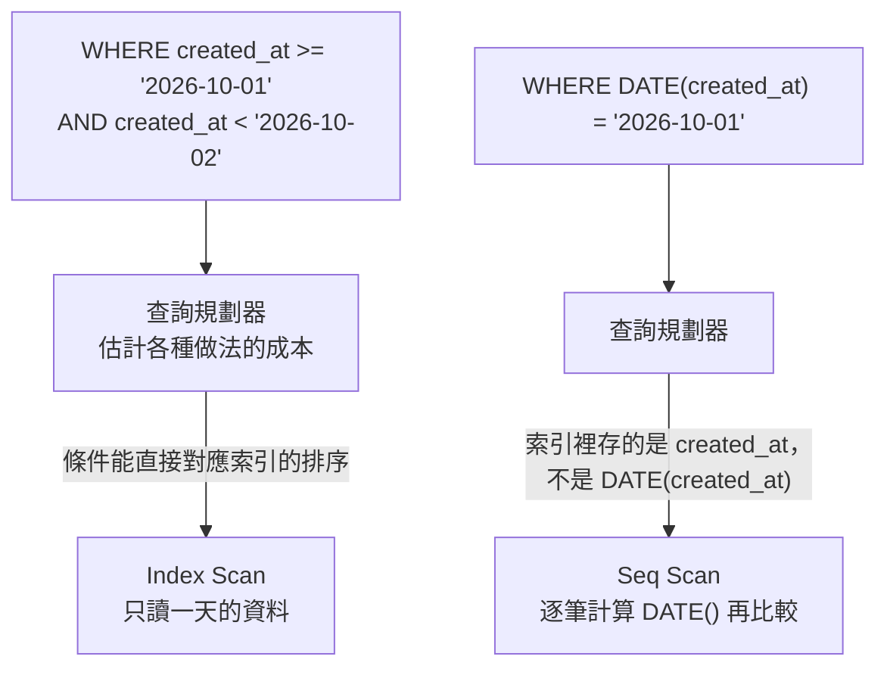

## 這是什麼

資料庫收到一句 SQL，不會馬上去讀資料，而是先想「怎麼找最快」。它可能沿著索引直接跳到要的那幾筆（像查字典先翻部首），也可能從第一筆讀到最後一筆（全表掃描）。這份「打算怎麼找」的計畫叫**執行計畫**。

索引只有在條件寫法讓資料庫「看得懂」時才用得上。同樣是找 10 月 1 日的訂單，寫法差一點，就可能從讀 200 筆變成讀 2,000 萬筆。這篇說明怎麼讀執行計畫，以及三種最常讓索引失效的寫法。

## 運作原理

B-tree 索引把欄位值排好順序，並記下每個值在資料表的位置。條件是「欄位等於某值」或「欄位在某範圍內」時，資料庫可以直接在排好的索引裡定位。



能利用索引的條件叫 **SARGable**（Search ARGument able）：欄位保持原樣放在比較運算子的一邊。只要對欄位套了函式、做了運算或型別轉換，索引裡排好的順序就派不上用場。

`EXPLAIN ANALYZE` 會真的執行查詢，並列出每一步實際讀了幾筆、花了多久。看到 `Seq Scan`（PostgreSQL）或 `type: ALL`（MySQL）出現在大表上，而且實際讀取的列數遠多於回傳的列數，就是索引沒用上的訊號。

## 常見錯誤與正確寫法

### 1. 在欄位上套函式

```sql
-- 錯：每一筆都要算 DATE()，索引用不上
SELECT id, total FROM orders WHERE DATE(created_at) = '2026-10-01';

-- 對：改寫成範圍，欄位保持原樣
SELECT id, total FROM orders
WHERE created_at >= '2026-10-01' AND created_at < '2026-10-02';
```

EF Core 寫 `o.CreatedAt.Date == day` 也會被翻譯成類似的函式呼叫。在 C# 裡先算好範圍的起點與終點，再寫成 `o.CreatedAt >= start && o.CreatedAt < end`。

如果真的需要依函式結果查詢（例如不分大小寫比對 email），PostgreSQL 可以建立**運算式索引**：`CREATE INDEX ON customers (lower(email));`，查詢時就要寫成 `WHERE lower(email) = ...`。

### 2. 前置萬用字元

```sql
-- 錯：開頭是 %，無法利用排序，只能整表比對
SELECT id, name FROM products WHERE name LIKE '%保溫杯%';
```

`LIKE '保溫%'`（只有結尾萬用字元）可以用索引；中間或開頭的比對要改用全文檢索，例如 PostgreSQL 的 `tsvector` 與 GIN 索引。

### 3. 欄位和參數的型別不一致

MySQL 中，`sku` 欄位是 `VARCHAR`，條件卻寫成數字 `WHERE sku = 1001`，MySQL 會把每一筆的 `sku` 轉成數字再比較，索引無法使用。參數的型別要和欄位一致：

```csharp
// 欄位是字串，參數也要是字串
var product = await db.Products.SingleOrDefaultAsync(p => p.Sku == sku.ToString(), ct);
```

### 4. 為區分度很低的欄位建索引

`status` 只有 5 種值，其中 `Completed` 佔 90%。查 `WHERE status = 'Completed'` 時，走索引反而比較慢，資料庫會選擇全表掃描。這類欄位通常放在**複合索引**的後面，和區分度高的欄位一起使用，例如 `(buyer_id, status)`。

## 使用邊界

- 索引加速讀取，但每次寫入都要同步更新索引，也佔空間。只為實際存在、而且頻繁的查詢建立索引。
- 執行計畫取決於統計資訊。資料分布大幅改變後（例如大量匯入），統計資訊過時，規劃器可能選錯；PostgreSQL 的 autovacuum 會自動更新，必要時手動執行 `ANALYZE`。
- `EXPLAIN ANALYZE` 會真的執行語句。對 `UPDATE`、`DELETE` 使用時，包在交易裡並在之後 `ROLLBACK`。
- 大表分頁與覆蓋索引見 [上億筆資料的查詢](/data-access/large-table-queries/)。

## 雲端排查

### 叢集層（GKE 與 EKS 相同）

```bash
# 從叢集內用 psql 連到資料庫（GKE 透過 Auth Proxy、EKS 透過 RDS 端點）
kubectl run psql -n shop --rm -it --image=postgres:18 -- \
  psql "host=<資料庫端點> dbname=shop user=readonly_diag sslmode=require"
```

用唯讀的診斷帳號連線，避免誤改資料。

### 託管服務層

#### 兩邊相同：找出最耗時的查詢

```sql
-- PostgreSQL（需啟用 pg_stat_statements）：總耗時最高的前 10 個查詢
SELECT calls, round(mean_exec_time::numeric, 1) AS mean_ms,
       round(total_exec_time::numeric) AS total_ms, rows, left(query, 120) AS query
FROM pg_stat_statements
ORDER BY total_exec_time DESC
LIMIT 10;
```

```sql
-- MySQL：依語句摘要彙總的耗時（單位為皮秒，除以 1e9 得毫秒）
SELECT DIGEST_TEXT, COUNT_STAR, ROUND(SUM_TIMER_WAIT / 1e9) AS total_ms, SUM_ROWS_EXAMINED
FROM performance_schema.events_statements_summary_by_digest
ORDER BY SUM_TIMER_WAIT DESC
LIMIT 10;
```

`rows`（或 `SUM_ROWS_EXAMINED`）遠大於實際需要的筆數，代表在掃描大量資料；拿這句 SQL 去跑 `EXPLAIN ANALYZE`。

#### GKE

在 Cloud SQL 開啟 **Query Insights**，主控台會依查詢摘要列出耗時、執行次數與執行計畫：

```bash
gcloud sql instances patch shop-db --insights-config-query-insights-enabled
```

Cloud Monitoring 的 `cloudsql.googleapis.com/database/cpu/utilization` 持續偏高，又和某個查詢的上線時間吻合，多半是那個查詢沒走索引。

#### EKS

RDS 以 CloudWatch 的 `AWS/RDS` 命名空間觀察：`CPUUtilization` 和 `ReadIOPS` 同時升高，代表正在大量讀取資料頁，常見原因就是全表掃描。逐句分析使用上面的 `pg_stat_statements`，或 RDS 的 Performance Insights。

### 應用程式層

在開發環境開啟 EF Core 的 SQL 日誌（`Microsoft.EntityFrameworkCore.Database.Command` 設為 Information），確認 LINQ 被翻譯成什麼 SQL；正式環境改用 OpenTelemetry 的資料庫追蹤，從慢的請求找到對應的 SQL。
