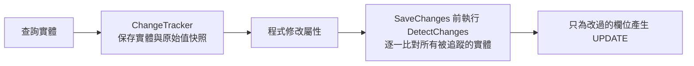

## 這是什麼

用 EF Core 查出一張訂單、改了狀態、呼叫 `SaveChangesAsync`，EF Core 就知道要送出 `UPDATE orders SET status = ...`。它怎麼知道哪個欄位改了？因為查出實體時，它在旁邊存了一份原始值的**快照**，存檔時逐一比對。這個機制叫**變更追蹤**。

對一般的用例（載入幾筆、改幾筆）這很方便。但在批次作業裡，同一個 `DbContext` 載入了上萬筆實體，快照佔滿記憶體，每次存檔前的比對也越來越慢。

## 運作原理



**DetectChanges** 會比對「所有」被追蹤的實體，成本和實體數量成正比。它不只在 `SaveChanges` 時執行，查詢、`Add`、讀取 `Entries()` 等操作也會自動觸發。在迴圈裡每次 `Add` 一筆、DbContext 裡已經有一萬筆，每次都要比對一萬筆。

**身分解析**：同一個 `DbContext` 中，同一個主鍵只會有一個實體物件。查詢結果裡出現兩次的買家，指向同一個物件。

三種查詢模式：

| 模式 | 追蹤 | 同一主鍵共用物件 | 適合 |
| --- | --- | --- | --- |
| 預設（追蹤） | 是 | 是 | 要修改並存檔 |
| `AsNoTracking()` | 否 | 否（重複的資料會建立多個物件） | 唯讀、資料不重複 |
| `AsNoTrackingWithIdentityResolution()` | 否 | 是 | 唯讀，但結果中同一筆關聯資料會重複出現 |

## 常見錯誤與正確寫法

### 1. 一個 DbContext 處理全部資料

```csharp
// 錯：十萬筆全部留在同一個 DbContext，記憶體持續增加、越跑越慢
foreach (var line in csvLines)
{
    db.Products.Add(Product.FromCsv(line));
    await db.SaveChangesAsync(ct);
}
```

分批處理，每批存完就清空追蹤：

```csharp
foreach (var chunk in csvLines.Chunk(500))
{
    db.Products.AddRange(chunk.Select(Product.FromCsv));
    await db.SaveChangesAsync(ct);
    db.ChangeTracker.Clear(); // 釋放這一批的實體與快照
}
```

如果只是要大量寫入或更新、不需要實體的行為，`ExecuteUpdateAsync` 或資料庫的 COPY 更快，見 [批次更新](/data-access/batch-updates/)。

### 2. 用 Update() 只為了改一個欄位

```csharp
// 錯：Update 把所有欄位標記為已修改，送出更新全部欄位的 SQL，
// 也可能用舊值覆蓋掉其他人剛改的欄位
var product = new Product { Id = id, Price = newPrice };
db.Products.Update(product);
```

先載入再修改，EF Core 只會更新真的改變的欄位：

```csharp
var product = await db.Products.SingleAsync(p => p.Id == id, ct);
product.ChangePrice(newPrice);
await db.SaveChangesAsync(ct); // UPDATE products SET price = @p WHERE id = @id
```

不想先查詢時，用 `ExecuteUpdateAsync` 直接更新指定欄位。

### 3. 長生命週期的 DbContext 讀到舊資料

在背景服務裡建立一個 `DbContext` 一直用，第二次查詢同一筆資料時，EF Core 會回傳已經追蹤的那個物件，而不是資料庫裡的最新值。每個工作單元建立新的 `DbContext`（用 `IDbContextFactory` 或新的 scope），用完就釋放，見 [C# 連線設計](/data-access/csharp-connections/)。

## 使用邊界

- 一般的 Web 請求，`DbContext` 生命週期就是一個請求，追蹤的實體不多，不需要特別處理。
- 暫時關閉 `ChangeTracker.AutoDetectChangesEnabled` 可以減少大量 `Add` 時的比對次數，但要記得在 `SaveChanges` 前手動呼叫 `DetectChanges()`，否則修改可能沒被存到。只在量測後確認有幫助時使用。
- 要修改的資料，不要用 `AsNoTracking` 查詢後再 `Update`，這會遇到上面「更新全部欄位」的問題。

## 雲端排查

### 叢集層（GKE 與 EKS 相同）

```bash
# 批次作業的 Pod 記憶體是否持續上升、是否因 OOMKilled 重啟
kubectl top pod -n shop -l app=catalog-import
kubectl get pod -n shop -l app=catalog-import \
  -o jsonpath='{range .items[*]}{.metadata.name}{"\t"}{.status.containerStatuses[0].lastState.terminated.reason}{"\n"}{end}'
```

`lastState.terminated.reason` 是 `OOMKilled`，代表容器超過記憶體上限被終止；批次作業的記憶體隨處理筆數線性增加，通常是追蹤的實體沒有釋放。

### 託管服務層

#### GKE

Cloud Monitoring 的 `kubernetes.io/container/memory/used_bytes` 依容器畫出記憶體曲線；批次作業期間呈現一路上升、沒有回落的斜線，就是累積追蹤的典型樣子。

#### EKS

啟用 Container Insights 後，`ContainerInsights` 命名空間的 `pod_memory_utilization` 與 `pod_number_of_container_restarts` 可以看到同樣的趨勢與重啟次數。

### 應用程式層

在 Pod 內用 `dotnet-counters monitor --process-id 1 --counters System.Runtime` 觀察 `dotnet.gc.heap.total_allocated` 與 GC 次數；需要確認是哪些物件，用 `dotnet-gcdump collect` 取得堆積摘要，查看 EF Core 內部的實體項目數量是否隨時間增加。記憶體分析的方法見 [GC 與容器記憶體](/platforms/dotnet/gc-memory/)。
