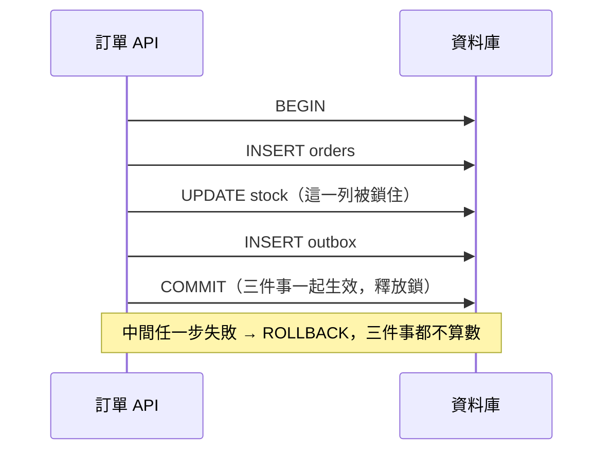

## 這是什麼

建立訂單時要做三件事：寫入訂單、扣庫存保留量、寫入 outbox 事件。這三件事要嘛全部成功，要嘛全部不算數；如果訂單寫進去了但庫存沒扣，就會超賣。

**交易**（transaction）就是把多個資料庫操作包成一個不可分割的單位：提交（COMMIT）時一起生效，回滾（ROLLBACK）時一起取消。交易期間，資料庫會對修改的資料加鎖，其他交易要改同一筆資料就得等。

## 運作原理



EF Core 的 `SaveChangesAsync` 會自動把這一次要送出的所有變更包在一個交易裡。所以「載入、修改多個實體、呼叫一次 SaveChanges」本身就是原子的，不需要另外開交易。

需要明確開交易的情況是：一個用例要呼叫**多次** `SaveChanges`，或是混用 EF Core 與原生 SQL（例如 `ExecuteUpdateAsync`），而且它們要一起成功。

**鎖會一直持有到交易結束。** 交易越長，其他請求等待越久。交易裡如果還做了外部 API 呼叫，對方慢 3 秒，這段期間被鎖住的庫存列就讓所有人等 3 秒。

## 常見錯誤與正確寫法

### 1. 交易裡呼叫外部服務

```csharp
// 錯：付款閘道回應前，庫存列一直被鎖著；閘道逾時，交易也跟著拖住連線
await using var tx = await db.Database.BeginTransactionAsync(ct);
stock.Reserve(quantity);
await db.SaveChangesAsync(ct);
var payment = await paymentGateway.AuthorizeAsync(order, ct); // 外部 I/O
order.MarkAuthorized(payment.Id);
await db.SaveChangesAsync(ct);
await tx.CommitAsync(ct);
```

把外部呼叫移出交易，用狀態記錄進度：先在一個短交易中建立「待付款」訂單並保留庫存，提交；再呼叫付款；最後用另一個短交易記錄結果。付款的結果要靠冪等鍵與狀態查詢處理「呼叫成功但沒收到回應」的情況，見 [取消與資源釋放](/languages/csharp/cancellation-disposable/)。

### 2. 開了重試策略，又自己開交易

使用 `EnableRetryOnFailure()` 時，EF Core 會在暫時性錯誤時重試。但它無法只重試交易中的某一句，因此直接開交易會丟出例外：「執行策略不支援使用者發起的交易」。把整個交易放進執行策略裡，讓它整段重試：

```csharp
var strategy = db.Database.CreateExecutionStrategy();
await strategy.ExecuteAsync(async () =>
{
    await using var tx = await db.Database.BeginTransactionAsync(ct);
    db.Orders.Add(order);
    await db.SaveChangesAsync(ct);
    var reserved = await db.Stocks.Where(s => s.ProductId == order.ProductId && s.Available >= order.Quantity)
        .ExecuteUpdateAsync(s => s.SetProperty(x => x.Available, x => x.Available - order.Quantity), ct);
    if (reserved == 0) throw new OutOfStockException(order.ProductId); // 沒有更新到任何列：庫存不足，交易回滾
    await tx.CommitAsync(ct);
});
```

整段會被重新執行，所以裡面不能有「執行兩次會出問題」的外部動作。

### 3. 用 TransactionScope 跨兩個資料庫

`TransactionScope` 裡開了第二個連線（另一個資料庫，甚至同一個資料庫的第二條連線），交易會嘗試升級成分散式交易。.NET 只在 Windows 上支援分散式交易；在 Linux 容器裡會直接丟出例外。跨資料庫、跨服務的一致性用 [Outbox 與 Inbox](/architecture/outbox-inbox/)。

如果仍要使用 `TransactionScope`（例如包住同一條連線的多個操作），非同步程式要加上 `TransactionScopeAsyncFlowOption.Enabled`，否則 `await` 之後交易不會跟著流動。

## 使用邊界

- **隔離等級**決定交易之間看得到彼此多少變更，以及何時會衝突。PostgreSQL 預設 Read Committed，MySQL 預設 Repeatable Read，行為不同，見 [隔離與鎖](/data-access/isolation-locking/)。
- `COMMIT` 送出後連線中斷，你無法知道交易到底有沒有成功。重試前先用業務唯一鍵查詢結果，見 [高併發 CRUD](/data-access/concurrent-crud/)。
- 純查詢不需要交易；開了交易反而延長連線持有時間。

## 雲端排查

### 叢集層（GKE 與 EKS 相同）

```bash
# 交易卡住時，API 請求會跟著逾時；先看哪些 Pod 的錯誤日誌在增加
kubectl logs -n shop -l app=order-api --since=10m | grep -i -E "timeout|deadlock|could not serialize"
```

### 託管服務層

#### 兩邊相同：找出執行太久或閒置在交易中的連線

```sql
-- PostgreSQL：持有交易超過 5 秒的連線；state 為 idle in transaction 代表交易開著卻沒在做事
SELECT pid, usename, state, now() - xact_start AS xact_age, left(query, 100) AS last_query
FROM pg_stat_activity
WHERE xact_start IS NOT NULL AND now() - xact_start > interval '5 seconds'
ORDER BY xact_age DESC;
```

```sql
-- MySQL：執行超過 5 秒的 InnoDB 交易
SELECT trx_id, trx_started, TIMESTAMPDIFF(SECOND, trx_started, NOW()) AS age_s, trx_mysql_thread_id
FROM information_schema.innodb_trx
WHERE trx_started < NOW() - INTERVAL 5 SECOND
ORDER BY trx_started;
```

`idle in transaction` 很多，通常是程式在交易中等待外部 I/O，或忘了提交。PostgreSQL 可以設定 `idle_in_transaction_session_timeout`，讓閒置太久的交易自動結束。

#### GKE

Cloud SQL 用資料庫旗標設定逾時。`--database-flags` 會**取代**所有既有旗標，執行前先用 `describe` 確認目前的旗標並一併列出：

```bash
gcloud sql instances describe shop-db --format='value(settings.databaseFlags)'
gcloud sql instances patch shop-db \
  --database-flags=idle_in_transaction_session_timeout=60000   # 毫秒；記得加上原有旗標
```

#### EKS

RDS 透過自訂的參數群組設定 `idle_in_transaction_session_timeout`，套用到執行個體後生效。長交易也會讓 CloudWatch `AWS/RDS` 的 `DatabaseConnections` 居高不下，因為連線被交易佔著無法歸還。

### 應用程式層

在 OpenTelemetry 的追蹤裡，找出同一個請求中「資料庫 span 之間夾著一個很長的 HTTP span」的模式，那就是交易內呼叫了外部服務。
