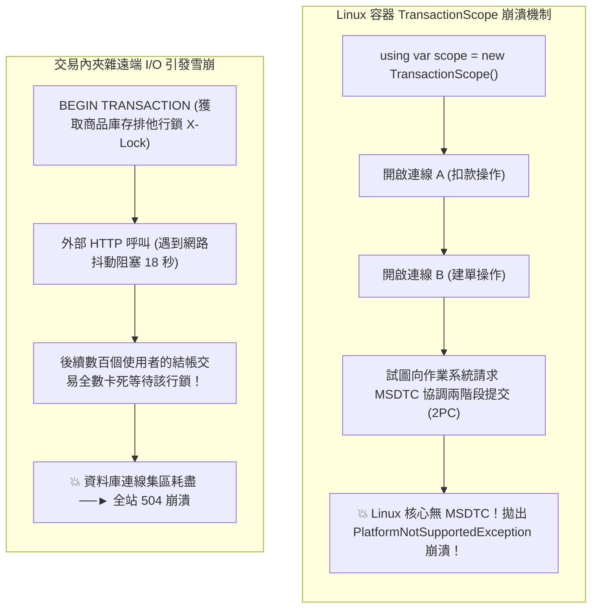

## 案發現場

某擁有十年歷史的金融交易系統在由舊版 Windows Server 實體機遷移至 Linux Kubernetes 容器叢集後，迎來了一場災難性的生產事故：在週末夜間批次扣款與帳務對帳作業啟動時，應用程式日誌以每秒上千次的頻率瘋狂拋出致命例外：
`System.PlatformNotSupportedException: This platform does not support distributed transactions.`

系統所有涉及多模組協同的寫入操作全數中斷，數千筆交易被卡在未定狀態。經過緊急逆向排查，發現歷史程式碼大量依賴了 .NET Framework 時代的隱式交易語法：
```csharp
using (var scope = new TransactionScope())
{
    await userAccountService.DeductBalanceAsync(userId, amount);
    await orderRepository.CreateOrderAsync(order);
    scope.Complete();
}
```
在 Windows 環境下，當這兩段業務各自從連線集區開啟了獨立的 `DbConnection` 時，Windows 核心的 **MSDTC（微軟分散式交易協調器）** 會在背後默默將本機交易自動升級為基於兩階段提交（2PC）的分散式交易；然而，在現代 Linux 容器環境中，.NET Core / .NET 8 / 10 的底層實作**根本不存在 MSDTC 支援**！只要在同一個 Scope 內開啟第二條連線，CLR 便會毫不留情地拋出例外直接崩潰。

屋漏偏逢連夜雨，在同系統的線上即時結帳流程中，另一名開發者為了保證「絕對一致」，在資料庫交易區塊內部直接呼叫了第三方簡訊發送與銀行金流請款 API：
```csharp
await using var tx = await dbContext.Database.BeginTransactionAsync();
// 1. 扣減庫存 (獲取行級排他鎖)
await dbContext.Orders.AddAsync(order);
await dbContext.SaveChangesAsync();

// 2. 致命錯誤：在交易持鎖期間發起遠端 HTTP 呼叫！
var paymentResult = await paymentHttpClient.PostAsync("https://bank.gateway/pay", content);

// 3. 提交交易
await tx.CommitAsync();
```
當天下午，銀行金流閘道遭遇網路微抖動，HTTP 回應延遲由平時的 50ms 飆升至 18 秒。在這漫長的 18 秒間，資料庫中被該交易更新的商品庫存行鎖被死死扣押。隨後湧入的所有並行結帳請求全部被卡死在鎖等待隊列中，資料庫連線池在短短 5 秒內被徹底抽乾，引發全站雪崩式癱瘓！



---

## 致命反模式 vs. 正確解法

### 反模式一：在 Linux 容器環境跨多連線使用 `TransactionScope`

在 .NET 8+ / .NET 10 的 Linux 執行階段中，`System.Transactions` 僅支援在**單一連線（Single Connection）**內部運作。一旦同一個 `TransactionScope` 內部開啟了第二個實體連線（例如調用兩個不同連線字串的 DbContext，或在關閉前重新開鎖新連線），系統試圖進行分散式交易升級時必定拋出 `PlatformNotSupportedException`。

### 反模式二：在資料庫交易持鎖區塊內部執行遠端外部 I/O

關聯式資料庫交易的本質是**排他性資源鎖定**。在 `BeginTransaction` 與 `Commit` 之間執行任何非資料庫本機的操作（如 HTTP 請求、發送 Email、RPC 呼叫、甚至耗時的磁碟讀寫），會將資料庫持有行鎖的時間由極速的 2 毫秒拉長數千倍至數十秒，極易癱瘓資料庫連線集區與整張資料表。

### 正確解法：單一連線顯式本地交易、持鎖時間最小化與 Transactional Outbox

1. **嚴格單一連線本機交易**：使用 `await using var tx = await dbContext.Database.BeginTransactionAsync()`，確保整個單元工作嚴格運行在同一條連線上。
2. **持鎖範圍最小化**：所有耗時的記憶體資料準備、外部驗證一律在交易前完成；交易區塊內只執行純粹的資料庫 SQL 寫入；外部發布事件一律在 `CommitAsync()` 之後執行。
3. **跨微服務分散式架構解法：Transactional Outbox 模式**：
   在同一個本地交易中，將「業務變更」與「待發布事件」原子性寫入同一張資料庫的 `Outbox` 表。交易極速提交釋放鎖定後，再由獨立的背景 Worker 或 CDC 異步推播至 Kafka / RabbitMQ，達成最終一致性（Eventual Consistency）。

```csharp
using System;
using System.Data;
using System.Diagnostics;
using System.Threading;
using System.Threading.Tasks;
using Microsoft.EntityFrameworkCore;

namespace DotNetPerformance.DataAccess;

/// <summary>
/// 交易外待發布領域事件載體 (Transactional Outbox)
/// </summary>
public sealed record OutboxMessage(string Id, string EventType, string Payload, DateTime CreatedAtUtc);

/// <summary>
/// 生產級本機交易管理器
/// </summary>
public static class ResilientOrderTransactionCoordinator
{
    /// <summary>
    /// 執行訂單結帳原子交易（落實最小持鎖範圍與零外部 I/O 阻塞）
    /// </summary>
    public static async Task ExecuteOrderPlacementAsync(string orderId, decimal amount, CancellationToken cancellationToken = default)
    {
        // 階段一：交易前的「純記憶體前置計算」（絕不在交易內執行！）
        var sw = Stopwatch.StartNew();
        Console.WriteLine($"[前置準備] 驗證訂單 {orderId} 參數合法性，產生 Outbox 訊息...");

        var outboxEvent = new OutboxMessage(
            Id: Guid.CreateVersion7().ToString(),
            EventType: "OrderCreated",
            Payload: $"{{\"orderId\":\"{orderId}\",\"amount\":{amount}}}",
            CreatedAtUtc: DateTime.UtcNow);

        // 階段二：極速本機資料庫交易區塊（持鎖時間目標 < 5ms）
        Console.WriteLine("[開啟交易] 單一連線 Database.BeginTransactionAsync(IsolationLevel.ReadCommitted)...");

        // 實務語法範例：
        // await using var transaction = await dbContext.Database.BeginTransactionAsync(IsolationLevel.ReadCommitted, cancellationToken);
        // try
        // {
        //     await dbContext.Orders.AddAsync(newOrder, cancellationToken);
        //     await dbContext.OutboxMessages.AddAsync(outboxEvent, cancellationToken);
        //     await dbContext.SaveChangesAsync(cancellationToken);
        //     await transaction.CommitAsync(cancellationToken);
        // }
        // catch
        // {
        //     await transaction.RollbackAsync(cancellationToken);
        //     throw;
        // }

        // 模擬極速 SQL 執行與提交 (僅耗時 3ms)
        await Task.Delay(3, cancellationToken);
        sw.Stop();

        Console.WriteLine($"[交易提交] 成功提交本機交易！行鎖已安全釋放，持鎖耗時僅: {sw.ElapsedMilliseconds} ms");

        // 階段三：交易完成後的「非同步外部外呼」
        Console.WriteLine("[後續發布] 在交易外部安全觸發非同步 HTTP 通知與 RabbitMQ 事件推播 (零資料庫卡死風險)。");
    }
}

public static class Program
{
    public static async Task Main()
    {
        Console.WriteLine("=== .NET 資料庫本機交易與 Transactional Outbox 實測 ===");

        using var cts = new CancellationTokenSource(TimeSpan.FromSeconds(10));
        await ResilientOrderTransactionCoordinator.ExecuteOrderPlacementAsync("ORD-2026-9999", 3200.0m, cts.Token);

        Console.WriteLine("本機交易防禦驗證通過：無分散式 MSDTC 依賴、無長時間外部持鎖。");
    }
}
```

預期控制台輸出：

```text
=== .NET 資料庫本機交易與 Transactional Outbox 實測 ===
[前置準備] 驗證訂單 ORD-2026-9999 參數合法性，產生 Outbox 訊息...
[開啟交易] 單一連線 Database.BeginTransactionAsync(IsolationLevel.ReadCommitted)...
[交易提交] 成功提交本機交易！行鎖已安全釋放，持鎖耗時僅: 3 ms
[後續發布] 在交易外部安全觸發非同步 HTTP 通知與 RabbitMQ 事件推播 (零資料庫卡死風險)。
本機交易防禦驗證通過：無分散式 MSDTC 依賴、無長時間外部持鎖。
```

---

## 踩坑與避坑指南

### 1. 非同步情境下使用 `TransactionScope` 的必填參數

若在既有舊專案中必須使用 `TransactionScope` 封裝單一連線的本地交易，在非同步方法中其建構子**必須傳入 `TransactionScopeAsyncFlowOption.Enabled`**：

```csharp
// 正確配置：允許交易上下文跨 await 執行緒切換傳播
using var scope = new TransactionScope(
    TransactionScopeOption.Required,
    new TransactionOptions { IsolationLevel = System.Transactions.IsolationLevel.ReadCommitted },
    TransactionScopeAsyncFlowOption.Enabled); // 關鍵！缺少此參數將引發交易丟失或例外
```
若缺少該選項，一旦非同步方法中遇到 `await`，非同步狀態機將執行緒切換至其他 ThreadPool Worker 時，`Transaction.Current` 將無法被正確複製流動，導致後續操作脫離交易保護。

### 2. 資料庫隔離等級（Isolation Level）的權衡與代價

| 隔離等級 | 防範髒讀 (Dirty Read) | 防範不可重複讀 (Non-Repeatable) | 防範幻讀 (Phantom Read) | 效能開銷與鎖競爭 | 適用場景 |
| :--- | :--- | :--- | :--- | :--- | :--- |
| **Read Uncommitted** | 否 | 否 | 否 | 最低 | **線上交易嚴禁使用**。 |
| **Read Committed** (預設) | **是** | 否 | 否 | 較低（行級讀鎖即用即放，或 MVCC 快照讀） | 95% 以上微服務與 OLTP 交易的最佳平衡點。 |
| **Repeatable Read** | **是** | **是** | 否（MySQL 靠 Gap Lock 可防） | 中等（讀鎖持有至交易結束，或 MVCC 一致性視圖） | 嚴格要求同交易內多次讀取數據必須完全一致。 |
| **Serializable** | **是** | **是** | **是** | **極高（頻繁表鎖或大量並發死結回滾）** | 金融高敏感批次結算（需搭配重試機制）。 |
| **Snapshot** (SQL Server) | **是** | **是** | **是** | 依賴 tempdb 版本鏈，無讀寫鎖爭搶 | 需高並發讀寫且允許 tempdb 空間開銷。 |

### 3. 何時不該顯式開啟交易？

- **單一 SQL 語句自動提交（Single Statement Auto-Commit）**：
  若操作僅包含單道具備原子性的條件更新語句（例如：`UPDATE Products SET Stock = Stock - 1 WHERE Id = @id AND Stock >= 1`），關聯式資料庫引擎本身就會保證單語句的原子性。此時不需要顯式包裹 `BeginTransactionAsync`，可省下兩次網路往返（Round-trip）。

---

## 線上排查指令

### 1. 檢測 PostgreSQL 中執行超過 5 秒的危險長交易

找出處於 `idle in transaction` 或長時間持鎖的慢交易：

```sql
-- 查詢 PostgreSQL 目前持續超過 5 秒的未結束交易與對應 SQL
SELECT 
    pid, 
    usename, 
    client_addr,
    now() - xact_start AS transaction_duration, 
    state, 
    query 
FROM pg_stat_activity 
WHERE state IN ('active', 'idle in transaction') 
  AND now() - xact_start > interval '5 seconds'
ORDER BY transaction_duration DESC;
```

### 2. 檢測 MySQL 當前持有鎖超過 5 秒的 InnoDB 交易

```sql
-- 查詢當前阻塞中的 InnoDB 交易與持鎖時長
SELECT 
    trx_id, 
    trx_state, 
    trx_started, 
    TIMESTAMPDIFF(SECOND, trx_started, NOW()) AS duration_seconds, 
    trx_rows_locked,
    trx_query 
FROM information_schema.innodb_trx 
WHERE TIMESTAMPDIFF(SECOND, trx_started, NOW()) > 5;
```

### 3. 即時強制終止卡死的殭屍長交易行程

當確認某個交易因外部 HTTP 超時卡死並造成資料表全鎖時，緊急中斷連線：

```sql
-- PostgreSQL 中斷特定阻塞 PID
SELECT pg_terminate_backend(<blocking_pid>);

-- MySQL 終止特定阻塞執行緒
KILL <blocking_thread_id>;
```
