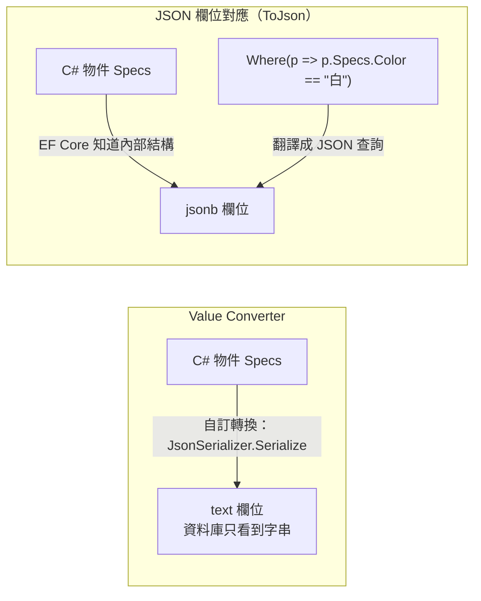

## 這是什麼

C# 的型別和資料庫的欄位型別不一定一一對應。`decimal` 可以直接對到 `numeric`，但「訂單狀態」這個列舉、「商品規格」這種巢狀物件、「標籤」這種字串清單，要怎麼存？

EF Core 預設知道怎麼對應常見型別；其他情況用兩種方式處理：

- **Value Converter（值轉換器）**：存檔時把 C# 值轉成資料庫能存的值，讀取時再轉回來。例如把列舉存成字串。
- **JSON 欄位對應**：把一個物件整個存成資料庫的 JSON 欄位，並且讓 LINQ 查詢可以翻譯成 JSON 的查詢語法。

## 運作原理



關鍵差別在「EF Core 是否知道內部結構」。自訂轉換器對 EF Core 來說是黑盒子：它只知道「轉成一個字串」，所以無法把 `p.Specs.Color == "白"` 翻譯成 SQL。JSON 欄位對應則讓 EF Core 理解物件的屬性，能翻譯成資料庫的 JSON 運算子。

變更追蹤也受影響。EF Core 用「比較新舊值」判斷欄位是否改了。如果轉換的是 `List<string>` 這種可變物件，原地 `Add` 一個元素後，物件參考沒變，預設的比較會認為「沒改」，這次修改就不會被存進去。**ValueComparer** 告訴 EF Core 如何比較內容與建立快照。

## 常見錯誤與正確寫法

### 1. 用自訂轉換器存需要查詢的物件

```csharp
// 錯：Specs 存成字串，查詢「顏色是白色」的商品時無法翻譯成 SQL
builder.Property(p => p.Specs).HasConversion(
    v => JsonSerializer.Serialize(v, (JsonSerializerOptions?)null),
    v => JsonSerializer.Deserialize<ProductSpecs>(v, (JsonSerializerOptions?)null)!);
```

改用 JSON 欄位對應，讓 EF Core 理解結構：

```csharp
// ProductSpecs 是一般的類別，含 Color、Size 等屬性
builder.OwnsOne(p => p.Specs, specs => specs.ToJson());

// 可以翻譯成 JSON 查詢
var whiteCups = await db.Products.Where(p => p.Specs.Color == "白").ToListAsync(ct);
```

JSON 欄位適合結構不固定、各商品類別欄位不同的資料。經常篩選、排序的欄位，仍然做成一般欄位並建立索引比較好。

### 2. 轉換可變集合卻沒設定 ValueComparer

```csharp
builder.Property(p => p.Tags)
    .HasConversion(
        v => string.Join(',', v),
        v => v.Split(',', StringSplitOptions.RemoveEmptyEntries).ToList())
    .Metadata.SetValueComparer(new ValueComparer<List<string>>(
        (a, b) => a!.SequenceEqual(b!),                                    // 依內容比較
        v => v.Aggregate(0, (hash, tag) => HashCode.Combine(hash, tag.GetHashCode())),
        v => v.ToList()));                                                // 快照要複製一份
```

沒有這段，`product.Tags.Add("新品")` 之後 `SaveChanges` 不會更新資料庫，而且不會有任何錯誤。

### 3. 列舉存整數，日後調整順序就全錯

列舉預設存成整數。有人在中間插入一個新值，之後的數字全部位移，資料庫裡的舊資料意義就變了。存成字串，並限定長度：

```csharp
builder.Property(o => o.Status)
    .HasConversion<string>()
    .HasMaxLength(32);
```

### 4. 把本地時間存進 timestamptz

Npgsql 6 起，`DateTime` 寫入 PostgreSQL 的 `timestamp with time zone` 欄位時，`Kind` 必須是 `Utc`，否則丟出例外。這是刻意的設計，避免伺服器時區不同時存錯時間。一律以 UTC 存入，用 `DateTimeOffset` 或 `DateTime.UtcNow`；顯示時再依使用者時區轉換，見 [時間與時區](/platforms/dotnet/time-zones/)。

## 使用邊界

- 不同的資料庫 provider 對 JSON 欄位的支援程度不同（PostgreSQL 的 `jsonb` 支援最完整），使用前確認你的 provider 版本支援哪些查詢。
- JSON 欄位內的屬性要建立索引，需要資料庫特有的做法（例如 PostgreSQL 的 GIN 索引或運算式索引），透過 migration 的原生 SQL 建立。
- 欄位型別的變更會影響已存在的資料，修改前規劃資料轉換，見 [Migration](/data-access/migrations/)。
