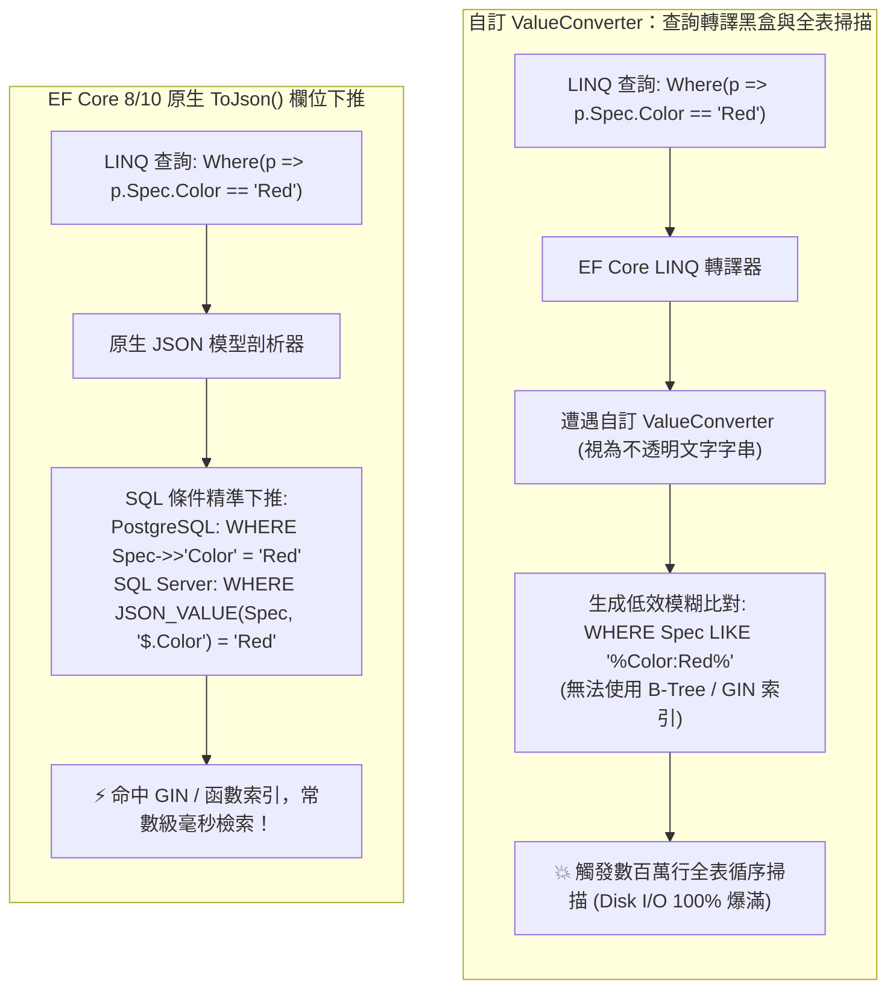

## 案發現場

某快速擴張的電商平台商品中心，為了解決各商品分類自訂規格（如手機的「處理器/記憶體」、衣服的「顏色/尺碼」）不斷變化的痛點，工程師決定引入「半結構化」儲存架構：在 `Product` 實體上宣告一個自訂的 C# 規格物件 `ProductSpecification`，並在 Entity Framework Core 中註冊自訂的 `ValueConverter`，利用 `System.Text.Json` 將其序列化為字串存入資料庫的 `nvarchar(max)` 或 `text` 欄位中。

這套架構上線初期運作順暢，直到行銷團隊推出了一次「紅色系商品專案促銷」。前端發起了一筆看似簡單的條件查詢：`Where(p => p.Specification.Color == "Red")`。查詢發出後，資料庫伺服器的磁碟 I/O 利用率瞬間飆升至 100%，CPU 持續滿載，單次查詢耗時長達 14 秒！多筆請求直接引發連鎖超時崩潰。

DBA 截取 SQL 執行計畫後大驚失色：由於開發者使用了自訂的黑盒字串 `ValueConverter`，EF Core 的 SQL 轉譯器完全無法理解該欄位內部的 JSON 階層結構！LINQ 條件無法被轉譯為資料庫原生的 JSON 提取函式，而是被迫生成了毀滅性的全表模糊搜尋：`WHERE [Specification] LIKE '%"Color":"Red"%'`，強迫資料庫對數百萬行商品進行痛苦的**全表循序掃描（Full Table Scan）**！

更令團隊崩潰的另一起事故發生在購物車模組：工程師使用 `ValueConverter` 將標籤清單 `List<string>` 轉換為逗號分隔字串。然而在使用者修改購物車清單（呼叫 `cart.Tags.Add("VIP")`）並呼叫 `SaveChanges()` 後，系統完全沒有報錯，但新標籤卻**神秘地消失了**！資料庫中依舊是舊的字串！排查發現：由於未配置 `ValueComparer`，EF Core 的變更追蹤器比對了物件記憶體位址，誤判為「實體未曾修改」，將使用者的異動**直接靜默丟棄**！



---

## 致命反模式 vs. 正確解法

### 反模式一：使用不透明的自訂字串 `ValueConverter` 儲存結構化物件

`ValueConverter` 的底層定位是**標量數值（Scalar Value）的儲存轉譯**（例如將 C# `DateTime` 轉換為 Unix 毫秒 `long`，或將自訂強型別識別碼 `OrderId` 轉換為 `Guid`）。若將其濫用為多欄位物件或 JSON 字典的序列化工具：
- EF Core 的查詢提供者無法解析中繼資料模型。
- 對子屬性的任何過濾、排序或投影，皆無法生成結構化 SQL 語法，只能退化為效能低劣的 `LIKE` 模糊比對或直接擲出無法轉譯例外。

### 反模式二：轉換可變集合（Mutable Collections）未配置 `ValueComparer`

當使用值轉換器將可變型別（如 `List<T>`、`Dictionary<TKey, TValue>` 或可變自訂類別）存為資料庫字串時：
- EF Core 的 `ChangeTracker` 預設採用**參考相等性比對（Reference Equality）**。
- 當你在程式碼中修改集合內部元素（如 `tags.Add("Promo")`）時，集合物件本身的記憶體位址並沒有改變。
- 在呼叫 `SaveChangesAsync()` 時，變更追蹤器比對記憶體指標一致，判定實體處於 `Unchanged` 狀態，**你的修改將被靜默忽略，資料直接遺失**！

### 正確解法：全面擁抱 EF Core 原生 `ToJson()` 欄位映射，並為可變轉換配置 `ValueComparer`

自 EF Core 8 起，微軟正式引入了革命性的 **原生 JSON 欄位支援（`ToJson()`）**。它將自訂物件視為 Owned Entity，並在資料庫端直接映射為原生 JSON 儲存型別（如 PostgreSQL `jsonb` 或 SQL Server `JSON`）。這使得 LINQ 條件能夠被完美轉譯為資料庫的 JSON 提取運算子，享受索引加速。若必須使用自訂可變型別轉換，則必須配對配置 `ValueComparer`。

```csharp
using System;
using System.Collections.Generic;
using System.Linq;
using Microsoft.EntityFrameworkCore.ChangeTracking;

namespace DotNetPerformance.DataAccess;

/// <summary>
/// 商品規格複合型別（原生 ToJson 映射載體）
/// </summary>
public sealed class ProductSpecification
{
    public string Color { get; set; } = string.Empty;
    public string Size { get; set; } = string.Empty;
    public int WeightGrams { get; set; }
}

/// <summary>
/// 標籤集合深層比較器（防範 ValueConverter 變更被靜默丟棄）
/// </summary>
public static class TagCollectionComparerFactory
{
    /// <summary>
    /// 建立針對 List<string> 的生產級 ValueComparer
    /// </summary>
    public static ValueComparer<List<string>> CreateListStringComparer()
    {
        return new ValueComparer<List<string>>(
            // 1. 相等性比對邏輯：逐元素內容比對，而非比對記憶體指標
            equalsExpression: (c1, c2) => (c1 == null && c2 == null) || (c1 != null && c2 != null && c1.SequenceEqual(c2)),
            // 2. 雜湊碼產生邏輯：結合所有元素的 HashCode
            hashCodeExpression: c => c.Aggregate(0, (hash, item) => HashCode.Combine(hash, item.GetHashCode())),
            // 3. 快照深拷貝邏輯：載入時建立全新的副本，確保原始值不被污染
            snapshotExpression: c => c.ToList());
    }
}

public static class Program
{
    public static void Main()
    {
        Console.WriteLine("=== EF Core 型別映射、ToJson 與 ValueComparer 防禦實測 ===");

        // 1. 驗證 ValueComparer 深度比對邏輯
        var comparer = TagCollectionComparerFactory.CreateListStringComparer();
        var originalList = new List<string> { "Electronics", "FlashSale" };
        var snapshotList = comparer.Snapshot(originalList);

        Console.WriteLine($"[快照建立] 快照物件是否為獨立副本 (ReferenceEquals == false): {!ReferenceEquals(originalList, snapshotList)}");

        // 模擬使用者修改原集合內容
        originalList.Add("FreeShipping");

        // 驗證 ChangeTracker 是否能精確捕捉到內容異動
        bool isChanged = !comparer.Equals(originalList, snapshotList);
        Console.WriteLine($"[變更偵測] 偵測到內部元素異動: {isChanged} (成功防禦變更靜默遺失！)");

        // 2. 原生 ToJson 欄位結構宣告語意展示
        Console.WriteLine("\n[原生 ToJson 配置語意]");
        Console.WriteLine("  modelBuilder.Entity<ProductItem>().OwnsOne(p => p.Spec, b => b.ToJson());");
        Console.WriteLine("  -> 支援 SQL 條件下推: WHERE Spec->>'Color' = 'Red' (PostgreSQL)");
        Console.WriteLine("  -> 支援 SQL 條件下推: WHERE JSON_VALUE(Spec, '$.Color') = 'Red' (SQL Server)");
    }
}
```

預期控制台輸出：

```text
=== EF Core 型別映射、ToJson 與 ValueComparer 防禦實測 ===
[快照建立] 快照物件是否為獨立副本 (ReferenceEquals == false): True
[變更偵測] 偵測到內部元素異動: True (成功防禦變更靜默遺失！)

[原生 ToJson 配置語意]
  modelBuilder.Entity<ProductItem>().OwnsOne(p => p.Spec, b => b.ToJson());
  -> 支援 SQL 條件下推: WHERE Spec->>'Color' = 'Red' (PostgreSQL)
  -> 支援 SQL 條件下推: WHERE JSON_VALUE(Spec, '$.Color') = 'Red' (SQL Server)
```

---

## 踩坑與避坑指南

### 1. Enum（列舉）欄位儲存的最佳實務：整數 vs. 字串

在實體中定義 `OrderStatus` 列舉時，儲存策略存在兩難：
- **預設存為整數（`int`）**：儲存緊湊（4 bytes），但若未來工程師在列舉中間插入新成員（如在 `Pending(0)` 與 `Paid(1)` 之間插入 `Processing`），資料庫中已儲存的整數映射將**全部錯位**，造成嚴重的資料語意損毀！
- **存為字串（`HasConversion<string>()`）**：
  具備最高的向前相容性與可讀性，但必須宣告長度限制：
  ```csharp
  // 最佳配置：存為字串但嚴格限制長度為 32 字元，防止生成未約束的 nvarchar(max)
  builder.Property(o => o.Status)
      .HasConversion<string>()
      .HasMaxLength(32)
      .IsUnicode(false); // 在 SQL Server 生成 ASCII varchar(32)，節省 50% 儲存空間
  ```

### 2. DateTimeOffset 與 UTC 儲存的轉換陷阱

在跨資料庫部署時，若將 `DateTimeOffset` 存入只支援普通 `datetime` 的資料庫（如 MySQL 或 SQLite），必須配置轉換器確保寫入與讀出時一律強制對齊為 UTC：

```csharp
builder.Property(e => e.CreatedAt)
    .HasConversion(
        v => v.ToUniversalTime(),
        v => v.ToUniversalTime());
```
若缺少該轉換，在跨時區伺服器查詢時，會因遺失 `Offset` 位移量而產生 8 小時的計算時間差。

### 3. 何時不該使用 JSON 欄位（`ToJson`）？

- **需要強外鍵約束（Foreign Key Constraints）的核心實體**：若將子訂單或支付交易塞入訂單 JSON 內部，資料庫無法為其建立外鍵保護，且在進行多維度統計聚合（`GROUP BY`）時效能遠遜於標準正規化關聯表。
- **高頻獨立修改子屬性**：若資料頻繁只修改 JSON 內部的某個微小屬性，資料庫仍必須重寫整個 JSON 文件的二進位頁面，增加 WAL 寫入放大。

---

## 線上排查指令

### 1. 檢驗 PostgreSQL JSON 查詢是否正確命中 GIN 索引

確認 LINQ 是否成功下推為原生 JSON 運算子：

```sql
-- 檢驗查詢執行計畫是否走 Bitmap Index Scan 命中 GIN 索引，而非 Seq Scan 全表掃描
EXPLAIN (ANALYZE, BUFFERS) 
SELECT * FROM "Products" 
WHERE "Spec"->>'Color' = 'Red';
```

若輸出顯示 `Seq Scan on Products`，代表缺乏 GIN 索引或運算子未正確下推。

### 2. 檢索應用程式日誌中無法轉譯 SQL 的警告

確認是否在 LINQ 中呼叫了未受支援的 C# 運算：

```bash
# 抓取 EF Core 由於無法轉譯而引發的警告日誌
grep -i -E "could not be translated|ClientEvaluation" /var/log/app/*.log | tail -n 20
```
