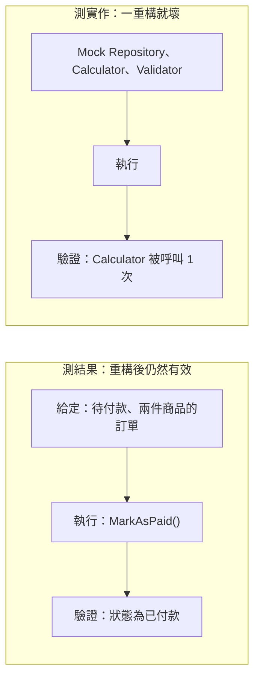

## 這是什麼

測試的目的，是讓你改程式時有信心不會弄壞既有的功能。最有價值的測試，保護的是**業務規則**：「待付款的訂單可以付款」「已出貨的訂單不能取消」「滿千免運」。這些規則在重構時不該改變，所以測試也不該因為重構而失敗。

**商業行為測試**指的是：給定一個情境，執行一個業務動作，檢查結果是否符合規則。它不關心內部用了哪些類別、呼叫了幾次哪個方法。

## 運作原理



測試大致分三層，越往下越接近真實、也越慢：

| 層級 | 測什麼 | 依賴 |
| --- | --- | --- |
| 領域測試 | 實體與值物件的規則 | 純記憶體，不需要替身 |
| 用例測試 | 一個用例的流程與結果 | 只替換系統邊界（付款閘道、時間） |
| 整合測試 | 和資料庫、Redis、RabbitMQ 一起運作的結果 | 真實的服務（容器），見 [整合測試](/engineering/integration-tests/) |

**測試替身**（Mock、Stub、Fake）用來取代你無法控制或不想真的呼叫的東西。適合替換的是系統邊界：外部付款 API、寄信服務、目前時間。不適合替換的是你自己的領域物件與資料庫。

## 常見錯誤與正確寫法

### 1. 驗證呼叫次數，而不是結果

```csharp
// 錯：只要重構把計算移到別處，測試就失敗，即使結果完全正確
calculator.Received(1).Calculate(Arg.Any<Order>());
```

直接驗證業務結果：

```csharp
public class OrderTests
{
    [Fact]
    public void 已付款訂單不能再加商品()
    {
        var order = new OrderBuilder().WithItem(price: 100, quantity: 1).Build();
        order.MarkAsPaid();

        var act = () => order.AddItem(Guid.NewGuid(), new Money(50, "TWD"), 1);

        Assert.Throws<InvalidOperationException>(act);
        Assert.Single(order.Lines); // 明細沒有被改變
    }
}
```

`OrderBuilder` 提供合理的預設值，讓測試只寫它關心的部分，見 [Factory 與 Builder](/architecture/creation-patterns/)。

### 2. 只在系統邊界使用替身

```csharp
[Fact]
public async Task 付款閘道拒絕時訂單維持待付款()
{
    var gateway = Substitute.For<IPaymentGateway>(); // 外部系統：用替身
    gateway.AuthorizeAsync(Arg.Any<PaymentRequest>(), Arg.Any<CancellationToken>())
           .Returns(PaymentResult.Declined("卡片額度不足"));

    var order = new OrderBuilder().Build();
    var handler = new PayOrderHandler(gateway);

    var result = await handler.HandleAsync(order, TestContext.Current.CancellationToken);

    Assert.False(result.Succeeded);
    Assert.Equal(OrderStatus.PendingPayment, order.Status); // 驗證的是業務結果
}
```

### 3. 用 EF Core InMemory 測資料存取

InMemory provider 不是關聯式資料庫：沒有交易、沒有唯一約束、LINQ 的翻譯行為也不同。用它測試，唯一約束擋重複下單、條件更新防超賣這些最重要的行為都測不到，還可能讓在真實資料庫會失敗的查詢通過。資料存取用真實的 PostgreSQL 或 MySQL 測，見 [整合測試](/engineering/integration-tests/)。

### 4. 測試依賴目前時間

「優惠券在午夜過期」的測試，只有在特定時間跑才會通過。程式注入 `TimeProvider`，測試用 `FakeTimeProvider` 控制時間：

```csharp
// 套件：Microsoft.Extensions.TimeProvider.Testing
var time = new FakeTimeProvider(new DateTimeOffset(2026, 10, 31, 23, 59, 0, TimeSpan.FromHours(8)));
var coupon = Coupon.Create(expiresAt: new DateTimeOffset(2026, 11, 1, 0, 0, 0, TimeSpan.FromHours(8)));

Assert.True(coupon.IsValid(time.GetUtcNow()));
time.Advance(TimeSpan.FromMinutes(2));
Assert.False(coupon.IsValid(time.GetUtcNow()));
```

## 使用邊界

- 不要為了覆蓋率去測 getter、DTO 或框架本身的行為。測試寫在規則上。
- xUnit 預設會平行執行不同的測試類別；測試之間共用靜態狀態或同一個資料庫時，會互相干擾。每個測試準備自己的資料，或把需要共用的放進同一個 collection。
- `async` 測試方法回傳 `Task`，不要寫 `async void`，否則例外不會讓測試失敗。
- 快取與訊息相關的故障情境（服務停止、重送）屬於整合層級，見 [快取與訊息的測試](/engineering/cache-messaging-tests/)。
