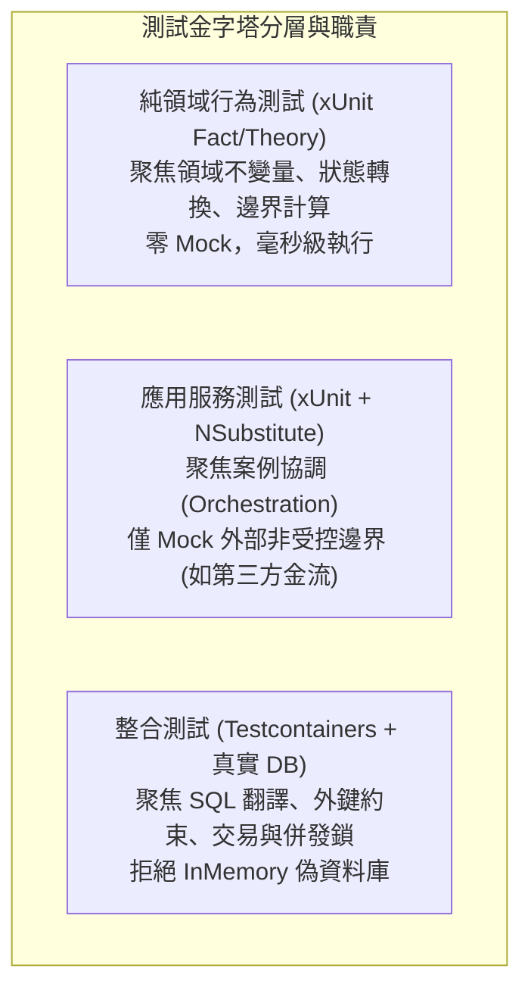

在電商軟體開發中，自動化測試是保障高頻交付與系統正確性的關鍵安全網。然而，許多團隊常陷入「測試覆蓋率高達 90%，線上發布依然頻繁故障」的困境。問題的核心在於：測試是否真正聚焦於「可驗證的商業行為不變量（Domain Invariants）」，抑或僅是在機械式地模擬內部實作細節。

## 案發現場

某電商核心訂單服務在一次大促前夕發布了新版結帳與折扣計算模組。CI 流水線中 850 個單元測試在 30 秒內全數以綠燈通過，然而上線短短 15 分鐘內，維運團隊即接獲客服回報重大災情：

1. **負數金額訂單成功建立**：系統出現數十筆結帳金額為 `-150` 元的異常訂單，財務系統甚至自動向消費者派發退款。排查發現，開發者為訂單計算寫了單元測試，但測試中使用 NSubstitute 將所有折扣服務全部 Mock 成回傳固定值，完全沒有針對「折抵上限不得大於訂單總額」等邊界狀態進行斷言。
2. **重構即雪崩（脆弱測試 Brittle Tests）**：技術團隊為了效能優化，將原本在 Handler 中呼叫的 `_orderRepo.UpdateAsync()` 與 `_eventPublisher.PublishAsync()` 合併為一次資料庫交易 Outbox 提交。結果一改動內部方法呼叫順序，全專案有 300 多個單元測試瞬間爆紅，原因是測試程式碼寫滿了 `_orderRepo.Received(1).UpdateAsync(...)` 的呼叫次數驗證，測試與實作細節強烈耦合。
3. **EF Core InMemory 假性成功陷阱**：在測試資料庫持久化時，工程師使用了 `UseInMemoryDatabase`。測試順利通過，但上線執行在 PostgreSQL 上時，卻因缺少必填欄位的外鍵約束而拋出 `PostgresException: 23502 null value in column violates not-null constraint`，交易全數失敗。
4. **隨機閃爍測試（Flaky Tests）延誤部署**：CI 伺服器在平行執行 xUnit 測試時，部分訂單超時測試時好時壞。排查發現測試中依賴了 `Thread.Sleep(500)` 與共用的靜態記憶體時鐘，受到 CI 節點 CPU 負載波動影響而產生隨機失敗。



## 反模式與正確解法

### 反模式一：過度 Mock 內部實作，驗證呼叫次數而非業務結果

開發者為求「隔離」，把系統內所有相依介面（甚至領域物件本身）全部替換成 Mock，並在測試結尾大量使用 `substitute.Received(1).SomePrivateStep()`。這種測試只驗證了「程式碼每一行怎麼寫」，一旦重構演算法或重構內部結構，測試立即破裂；更糟的是，若 Mock 假造了錯誤的資料（例如回傳負數金額），被測程式碼就會在錯誤的假設下跑出假綠燈。

#### 正確解法：純領域邏輯完全不依賴 Mock，針對狀態與例外斷言

領域實體（Domain Entity）與值物件（Value Object）應該是完全純粹的 C# 類別。透過 xUnit 的 `[Fact]` 與 `[Theory]`，直接驗證在各種合法與邊界輸入下，領域狀態是否正確變更，或是否如期拋出強型別商業例外：

```csharp
public sealed class OrderDomainTests
{
    [Fact]
    public void CancelOrder_WhenAlreadyPaid_ShouldThrowDomainException()
    {
        // Arrange
        var order = Order.Create(OrderId.New(), CustomerId.New());
        order.MarkAsPaid(PaymentId.New(), paidAmount: 500m);

        // Act & Assert
        var ex = Assert.Throws<InvalidOrderOperationException>(() =>
        {
            order.Cancel(reason: "買家主動取消");
        });

        Assert.Equal("已付款之訂單不得直接取消，必須走退款申請流程。", ex.Message);
        Assert.Equal(OrderStatus.Paid, order.Status); // 驗證狀態未被破壞
    }

    [Theory]
    [InlineData(100, 150, 0)]  // 折扣大於總額時，應限制折抵後金額下限為 0
    [InlineData(100, 30, 70)]   // 正常折扣
    [InlineData(100, 0, 100)]   // 無折扣
    public void ApplyDiscount_ShouldCalculateNetPayableCorrectly(
        decimal subtotal, decimal discount, decimal expectedNet)
    {
        // Arrange
        var order = Order.CreateWithSubtotal(OrderId.New(), subtotal);

        // Act
        order.ApplyCoupon(new Coupon(CouponCode.Create("PROMO"), discount));

        // Assert
        Assert.Equal(expectedNet, order.NetPayableAmount);
    }
}
```

### 反模式二：在應用服務層全面開放 Class Mock，侵入領域設計

為了配合測試框架 Mock 類別，強行將領域類別的所有方法標註為 `virtual`，甚至將建構子開放為 `public`，破壞了封裝性（Encapsulation）。

#### 正確解法：NSubstitute 僅用於替換真正的外部不可控邊界（Out-of-Process Ports）

在應用層（Application Layer）的 Use Case 測試中，NSubstitute 僅應作用於外部 I/O 抽象介面（如第三方支付閘道 `IPaymentGateway`、發票開立服務 `IInvoiceService`）。透過模擬外部異常或回傳值，驗證 Handler 在成功或失敗時的業務分支：

```csharp
public sealed class CheckoutOrderHandlerTests
{
    private readonly IPaymentGateway _paymentGateway = Substitute.For<IPaymentGateway>();
    private readonly IOrderRepository _orderRepository = Substitute.For<IOrderRepository>();
    private readonly TimeProvider _timeProvider = Substitute.For<TimeProvider>();

    [Fact]
    public async Task Handle_WhenPaymentFails_ShouldMarkOrderAsPaymentFailed()
    {
        // Arrange
        var orderId = OrderId.New();
        var order = Order.Create(orderId, CustomerId.New());
        _orderRepository.GetByIdAsync(orderId, Arg.Any<CancellationToken>())
            .Returns(order);

        // 模擬外部第三方金流回傳拒絕
        _paymentGateway.ChargeAsync(Arg.Any<PaymentRequest>(), Arg.Any<CancellationToken>())
            .Returns(PaymentResult.Failed("餘額不足"));

        var handler = new CheckoutOrderHandler(_orderRepository, _paymentGateway, _timeProvider);

        // Act
        var result = await handler.HandleAsync(new CheckoutCommand(orderId), CancellationToken.None);

        // Assert：針對業務結果斷言，而非檢查呼叫細節
        Assert.False(result.IsSuccess);
        Assert.Equal("付款失敗：餘額不足", result.ErrorMessage);
        Assert.Equal(OrderStatus.PaymentFailed, order.Status);
    }
}
```

### 反模式三：使用 EF Core InMemory 取代真實資料庫進行儲存測試

EF Core InMemory 僅是在記憶體中用 Dictionary 儲存物件參考，它**不支援交易交易復原（Transaction Rollback）、不支援關聯外鍵約束、不支援原生 SQL 函式，更無法檢驗 SQL 語法翻譯正確性**。

#### 正確解法：使用 Testcontainers 執行真正的關聯式資料庫整合測試

詳細資料庫交易與真實 SQL 測試應由整合測試負責（配合 Testcontainers 啟動暫時的 PostgreSQL 容器），單元測試則保持極速專注於純邏輯。

## 踩坑與避坑指南

### 1. 非同步測試方法的簽章陷阱：切勿使用 `async void`
在撰寫 xUnit 測試時，非同步測試必須宣告為 `public async Task`。若誤寫為 `public async void`，xUnit runner 無法得知該 Task 何時完成，測試方法會被視為立即結束並顯示綠燈，而內部非同步拋出的斷言失敗會直接在線程池中變成未處理例外（Unhandled Exception），引發測試處理程序非預期崩潰。

### 2. 時間相依性問題：善用 .NET 8+ 原生 `TimeProvider`
避免在測試中呼叫 `DateTime.UtcNow` 或使用 `Thread.Sleep` 來等待時間經過。
- **避坑建議**：全面注入 `TimeProvider`（或使用 `Microsoft.Extensions.Time.Testing` 套件中的 `FakeTimeProvider`），在測試中呼叫 `fakeTime.Advance(TimeSpan.FromMinutes(30))`，能在零延遲下精確模擬訂單 30 分鐘逾時未付款的自動取消邏輯。

### 3. xUnit 測試平行化與靜態狀態共享
xUnit 預設會跨不同測試類別（Test Classes）進行多執行緒平行執行。若被測程式碼或測試輔助類別中存有靜態變數（`static`）、未隔離的單例快取，會引發跨測試的隨機資料污染。
- **避坑建議**：若有共用昂貴資源（例如整合測試資料庫），使用 `IClassFixture<T>` 或 `ICollectionFixture<T>` 進行生命週期管理，並為每個測試產生獨立的資料隔離標籤（如獨立的 TenantId 或 OrderId）。

## 線上排查指令

針對本機與 CI 環境中的測試執行失敗、逾時卡死與覆蓋率分析，使用下列指令排查：

```bash
# 1. 執行特定專案的所有單元測試並輸出詳細除錯資訊
dotnet test tests/DevWiki.Ecommerce.UnitTests/ --logger "console;verbosity=normal"

# 2. 針對特定測試類別或方法執行精確過濾
dotnet test --filter "FullyQualifiedName~OrderDomainTests"

# 3. 排查測試死鎖或卡死問題（啟用 Hang 逾時自動傾印轉儲）
dotnet test --blame-hang --blame-hang-timeout 60s --logger "trx;LogFileName=test-results.trx"

# 4. 收集程式碼覆蓋率報告（使用 coverlet 產出 Cobertura 格式）
dotnet test /p:CollectCoverage=true /p:CoverletOutputFormat=cobertura /p:Threshold=80

# 5. 排查 xUnit 平行化引發的隨機失敗（強制單執行緒依序執行驗證）
dotnet test --no-build -- ParallelizeTestCollections=false
```
