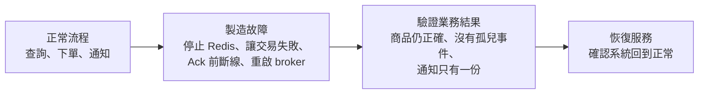

## 這是什麼

快取和訊息系統最重要的行為，都發生在「出錯的時候」：Redis 連不上時商品頁還能不能顯示、訂單交易失敗時事件會不會被誤發、Worker 在 Ack 前當掉時通知會不會寄兩次。

這些行為用 Mock 測不出來：Mock 的 Redis 不會斷線，Mock 的 RabbitMQ 不會重送。要用真的服務，並且在測試中**主動製造故障**。

## 運作原理



每個故障情境都要回答「使用者看到什麼」：

| 故障 | 要驗證的結果 |
| --- | --- |
| Redis 停止 | 商品查詢改回資料庫，結果正確；回源數量有上限 |
| 快取資料損壞 | 辨識出損壞、刪除後回源，不把錯誤資料回給使用者 |
| 寫入 outbox 失敗 | 訂單也沒有建立（一起回滾） |
| broker 暫時無法交付 | 事件留在 outbox，恢復後繼續發布 |
| Consumer 在 Ack 前斷線 | 訊息重新交付，通知仍只有一份 |
| 持續失敗的訊息 | 有限次重試後進入死信佇列 |

## 常見錯誤與正確寫法

### 1. 用 Mock 模擬 Redis 與 RabbitMQ

Mock 只能模擬「回傳錯誤」，模擬不了逾時、半斷線、重新交付。用 Testcontainers 啟動真的服務，再在測試中停止它：

```csharp
// 套件：Testcontainers.Redis、Testcontainers.PostgreSql
[Fact]
public async Task Redis停止時商品查詢仍回傳正確資料()
{
    var client = _factory.CreateClient();
    var before = await client.GetFromJsonAsync<ProductDto>("/products/1", TestContext.Current.CancellationToken);

    await _redis.StopAsync(TestContext.Current.CancellationToken); // 製造故障

    var during = await client.GetFromJsonAsync<ProductDto>("/products/1", TestContext.Current.CancellationToken);
    Assert.Equal(before!.Price, during!.Price); // 降級後結果仍正確

    await _redis.StartAsync(TestContext.Current.CancellationToken); // 恢復，避免影響其他測試
}
```

### 2. 只測成功路徑，沒測回滾

讓 outbox 的寫入失敗（例如在測試中對 outbox 表加上一個會被違反的約束，或替換成會丟例外的實作），然後確認訂單表裡也沒有資料。這個測試保護的是「訂單和事件一起成功或一起失敗」，見 [Outbox 與 Inbox](/architecture/outbox-inbox/)。

### 3. 沒有測重送

讓 Consumer 處理完、提交交易，但在 Ack 之前關閉 Channel，RabbitMQ 會重新交付這則訊息。驗證通知表中這張訂單的通知仍然只有一筆。這個測試保護的是 Inbox 與業務唯一條件。

### 4. 宣告參數不一致讓測試環境就失敗

測試中宣告佇列的參數（例如 `x-queue-type: quorum`）和正式程式不同，RabbitMQ 會以 `PRECONDITION_FAILED` 關閉 Channel。測試與正式程式使用同一份拓撲宣告程式碼。

## 使用邊界

- 單節點容器的重啟，只能驗證最基本的恢復；broker 叢集、Redis 高可用的容錯移轉、跨區故障，要在雲端的測試環境做故障演練。
- 故障測試要在結束時恢復服務，或每個測試類別使用獨立的容器，避免影響其他測試。
- 測試的名稱與報告要寫清楚驗證的範圍；「通過了故障測試」不等於「能承受所有故障」。

## 雲端排查

故障演練在雲端的測試環境進行：主動製造故障，觀察系統的反應是否符合預期。

### 叢集層（GKE 與 EKS 相同）

```bash
# 停止所有通知 Worker：訊息應該在佇列中累積，而不是遺失
kubectl scale deployment notification-worker -n shop-staging --replicas=0

# 下幾張測試訂單後恢復，確認累積的訊息被處理、且通知沒有重複
kubectl scale deployment notification-worker -n shop-staging --replicas=2
```

### 託管服務層

#### GKE

觸發 Memorystore 的手動容錯移轉，觀察商品查詢的錯誤率與回源次數：

```bash
gcloud redis instances failover shop-cache-staging --region=asia-east1
```

自建的 RabbitMQ 可以刪除一個節點的 Pod，確認 quorum 佇列仍可運作：`kubectl delete pod -n messaging shop-mq-server-1`。

#### EKS

觸發 ElastiCache 的容錯移轉測試（只在測試環境）：

```bash
aws elasticache test-failover --replication-group-id shop-cache-staging --node-group-id 0001
```

Amazon MQ 的叢集部署可以透過重新啟動 broker 觀察 Consumer 的重新連線：`aws mq reboot-broker --broker-id <broker-id>`。

### 應用程式層

每次演練都記錄：故障開始與結束的時間、錯誤率、回源次數、佇列累積量、恢復所需時間，以及業務結果的核對（訂單數、通知數）。這些數字是改善降級策略與 SLO 的依據，見 [SLO 與告警](/engineering/slo-alerts/)。
