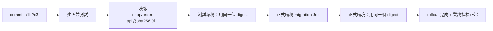

## 這是什麼

**CI**（持續整合）在每次提交時自動建置、測試；**CD**（持續交付／部署）把通過測試的版本送到各個環境。目的不只是「自動化」，更是讓每一次上線都**可追查、可重現、可回復**：線上跑的是哪個 commit、用了哪個映像、資料表是哪一版。

一條電商後端的交付流程大致是：

```text
commit → 建置與測試 → 建置映像並推送 → 弱點掃描 → 部署到測試環境 → 驗證
       → 執行 migration（正式環境）→ 更新 Deployment → 等 rollout 完成 → 驗證業務指標
```

## 運作原理



**建置一次，到處部署。** 映像在 CI 只建置一次，之後每個環境都部署同一個映像。用 **digest**（`@sha256:...`，映像內容的雜湊值）而不是 tag 指定版本：tag 可以被重新指向別的映像，digest 不行，所以「測試環境測過的」和「正式環境跑的」保證是同一份。

**CI 的雲端權限。** CI 要推送映像、更新叢集，需要雲端權限。不要把長期有效的服務帳號金鑰放在 CI 的機密設定裡；GCP 與 AWS 都支援讓 GitHub Actions 以 OIDC 身分換取短期憑證。

**部署順序。** 依 Expand／Contract，migration 要先於新版應用程式執行，而且新的資料表結構必須讓舊版程式也能運作，見 [Migration](/data-access/migrations/)。

## 常見錯誤與正確寫法

### 1. 用 latest 或可變的 tag 部署

```yaml
# 錯：latest 指向哪個映像會變；Pod 重建時可能拉到不同的版本
image: asia-east1-docker.pkg.dev/shop-prod/apps/order-api:latest
```

部署時寫入 digest，並保留 commit 資訊方便追查：

```yaml
image: asia-east1-docker.pkg.dev/shop-prod/apps/order-api@sha256:9f86d081884c7d659a2feaa0c55ad015a3bf4f1b2b0b822cd15d6c15b0f00a08
```

EKS 上的映像倉庫是 ECR，例如 `111122223333.dkr.ecr.ap-northeast-1.amazonaws.com/order-api@sha256:...`。

### 2. CI 裡放長期的雲端金鑰

GitHub Actions 以 OIDC 向雲端換取短期憑證：

```yaml
permissions:
  id-token: write   # 允許 workflow 取得 OIDC token
  contents: read

steps:
  # GCP：Workload Identity Federation
  - uses: google-github-actions/auth@v2
    with:
      workload_identity_provider: projects/123456/locations/global/workloadIdentityPools/github/providers/shop
      service_account: ci-deployer@shop-prod.iam.gserviceaccount.com

  # AWS：以 OIDC 扮演 IAM 角色
  - uses: aws-actions/configure-aws-credentials@v4
    with:
      role-to-assume: arn:aws:iam::111122223333:role/ci-deployer
      aws-region: ap-northeast-1
```

兩邊都要在雲端端限制「只有這個 repository 的這個分支」可以換取憑證。

### 3. kubectl apply 沒報錯就當作部署成功

`kubectl apply` 只代表 Kubernetes 收下了新的設定，新 Pod 可能還在拉映像、啟動失敗、或一直無法通過 readiness。等 rollout 完成，並設定逾時：

```bash
kubectl apply -k overlays/production
kubectl rollout status deployment/order-api -n shop --timeout=5m
```

rollout 完成後，再看幾分鐘的業務指標（錯誤率、下單成功率），符合預期才算部署成功；不符合就回復到上一個 digest。

## 使用邊界

- **回復應用程式不會回復資料庫。** 回復前確認舊版程式能和目前的資料表結構一起運作。
- 映像弱點掃描放在推送之後、部署之前；嚴重弱點擋下部署，其他的建立工單追蹤。GCP 用 Artifact Analysis，AWS 用 ECR 的掃描功能。
- 雲端資源與 Kubernetes 宣告的管理方式，見 [IaC](/engineering/iac/)；部署失敗時 Pod 的探針與停止行為，見 [探針與安全停止](/platforms/kubernetes/probes-resources/)。

## 雲端排查

### 叢集層（GKE 與 EKS 相同）

```bash
# 線上跑的是哪個 digest
kubectl get deployment order-api -n shop -o jsonpath='{.spec.template.spec.containers[0].image}'

# rollout 卡住時：新的 ReplicaSet、Pod 狀態與事件
kubectl rollout status deployment/order-api -n shop --timeout=30s
kubectl get pods -n shop -l app=order-api
kubectl describe pod <新的 pod> -n shop | tail -20

# 回復到上一個版本
kubectl rollout undo deployment/order-api -n shop
```

`ImagePullBackOff` 代表拉不到映像：digest 寫錯，或節點沒有讀取映像倉庫的權限。

### 託管服務層

#### GKE

```bash
# 確認映像存在並查看弱點掃描結果
gcloud artifacts docker images describe \
  asia-east1-docker.pkg.dev/shop-prod/apps/order-api@sha256:<digest> --show-package-vulnerability
```

GKE 節點拉取 Artifact Registry 的映像，需要節點服務帳號具備讀取權限；跨專案的倉庫要另外授權。

#### EKS

```bash
# 映像與掃描結果
aws ecr describe-images --repository-name order-api --image-ids imageDigest=sha256:<digest>
aws ecr describe-image-scan-findings --repository-name order-api --image-id imageDigest=sha256:<digest>
```

EKS 節點拉取 ECR 映像，需要節點的 IAM 角色具備 ECR 唯讀權限。

### 應用程式層

在應用程式啟動日誌與 `/health` 回應中帶上版本資訊（commit、建置時間），從任何一個 Pod 都能直接看出它跑的是哪個版本，和追蹤、錯誤報告對照。
