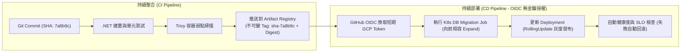

在現代電商系統中，軟體交付流水線（CI/CD Pipeline）是從開發者提交程式碼（Commit）到生產環境平穩接單的唯一安全走廊。自動化流水線不僅僅是自動執行 `dotnet build` 與推送 Docker 映像，更肩負著靜態品質防護、無密碼雲端授權、不可變產物追溯（Immutable Artifact Traceability）以及資料庫遷移安全的大任。

## 案發現場

某電商核心交易系統在一次緊急熱修復上線時，遭遇了災難性的交付事故，導致系統停機近一小時且無法即時復原：

1. **可變標籤（Mutable Tag）引發回滾徹底失效**：團隊在 CI 流水線中偷懶將映像標籤固定為 `:latest` 與 `:prod`。當新版本上線因 Bug 導致訂單全部拋出 500 時，值班人員立刻執行 `kubectl rollout undo` 試圖切回上一版。然而各個 Kubernetes 節點由於標籤名稱未變且配置了 `imagePullPolicy: IfNotPresent`，直接重用本機快取的錯誤映像，回滾操作完全失效，全站陷入癱瘓。
2. **靜態雲端金鑰外洩**：流水線為了部署 GKE，在 GitHub Repository Secrets 中存放了 Google 服務帳號（GSA）的長期 JSON 私鑰。某位兼職人員提交包含惡意 PR 流程的腳本，在建置日誌中將金鑰 Base64 打印出來，導致該金鑰遭外部爬蟲竊取並被濫用於加密貨幣挖礦。
3. **破壞性 Migration 導致舊版 Pod 瞬間暴斃**：新版程式重構了訂單資料表，將 `total_price` 欄位更名為 `payable_amount`。CI/CD 流水線在更新 Deployment 之前直接執行了 Migration。結果資料庫欄位立刻被刪除更名，此時線上正在處理結帳的數十個舊版（v1）Pod 瞬間因為找不到 `total_price` 欄位而全體噴出 SQL 異常，交易全線崩潰。
4. **未檢驗產物一致性**：測試環境（Staging）使用的是建置出來的映像 A，但在通過測試準備推進到生產環境（Production）時，流水線重新從主分支拉取代碼「重新編譯」了一次產生映像 B。兩次編譯之間剛好有其他 PR 被合併進去，導致未經測試的代碼意外流入生產環境。



## 反模式與正確解法

### 反模式一：使用 `:latest` 等可變標籤，並在各環境重複編譯

使用 `:latest` 或 `:v1` 等覆寫型標籤，破壞了產物的唯一性與確定性（Determinism）；而在 Staging 與 Production 分別重新執行一次建置，更無法保證生產環境執行的產物與測試通過的完全一致。

#### 正確解法：採用 Git Commit SHA 確定性標籤與單次構建多環境晉級

1. **唯一不可變標籤**：構建產物統一打上 `sha-${{ github.sha }}` 標籤，並記錄 Docker SHA256 唯一摘要（Digest，如 `@sha256:4d8a...`）。
2. **一次構建，環境晉級（Build Once, Promote Anywhere）**：在 CI 階段僅建置一次 Docker 映像並推送至 Artifact Registry。Staging 環境驗證無誤後，Production 部署流程直接引用該**同一個映像 Digest**，絕不在生產環境重新 build：

```yaml
# GitHub Actions 工作流程片段範例
- name: Build and Push Docker Image
  run: |
    IMAGE_URI="asia-east1-docker.pkg.dev/eshop-prod/eshop-repo/order-api:sha-${{ github.sha }}"
    docker build -t "$IMAGE_URI" -f src/OrderApi/Dockerfile .
    docker push "$IMAGE_URI"
    # 輸出不可變 Digest 以供部署階段精準引用
    echo "IMAGE_DIGEST=$(docker inspect --format='{{index .RepoDigests 0}}' "$IMAGE_URI")" >> $GITHUB_ENV
```

### 反模式二：在 CI 儲存庫中存放長期雲端服務帳號 JSON 私鑰

在 GitHub Actions、GitLab CI 中使用靜態 Service Account Key，面臨憑證洩漏、權限無法細粒度審計、過期輪替困難的高風險。

#### 正確解法：透過 Workload Identity Federation 實現 OIDC 無金鑰（Keyless）部署

利用 GitHub 提供的 OIDC Token，向 Google Cloud 的 Workload Identity Pool 換取最長 1 小時的短期 Google Cloud OAuth2 Access Token，完全無需在 GitHub Secrets 中存放任何實體私鑰：

```yaml
- name: Authenticate to Google Cloud via OIDC
  uses: google-github-actions/auth@v2
  with:
    workload_identity_provider: 'projects/123456789/locations/global/workloadIdentityPools/github-pool/providers/github-provider'
    service_account: 'cd-deployer@eshop-prod.iam.gserviceaccount.com'
    token_format: 'access_token'
```

### 反模式三：資料庫 Migration 執行破壞性變更，未與應用程式部署解耦

在多副本滾動發布過程中，新舊版本 Pod 一定會共同存活數分鐘。若 Migration 直接刪除舊欄位或修改型別，舊版 Pod 將立即崩潰。

#### 正確解法：嚴格落實「擴展與收縮（Expand and Contract）」原則

- **階段一（Expand 擴展）**：在發布新版程式前，先透過 Kubernetes 一次性 Job 執行向前相容的 Migration（例如新增欄位 `payable_amount`，允許 NULL 或設定預設值；舊欄位 `total_price` 保留）。此時新版與舊版 Pod 皆能正常讀寫。
- **階段二（Deploy 發布）**：執行 Deployment 滾動更新，全量替換為讀取 `payable_amount` 的新版 Pod。
- **階段三（Contract 收縮）**：在下一版迭代（確認無須回滾且舊版已全數下線）時，才發布另一份 Migration 刪除過時的舊欄位 `total_price`。

## 踩坑與避坑指南

### 1. 映像拉取策略 `imagePullPolicy` 陷阱
- 若標籤為 `:latest`，Kubelet 預設策略為 `Always`，每次都會向 Registry 檢查更新。
- 若標籤為具體版本號（如 `:sha-7a8b9c`），預設策略為 `IfNotPresent`。這是有利的設計，能加快 Pod 排程啟動速度並避免對 Registry 造成過大負載；但前提是**絕對不可覆寫既有標籤**！

### 2. 容器弱點掃描閘門（Trivy / Snyk）
在 CI 流水線中，容器映像構建完成後，必須在推送到 Registry 前執行自動化弱點掃描。若發現已知 `CRITICAL` 漏洞（例如嚴重的 Remote Code Execution 或底層 OS CVE），必須中斷流水線禁止發布：

```bash
trivy image --exit-code 1 --severity CRITICAL asia-east1-docker.pkg.dev/eshop-prod/eshop-repo/order-api:sha-7a8b9c
```

### 3. 部署成功判定條件：請勿僅依賴 `kubectl apply` 指令回傳 0
`kubectl apply` 只是向 API Server 成功提交了 YAML，**並不代表容器已經成功啟動並接單**！
- **避坑建議**：在 CI/CD 指令結尾必須加上：
  `kubectl rollout status deployment/order-api -n ecommerce-prod --timeout=180s`
  若在 180 秒內新 Pod 因 CrashLoopBackOff 或 Probe 失敗無法就緒，流水線會立即報錯並自動執行 `kubectl rollout undo`。

## 線上排查指令

針對 CI/CD 流水線失敗、映像版本追溯與線上回滾，維運人員可使用下列指令排查：

```bash
# 1. 檢視生產環境 Pod 當前實際執行的 Docker 映像版本與 Digest
kubectl get deployment order-api -n ecommerce-prod -o jsonpath='{.spec.template.spec.containers[*].image}'

# 2. 查詢 Artifact Registry 儲存庫中的映像歷史清單與 SHA256 摘要
gcloud artifacts docker images list asia-east1-docker.pkg.dev/eshop-prod/eshop-repo/order-api --include-tags

# 3. 檢視 Deployment 的發布版本歷史記錄（Revision 變更詳情）
kubectl rollout history deployment/order-api -n ecommerce-prod

# 4. 線上遭遇嚴重故障時秒級回滾至上一穩定版本
kubectl rollout undo deployment/order-api -n ecommerce-prod

# 5. 排查 CI/CD 一次性資料庫遷移 Job 的執行日誌與退出狀態
kubectl logs job/order-db-migration-sha-7a8b9c -n ecommerce-prod
```
