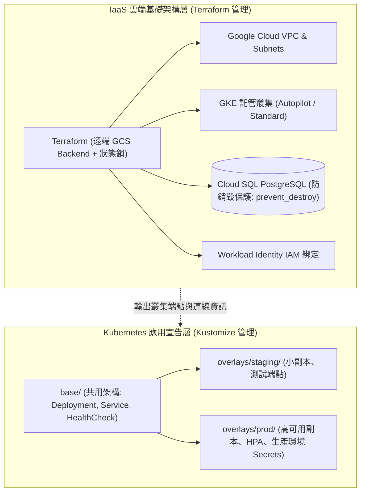

在建構現代電商系統時，我們通常需要管理兩個截然不同的基礎架構層級：一是底層的雲端資源（Google Cloud VPC 網路、Cloud SQL 資料庫實例、GKE 叢集、IAM 角色綁定）；二是運行於叢集內部的應用程式宣告（Deployment、Service、HTTPRoute、ConfigMap）。試圖用單一工具或隨意的人工操作混淆兩者的生命週期，是引發「組態漂移（Configuration Drift）」與災難性誤刪的核心根因。

## 案發現場

某電商技術團隊在進行年度電商系統架構升級時，差點造成不可挽回的正式環境資料庫全毀：

1. **狀態競爭與手動修改觸發毀滅性 Destroy-and-Recreate**：團隊使用 Terraform 管理 GCP 資源，但狀態檔（`terraform.tfstate`）存放於工程師本機硬碟且未啟用分散式鎖定。某位維運因急於修復連線，直接在 Google Cloud 控制台手動修改了 Cloud SQL 的子網路與實例型號。隨後另一位工程師在本機執行 `terraform apply`，Terraform 偵測到底層資源與本地狀態嚴重脫節，判定該變更無法線上修改，計畫將**生產環境的核心 PostgreSQL 實例「強制銷毀並重建（Destroy and Recreate）」**，幸而在最後確認階段被資深架構師攔截。
2. **Helm 模板地獄（Template Hell）導致縮排崩潰**：為了在測試環境（Staging）與正式環境（Production）共用同一套 Kubernetes 配置，團隊自己手寫了複雜的 Helm Chart，充斥著大量 `{{- if eq .Values.env "prod" }}` 與巢狀字串替換。在一次更新日誌環境變數的 PR 中，工程師少打了一個空格縮排，導致 YAML 語法解析錯誤，整批微服務在發布當下全面部署失敗。
3. **基礎設施與應用部署生命週期嚴重耦合**：流水線將 Terraform（建立 GKE 叢集與 Cloud SQL）與應用程式發布腳本（部署 ASP.NET Core API）揉合在同一個腳本中。每當應用程式只改動一行 C# 代碼需要發布時，流水線都要跑一次長達 15 分鐘的 `terraform plan`，嚴重拖慢迭代速度，且屢次因 GCP API 速率限制而卡死。



## 反模式與正確解法

### 反模式一：本地存放 State 檔案，並在雲端控制台進行手動熱修復

在 Web 控制台手動點擊修改 VPC 路由、資料庫參數或防火牆規則，會讓程式碼庫（Git）失去作為「唯一真實來源（Single Source of Truth）」的威信。而本機儲存 state 更是多人協作時的致命禁忌，極易引發狀態覆蓋與資料庫誤刪。

#### 正確解法：遠端 GCS Backend 狀態鎖定與宣告防銷毀保護

1. **啟用具備狀態鎖定與版本控制的遠端 Backend**：在 Google Cloud Storage (GCS) 上儲存 State，GCS 原生支援強一致性與物件鎖定，防止並行執行發生競爭：

```hcl
terraform {
  required_version = ">= 1.8.0"
  backend "gcs" {
    bucket = "eshop-terraform-state-prod"
    prefix = "infrastructure/gke-and-db"
  }
}
```

2. **對關鍵資料庫啟用 `prevent_destroy` 生命週期防護**：強制防止任何 `terraform apply` 指令因參數異動而意外銷毀生產資料庫：

```hcl
resource "google_sql_database_instance" "order_db" {
  name             = "eshop-order-db-prod"
  database_version = "POSTGRES_16"
  region           = "asia-east1"

  lifecycle {
    prevent_destroy = true # 即使執行 terraform destroy，亦嚴格拒絕刪除此實例！
  }

  settings {
    tier = "db-custom-4-16384"
    ip_configuration {
      ipv4_enabled    = false
      private_network = google_compute_network.eshop_vpc.id
    }
  }
}
```

### 反模式二：自研內部微服務全面採用重度 Helm 模板

Helm 適合用來封裝與分發**第三方現成套件**（如 ArgoCD、Prometheus、Cert-Manager）。但若用在團隊自身的業務微服務上，將原本清晰的 Kubernetes 宣告改寫成大量的 Go 模板語法（`{{ .Values.foo }}`），不僅喪失了原生 YAML 的語法檢查（Linter），還會讓配置審查（Code Review）變得極度晦澀。

#### 正確解法：自研應用採用 Kustomize 實施結構化無模板補丁

Kustomize 是 Kubernetes 官方內建的配置管理工具。它採用純宣告式架構，不使用任何模板變數替換，而是透過 `base/` 與 `overlays/` 進行明確的 Patch 合併：

- **`base/`**：定義共用的架構藍圖（Container Port、Liveness/Readiness 探針、Service 抽象）。
- **`overlays/prod/`**：僅宣告正式環境的差異（副本數調為 5、掛載生產專屬 ConfigMap、配置 HPA 自動擴縮）。

```yaml
# overlays/prod/kustomization.yaml
apiVersion: kustomize.config.k8s.io/v1beta1
kind: Kustomization

resources:
- ../../base

namespace: ecommerce-prod

patches:
- target:
    kind: Deployment
    name: order-api
  patch: |-
    - op: replace
      path: /spec/replicas
      value: 5
```

透過 `kustomize build overlays/prod`，開發者與維運人員能直接輸出最終產生的完整確定性 YAML， review 時所見即所得。

### 反模式三：一套工具包山包海，忽略生命週期隔離

許多團隊試圖在 Terraform 中使用 `kubernetes_manifest` 資源直接部署微服務應用，導致每次發布業務程式碼都要跑全套雲端 IaaS 資源掃描，造成效率低下且權限過度放大。

#### 正確解法：明確切分雲端基礎設施與 Kubernetes 應用交付流水線

| 維度 | 雲端基礎架構層 (IaaS) | 應用程式交付層 (Workloads) |
| :--- | :--- | :--- |
| **主責工具** | Terraform / OpenTofu | Kustomize + GitOps (ArgoCD) 或 CI 流水線 |
| **管理目標** | VPC, GKE 叢集, Cloud SQL, IAM, DNS | Deployment, Service, HTTPRoute, ConfigMap |
| **變更頻率** | 低頻（每週至每月一次） | 高頻（每日多次發布） |
| **狀態管理** | 依賴遠端 State 檔案（GCS Bucket） | 依賴 Kubernetes API Server etcd 收斂 |

## 踩坑與避坑指南

### 1. 組態漂移（Configuration Drift）的主動偵測
即使團隊建立了 IaC 規範，緊急事故時仍難免有人在 GCP Web 控制台手動調整參數。
- **避坑建議**：在 CI/CD 排程中（例如每晚凌晨），執行：
  `terraform plan -detailed-exitcode`
  若回傳碼為 2，代表雲端實際狀態與代碼發生漂移，流水線應自動發送 Slack 警報提醒工程師回寫或校正。

### 2. Kustomize 的 SecretGenerator 與 Pod 重啟
Kustomize 的 `secretGenerator` 預設會在 Secret 名稱末尾加上內容的 SHA 雜湊後綴（例如 `order-secret-4b8f9a`）。當機密內容變更時，產生的 Secret 名稱會改變，這會**強制觸發 Deployment 滾動更新**。
- **避坑建議**：理解這是刻意為之的最佳實踐（保證 Pod 永遠讀取最新機密）；若不需要此行為，可在 kustomization.yaml 中設定 `generatorOptions: disableNameSuffixHash: true`。

### 3. Terraform 狀態鎖定卡死（State Lock Stuck）
若某位工程師在本地執行 `terraform apply` 期間強制中斷連線或電腦當機，遠端 GCS 上的鎖定標記可能未被正常釋放，導致後續所有人的流水線拋出 `Error: Error acquiring the state lock`。
- **避坑建議**：確認前一人確實未在執行後，使用指令安全解除鎖定：
  `terraform force-unlock <LOCK-ID>`

## 線上排查指令

針對 IaC 執行錯誤、狀態漂移與 Kustomize 渲染問題，維運人員可使用下列指令排查：

```bash
# 1. 預覽 Terraform 基礎設施變更計畫並檢測組態漂移
terraform plan -detailed-exitcode

# 2. 列出當前 Terraform State 中納管的所有 GCP 實體資源清單
terraform state list

# 3. 本地預覽渲染生產環境 Kustomize 產出的完整確定性 YAML
kustomize build overlays/prod

# 4. 比對生產叢集線上實際運行的配置與本地 Kustomize 差異（Dry-run Diff）
kubectl diff -k overlays/prod

# 5. 排查因網路中斷而卡死的分散式狀態鎖定
terraform force-unlock <LOCK_ID>
```
