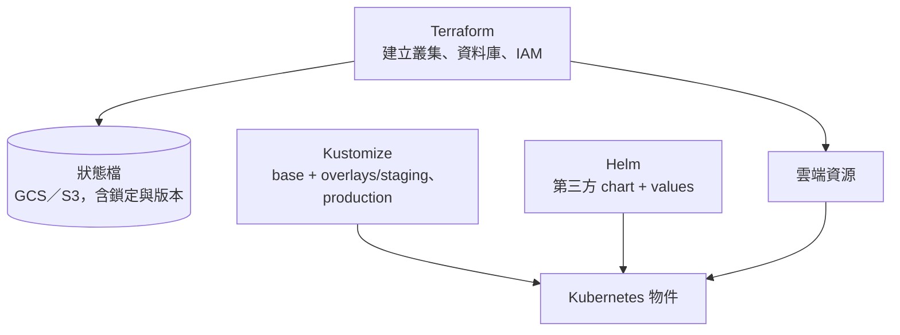

## 這是什麼

**IaC**（基礎設施即程式碼）把「建立了哪些雲端資源、叢集上有哪些設定」寫成檔案，放進版本控制。好處是：每次變更都經過審查、可以重現整個環境、出事時知道是誰在什麼時候改了什麼。

電商後端的基礎設施分成三類，各有適合的工具：

| 要管理的東西 | 工具 | 例子 |
| --- | --- | --- |
| 雲端資源 | Terraform | GKE／EKS 叢集、Cloud SQL／RDS、VPC、IAM、GCS／S3 bucket |
| 自己服務的 Kubernetes 宣告 | Kustomize | 訂單 API 的 Deployment、Service、HPA，以及各環境的差異 |
| 第三方元件 | Helm | Ingress controller、OpenTelemetry Collector、RabbitMQ Operator |

## 運作原理



**Terraform 狀態檔**記錄「Terraform 認為它建立了哪些資源」。每次 `plan` 都拿設定檔、狀態檔與實際的雲端資源比對，算出要做哪些變更。狀態檔必須放在共用的遠端位置，並且**同一時間只能有一個人修改**（鎖定），否則兩個人同時 `apply` 會互相覆蓋。

**漂移（drift）**：有人在主控台手動改了資源，實際狀態和設定檔不一致。下一次 `apply` 可能把手動的修改蓋掉，或出現意料之外的變更。

**Kustomize** 用「一份基礎設定（base）加上各環境的差異（overlay）」管理宣告，不需要樣板語言，直接寫 YAML。**Helm** 是 Kubernetes 的套件管理工具，適合安裝別人做好的元件，用 values 調整設定。

## 常見錯誤與正確寫法

### 1. 狀態檔放在自己的電腦，沒有鎖定

```hcl
# GKE 環境：狀態放在 GCS，GCS backend 內建鎖定
terraform {
  backend "gcs" {
    bucket = "shop-terraform-state"
    prefix = "prod/platform"
  }
}
```

```hcl
# EKS 環境：狀態放在 S3，Terraform 1.10 起可用 S3 原生鎖定
terraform {
  backend "s3" {
    bucket       = "shop-terraform-state"
    key          = "prod/platform/terraform.tfstate"
    region       = "ap-northeast-1"
    use_lockfile = true
    encrypt      = true
  }
}
```

存放狀態的 bucket 開啟版本管理（GCS Object Versioning、S3 Versioning），狀態檔損壞時才能回到前一版；狀態檔可能包含機密，要限制讀取權限。

### 2. 自己的服務也用複雜的 Helm 樣板

為自己的訂單 API 寫一份充滿 `{{ if }}` 的 Helm chart，讀起來像程式，審查時看不出最後會產生什麼 YAML。自己的服務用 Kustomize：

```text
deploy/
  base/              # Deployment、Service、HPA 的共同設定
  overlays/
    staging/         # 副本數 2、較小的資源
    production/      # 副本數 6、較大的資源、正式的設定來源
```

```bash
# 審查時先看最終產生的 YAML
kubectl kustomize deploy/overlays/production
```

### 3. 在主控台手動修改，沒有回寫到設定檔

緊急時在主控台把資料庫的規格調大，事後忘了改 Terraform。下一次有人 `apply`，規格又被改回去。定期在 CI 執行 `plan` 偵測漂移：

```bash
# 結束碼：0 沒有變更、1 錯誤、2 有差異（代表有漂移或未套用的變更）
terraform plan -detailed-exitcode -lock=false
```

結束碼為 2 時發出通知，由負責人決定要把手動修改寫回設定檔，還是用 Terraform 覆蓋。

## 使用邊界

- 一個 Terraform 專案不要包含所有資源。依生命週期拆開：網路與叢集很少變動，應用程式需要的 bucket、資料庫使用者較常變動；拆開後 `plan` 更快、影響範圍更小。
- Kubernetes 的 Secret 不要用明文放進 Kustomize。使用雲端的 Secret Manager／Secrets Manager，透過 CSI 驅動或 External Secrets 同步，見 [設定與 Secret](/platforms/kubernetes/configuration-security/)。
- 兩朵雲的資源名稱對應，見 [GCP 與 AWS 服務對照](/platforms/eks/cloud-service-mapping/)。

## 雲端排查

### 叢集層（GKE 與 EKS 相同）

```bash
# 叢集上的實際設定與版本控制中的差異
kubectl diff -k deploy/overlays/production

# Helm 安裝的元件與版本
helm list -A
```

### 託管服務層

#### GKE

狀態鎖卡住（例如 CI 中途被取消）時，`terraform plan` 會顯示持有鎖的 ID。確認沒有其他人正在執行後才解除：

```bash
gcloud storage ls gs://shop-terraform-state/prod/platform/   # 鎖檔與狀態檔
terraform force-unlock <LOCK_ID>
```

#### EKS

S3 backend 使用原生鎖定時，鎖是 bucket 中的 `.tflock` 檔；舊專案若仍用 DynamoDB 鎖定，鎖記錄在 DynamoDB 表中。同樣在確認沒有人執行後，以 `terraform force-unlock <LOCK_ID>` 解除。

```bash
aws s3 ls s3://shop-terraform-state/prod/platform/
```

### 應用程式層

在 CI 中保存每次 `plan` 的輸出與 `apply` 的紀錄，並與 commit 連結；出事時可以直接回答「這個資源最後一次是誰、為了什麼改的」。
