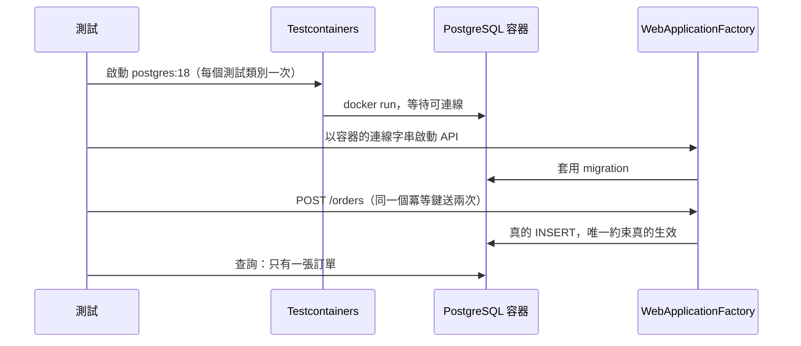

## 這是什麼

單元測試驗證規則，但很多錯誤只會在「元件組合起來」時出現：JSON 欄位名稱拼錯、Middleware 順序錯誤、唯一約束沒有建立、EF Core 的查詢在真實資料庫上翻譯失敗。

**整合測試**把 API 真的啟動起來，送出真的 HTTP 請求，連到真的資料庫，然後檢查回應與資料庫的結果。.NET 有兩個工具讓這件事變得容易：

- **WebApplicationFactory**：在測試程序內啟動整個 ASP.NET Core 應用程式（包含 DI、Middleware、路由），提供一個直接打到它的 `HttpClient`，不需要真的開 port。
- **Testcontainers**：在測試開始時用 Docker 啟動 PostgreSQL、Redis、RabbitMQ 容器，測試結束時自動清掉。

## 運作原理



測試程式透過 `HttpClient` 呼叫 API，請求會經過所有 Middleware、模型綁定、驗證、授權與序列化，和正式環境走的是同一條路徑。資料庫是真的 PostgreSQL，所以交易、鎖、唯一約束、JSON 欄位的行為都和正式環境一致。

## 常見錯誤與正確寫法

### 1. 用 Mock 或 InMemory 取代資料庫

「重複送出的下單請求只會建立一張訂單」這條規則，靠的是資料庫的唯一約束。用 InMemory 測試，約束不存在，測試通過了但保護不了任何東西。

用 Testcontainers 啟動真的 PostgreSQL，並讓 WebApplicationFactory 使用它：

```csharp
// 套件：Microsoft.AspNetCore.Mvc.Testing、Testcontainers.PostgreSql、xunit.v3
public sealed class ShopApiFactory : WebApplicationFactory<Program>, IAsyncLifetime
{
    private readonly PostgreSqlContainer _db = new PostgreSqlBuilder().WithImage("postgres:18").Build();

    public async ValueTask InitializeAsync()
    {
        await _db.StartAsync();
        using var scope = Services.CreateScope(); // 第一次存取 Services 時才會建立主機
        await scope.ServiceProvider.GetRequiredService<ShopDbContext>().Database.MigrateAsync();
    }

    protected override void ConfigureWebHost(IWebHostBuilder builder) =>
        builder.UseSetting("ConnectionStrings:Shop", _db.GetConnectionString()); // 改連測試容器

    public override async ValueTask DisposeAsync()
    {
        await base.DisposeAsync();
        await _db.DisposeAsync();
    }
}
```

測試時用正式的 migration 建立資料表，順便確認 migration 本身是正確的。

### 2. 只測 HTTP 狀態碼，不看資料庫

```csharp
public sealed class PlaceOrderTests(ShopApiFactory factory) : IClassFixture<ShopApiFactory>
{
    [Fact]
    public async Task 同一個冪等鍵送兩次只建立一張訂單()
    {
        var client = factory.CreateClient();
        var key = Guid.NewGuid().ToString();
        var request = new { productId = SeedData.ThermosId, quantity = 1 };

        var first = await SendAsync(client, request, key);
        var second = await SendAsync(client, request, key);

        Assert.Equal(HttpStatusCode.Created, first.StatusCode);
        Assert.Equal(first.Headers.Location, second.Headers.Location); // 回傳同一張訂單

        using var scope = factory.Services.CreateScope();
        var db = scope.ServiceProvider.GetRequiredService<ShopDbContext>();
        Assert.Equal(1, await db.Orders.CountAsync(o => o.IdempotencyKey == key)); // 資料庫裡只有一筆
    }

    private static Task<HttpResponseMessage> SendAsync(HttpClient client, object body, string key)
    {
        var message = new HttpRequestMessage(HttpMethod.Post, "/orders") { Content = JsonContent.Create(body) };
        message.Headers.Add("Idempotency-Key", key);
        return client.SendAsync(message, TestContext.Current.CancellationToken);
    }
}
```

### 3. 測試之間共用資料，彼此干擾

同一個測試類別共用一個容器（啟動成本只付一次），但每個測試使用自己產生的資料（例如新的冪等鍵、新的買家 ID），不要依賴其他測試留下的資料。需要乾淨狀態時，在測試前清空資料表（可以使用 Respawn 這類工具），而不是每個測試重開容器。

### 4. 外部服務在整合測試中被真的呼叫

付款閘道、簡訊服務這類第三方，在整合測試中用替身取代，在 `ConfigureWebHost` 的 `ConfigureTestServices` 裡替換註冊：

```csharp
builder.ConfigureTestServices(services =>
{
    services.RemoveAll<IPaymentGateway>();
    services.AddSingleton<IPaymentGateway, FakePaymentGateway>(); // 可設定回傳成功、拒絕或逾時
});
```

## 使用邊界

- 整合測試比單元測試慢。規則的各種組合用單元測試覆蓋；整合測試聚焦在「只有真實環境才會出錯」的地方：資料庫約束、交易、序列化、Middleware、授權。
- CI 環境需要能執行 Docker。GitHub Actions 的 Ubuntu runner 內建 Docker；其他 CI 要確認權限設定。
- Redis 與 RabbitMQ 的故障情境（服務停止、重送）見 [快取與訊息的測試](/engineering/cache-messaging-tests/)。
- 部署到雲端後的煙霧測試與驗證，見 [CI/CD](/engineering/ci-cd/)。
