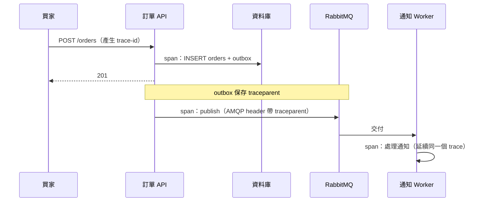

## 這是什麼

買家說「結帳很慢」。要找出原因，你需要三種資料：

- **指標（metrics）**：數字的時間序列，例如每秒請求數、P99 延遲、錯誤率。回答「整體狀況如何、從什麼時候開始變差」。
- **追蹤（traces）**：一個請求經過哪些服務、每一段花了多久。回答「這個請求慢在哪一段」。
- **日誌（logs）**：事件的詳細紀錄。回答「那一段發生了什麼事」。

**OpenTelemetry** 是收集這三種資料的開放標準。.NET 內建產生指標（`System.Diagnostics.Metrics`）與追蹤（`System.Diagnostics.Activity`），OpenTelemetry SDK 負責把它們匯出到 GCP 或 AWS 的觀測服務。

## 運作原理



**追蹤的傳遞**：每個請求有一個 trace ID，每一段工作是一個 span。呼叫下一個服務時，用 W3C Trace Context 標準的 `traceparent` 標頭把 trace ID 傳過去，對方就能接上同一條追蹤。HTTP 呼叫由 .NET 自動處理；透過訊息佇列時，要自己把 `traceparent` 放進訊息標頭（或 outbox 欄位）。

**內建指標**：.NET 8 起，ASP.NET Core、HttpClient、Kestrel、Runtime 都會產生標準的指標，例如 `http.server.request.duration`（請求耗時）、`http.client.request.duration`、`dotnet.gc.collections`、`dotnet.thread_pool.queue.length`。

## 常見錯誤與正確寫法

### 1. 沒有收集任何東西，出事才開始加

```csharp
// 套件：OpenTelemetry.Extensions.Hosting、OpenTelemetry.Instrumentation.AspNetCore、
//      OpenTelemetry.Instrumentation.Http、OpenTelemetry.Instrumentation.Runtime、OpenTelemetry.Exporter.OpenTelemetryProtocol
builder.Services.AddOpenTelemetry()
    .ConfigureResource(r => r.AddService("order-api"))
    .WithMetrics(m => m
        .AddAspNetCoreInstrumentation()
        .AddHttpClientInstrumentation()
        .AddRuntimeInstrumentation()
        .AddMeter("Shop.Orders"))           // 自己的業務指標
    .WithTracing(t => t
        .AddAspNetCoreInstrumentation()
        .AddHttpClientInstrumentation()
        .AddSource("Shop.Orders"))          // 自己的 ActivitySource
    .UseOtlpExporter();                     // 送到 OpenTelemetry Collector，再由它轉送到 GCP 或 AWS
```

應用程式只送到 Collector（以 OTLP 協定），由 Collector 決定送到哪個後端。換雲端時只改 Collector 的設定。

### 2. 把訂單 ID 放進指標的標籤

```csharp
// 錯：每張訂單產生一條新的時間序列，指標系統的成本與查詢時間爆炸
OrdersPlaced.Add(1, new KeyValuePair<string, object?>("order_id", order.Id));
```

指標的標籤（維度）只放**有限種類**的值，例如付款方式、結果（成功／失敗）、區域。訂單 ID、使用者 ID 這類無限種類的值，放在追蹤的屬性或日誌裡：

```csharp
private static readonly Meter Meter = new("Shop.Orders");
private static readonly Counter<long> OrdersPlaced = Meter.CreateCounter<long>("shop.orders.placed");

OrdersPlaced.Add(1, new KeyValuePair<string, object?>("payment_method", "credit_card"));
Activity.Current?.SetTag("shop.order_id", order.Id); // 追蹤可以帶具體的 ID
```

### 3. 每個服務自己產生 RequestId

各服務各自產生不同的 ID，日誌無法串在一起。統一使用 trace ID：日誌記錄 `Activity.Current?.TraceId`，錯誤回應帶上 `traceId`（見 [HTTP 契約](/frameworks/aspnet-core/http-contracts/)），買家回報問題時，一個 ID 就能找到整條路徑。

## 使用邊界

- **百分位數不能平均。** 把各 Pod 的 P99 取平均，不是整體的 P99。用直方圖（histogram）指標，在後端彙總後再計算百分位數。
- **追蹤要取樣。** 每個請求都完整記錄，在高流量時成本很高。常見做法是依比例取樣，並保留所有錯誤與慢請求的追蹤（在 Collector 做尾端取樣）。
- 日誌與追蹤可能包含個資，收集前決定哪些欄位要遮罩、保存多久。
- 依指標定義服務品質與告警，見 [SLO 與告警](/engineering/slo-alerts/)。

## 雲端排查

### 叢集層（GKE 與 EKS 相同）

```bash
# Collector 是否正常接收與匯出（匯出失敗會寫在日誌）
kubectl logs -n observability deployment/otel-collector --tail=50 | grep -i -E "error|dropped|refused"
```

### 託管服務層

#### GKE

指標可以用 Google Cloud Managed Service for Prometheus 收集（以 `PodMonitoring` 抓取應用程式的 Prometheus 端點，或由 Collector 匯出），在 Cloud Monitoring 中以 PromQL 查詢；追蹤由 Collector 以 OTLP 送到 Cloud Trace。

```bash
# 確認 PodMonitoring 設定存在並指向正確的 Pod
kubectl get podmonitoring -n shop
```

#### EKS

使用 AWS Distro for OpenTelemetry（ADOT）Collector，把指標送到 CloudWatch、追蹤送到 X-Ray；或啟用 CloudWatch Application Signals，自動產生服務的延遲、錯誤率與服務地圖。

```bash
# EKS add-on 形式安裝的 ADOT 狀態
aws eks describe-addon --cluster-name shop --addon-name adot --query 'addon.status'
```

### 應用程式層

在 Pod 內不經過任何後端，直接看程序的即時指標：

```bash
dotnet-counters monitor --process-id 1 --counters Microsoft.AspNetCore.Hosting,System.Runtime
```

`http.server.active_requests` 持續上升而每秒完成數沒有增加，代表請求在某處卡住；接著看追蹤中耗時最長的 span 在哪一段。
