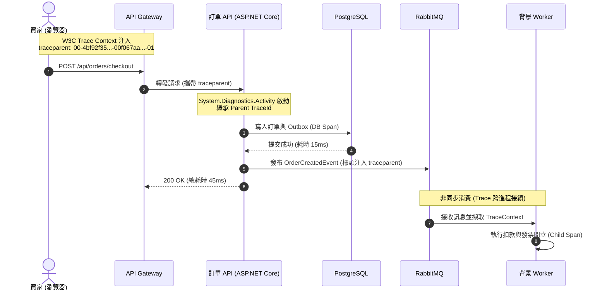

在分散式電商架構中，單一筆結帳請求往往需要跨越邊緣閘道、Web API、庫存服務、PostgreSQL 資料庫、Redis 快取與 RabbitMQ 訊息佇列。當線上發生「API 延遲從 50ms 飆升至 5,000ms」的重大異常時，僅靠傳統單機日誌或「CPU 使用率」往往如同瞎子摸象。現代可觀測性（Observability）要求我們將**指標（Metrics）**、**分散式追蹤（Tracing）**與**結構化日誌（Logs）**深度串聯，形成立體的排查證據鏈。

## 案發現場

某電商平台在特賣促銷期間，前端使用者紛紛反映結帳按鈕持續轉圈，最後跳出 HTTP 504 Gateway Timeout 錯誤。值班維運與後端工程師在緊急會議上面臨毫無線索的窘境：

1. **監控盲區（CPU 僅 20%，延遲卻破表）**：基礎設施監控面板顯示 Kubernetes 節點與 Pod 的 CPU、記憶體使用率均低於 30%，看似「毫無負載」。然而真實的使用者 P99 延遲已飆破 6 秒，根本無法得知瓶頸卡在資料庫連線池等待、Redis 網路阻塞、還是外部物流 API 逾時。
2. **日誌汪洋中的孤島（缺乏關聯 TraceId）**：工程師試圖從日誌系統（Elasticsearch / Cloud Logging）查詢該筆失敗訂單，但各微服務使用的是各自獨立生成的隨機 GUID（如 `HttpContext.TraceIdentifier`）。在數十萬筆每秒的日誌中，完全無法將前台 Web 的請求與後台背景 Worker 的處理步驟串聯在一起。
3. **高基數維度引爆監控時序資料庫（Cardinality Explosion）**：某位開發者在自定義 Prometheus 業務指標時，將 `order_id` 與 `user_id` 作為 Label 標籤注入。在大促流量湧入時，產生了超過數百萬個獨立時間序列（Time Series），瞬間將 Prometheus 伺服器記憶體擠爆 OOM 崩潰，全站即時監控徹底癱瘓。
4. **多 Pod 聚合數值失真**：主管詢問「系統平均 P95 延遲是多少？」，工程師將 10 個 Pod 各自回報的 P95 數值直接取算術平均數，得出了完全錯誤的虛假結論（百分位數不可直接進行代數平均）。



## 反模式與正確解法

### 反模式一：將高基數識別碼（High-Cardinality IDs）寫入 Metrics Labels

部分開發者在度量訂單失敗率時，撰寫了類似 `order_failures_total{order_id="ORD-99182", customer_id="CUST-812"}` 的指標。Prometheus 與大多數時序資料庫（TSDB）會為每一組唯一的 Label 組合建立一條獨立的時間序列。當訂單數量達數百萬時，時序數量呈幾何級數暴增，導致 TSDB 記憶體耗盡。

#### 正確解法：指標維持有界維度，高基數資料交由 Tracing 與 Logs 承載

- **指標（Metrics）**：回答「有沒有問題？趨勢如何？」。標籤**必須是低基數且有界枚舉**（如 `http_method: POST`, `http_route: /api/orders`, `http_status_code: 500`）。
- **分散式追蹤（Tracing）**：回答「具體哪一步變慢？」。`OrderId`、`CustomerId` 等高基數業務識別碼應寫入 Span 的 Attributes / Tags 中，提供精準追蹤：

```csharp
using System.Diagnostics;
using System.Diagnostics.Metrics;

public static class OrderTelemetry
{
    // 1. 定義 ActivitySource 用於分散式追蹤 (Tracing)
    public static readonly ActivitySource ActivitySource = new("DevWiki.Ecommerce.Orders", "1.0.0");

    // 2. 定義 Meter 用於有界聚合指標 (Metrics)
    private static readonly Meter Meter = new("DevWiki.Ecommerce.Orders", "1.0.0");
    public static readonly Counter<long> OrdersPlacedCounter = 
        Meter.CreateCounter<long>("ecommerce_orders_placed_total", "orders", "成功建立的訂單總數");
}

public async Task<OrderResult> CheckoutAsync(OrderRequest request, CancellationToken ct)
{
    // 啟動一個新 Span (Activity)
    using var activity = OrderTelemetry.ActivitySource.StartActivity(
        "Order.Checkout", 
        ActivityKind.Server);

    // 高基數欄位寫入 Span Attributes (Tracing 允許高基數)
    activity?.SetTag("ecommerce.order_id", request.OrderId.Value);
    activity?.SetTag("ecommerce.customer_id", request.CustomerId.Value);

    var result = await ProcessPaymentAndSaveAsync(request, ct);

    // 指標僅記錄低基數有界標籤！
    OrderTelemetry.OrdersPlacedCounter.Add(1, 
        new KeyValuePair<string, object?>("payment_method", request.PaymentMethod),
        new KeyValuePair<string, object?>("currency", "TWD"));

    return result;
}
```

### 反模式二：每層微服務自行生成隨機 RequestId，破壞追蹤鏈條

許多系統在每個服務的入口中介軟體隨機生成一個 `Guid.NewGuid()` 作為 `X-Request-ID`，在跨服務 HTTP 呼叫或 RabbitMQ 訊息轉發時未將其傳遞給下游。這導致每一段調用鏈路完全割裂，無法還原跨服務的呼叫拓撲（Call Graph）。

#### 正確解法：採用 W3C Trace Context 標準與 OpenTelemetry 自動傳播

遵循 W3C Trace Context 標準，使用 `traceparent` HTTP 標頭在微服務與訊息佇列間傳播追蹤上下文：
`traceparent: 00-4bf92f3577b34da6a3ce929d0e0e4736-00f067aa0ba902b7-01`
- `00`：版本號。
- `4bf92f3577b34da6a3ce929d0e0e4736`：全局唯一 TraceId（整條呼叫鏈共用）。
- `00f067aa0ba902b7`：當前 Span 的 ParentId。
- `01`：追蹤旗標（01 代表已採樣）。

.NET 的 `HttpClient` 與 ASP.NET Core 原生深度整合 `System.Diagnostics.Activity`，只要使用 `IHttpClientFactory` 發出呼叫，.NET 會全自動將當前的 `Activity.Current` 注入為 `traceparent` 標頭；在 RabbitMQ 訊息中，亦應將該標頭注入 AMQP BasicProperties 的 Headers 字典中，讓消費者接續追蹤。

### 反模式三：忽略 .NET Runtime 核心指標，無法排查執行緒池與 GC 瓶頸

當 CPU 負載很低但 API 響應極慢時，問題往往出在 **.NET 執行緒池飢餓（ThreadPool Starvation）** 或 **GC 暫停（Stop-The-World Pause）**。若僅採集 OS 層級的 CPU，將完全無法察覺應用程式內部的執行緒調度瓶頸。

#### 正確解法：啟用 .NET 原生 Runtime Meters 並建立儀表板

在 Program.cs 中配置 OpenTelemetry 採集官方內建的 Runtime 測量指標：

```csharp
builder.Services.AddOpenTelemetry()
    .WithMetrics(metrics => metrics
        .AddAspNetCoreInstrumentation()
        .AddHttpClientInstrumentation()
        .AddMeter("Microsoft.AspNetCore.Hosting")
        .AddMeter("Microsoft.AspNetCore.Server.Kestrel")
        .AddMeter("System.Runtime") // 收集 GC、記憶體分配、ThreadPool 指標
        .AddOtlpExporter());
```

關鍵觀測指標對照：
- `dotnet.runtime.threadpool.queue.length`：線程池工作佇列長度。若該數值持續大於 0，代表發生執行緒池飢餓！
- `dotnet.runtime.gc.pause.time`：GC 暫停總耗時。若 Gen 2 暫停時間頻繁過長，需排查大物件堆積（LOH）。

## 踩坑與避坑指南

### 1. `Activity.Current` 在非同步上下文丟失（ExecutionContext 流動中斷）
如果在非同步流程中使用了 `Task.Run`、`ThreadPool.UnsafeQueueUserWorkItem`，或者某些未正確流動 `ExecutionContext` 的自訂線程池，`Activity.Current` 可能變為 `null`，導致後續產生的子 Span 與 Parent 脫鉤，追蹤鏈路中斷。
- **避坑建議**：盡量使用標準的 `async/await`，避免繞過 ExecutionContext 的低階線程呼叫。在啟動背景長任務時，顯式傳入父級 `ActivityContext`。

### 2. 百分位數（P95 / P99）統計不可直接算術平均
在 Prometheus / Grafana 中，絕對不能對各個 Pod 的 P95 數值執行 `avg()` 運算。因為各個 Pod 的請求量權重不同，直接平均會嚴重低估長尾延遲。
- **避坑建議**：必須先採集 Histogram 直方圖 buckets（例如 `http_server_request_duration_seconds_bucket`），然後在 Prometheus 中使用 `histogram_quantile(0.95, sum(rate(...)) by (le))` 計算全系統真正的全局百分位數。

### 3. 生產環境全量採樣的網路與儲存成本
如果每秒有 20,000 個請求，100% 記錄每一個 Span 會產生龐大的網路頻寬消耗與儲存費用。
- **避坑建議**：生產環境採用動態採樣策略（例如使用 OpenTelemetry Collector 實施 Tail-based Sampling，針對 HTTP 5xx 錯誤與延遲大於 1 秒的請求 100% 保留，其餘健康請求僅採樣 1%~5%）。

## 線上排查指令

針對可觀測性鏈條異常、延遲排查與 .NET Runtime 效能診斷，使用下列指令排查：

```bash
# 1. 使用 dotnet-counters 即時監控運行中 Pod 的 .NET 核心 Runtime 狀態
dotnet-counters monitor --process-id 1 System.Runtime Microsoft.AspNetCore.Hosting

# 2. 模擬外部發起攜帶 W3C traceparent 的請求以驗證追蹤鏈路
curl -v -H "traceparent: 00-4bf92f3577b34da6a3ce929d0e0e4736-00f067aa0ba902b7-01" \
    http://localhost:8080/api/orders/1001

# 3. 在日誌系統中依據 TraceId 檢索端到端跨服務所有呼叫紀錄
kubectl logs -l app=order-api -n ecommerce-prod --tail=200 | grep "4bf92f3577b34da6a3ce929d0e0e4736"

# 4. Prometheus 查詢全系統 P95 延遲範例（確保使用直方圖聚合計算）
# histogram_quantile(0.95, sum(rate(http_server_request_duration_seconds_bucket[5m])) by (le))

# 5. 檢視 Pod 內部線程池佇列深度（排查 ThreadPool 飢餓問題）
dotnet-dump collect -p 1
dotnet-dump analyze core_dump -c "threads"
```
