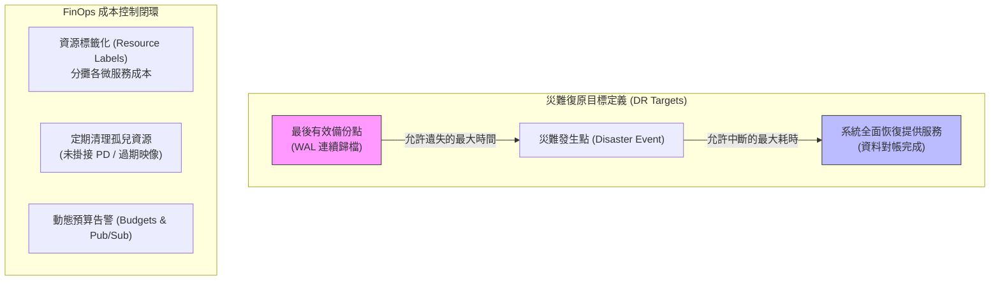

在電商軟體工程實務中，「系統平時跑得順」只是基本要求；當不可抗力的災難降臨（如雲端可用區斷電、資料庫儲存損毀、或勒索病毒攻擊）時，系統能否在預期時間內精確復原資料，決定了企業的生死存亡。然而，高可用與災難復原並非無上限投入資源；如何在**復原目標（RPO / RTO）**、**真實還原演練證據**與**雲端成本控制（FinOps）**之間取得工程平衡，是資深架構師的必修課題。

## 案發現場

某電商技術團隊在經歷一次區域性機房故障與月底財務對帳時，遭遇了可用性與帳單的雙重暴擊：

1. **備份有效性的虛假安全感**：維運團隊的自動化排程每天深夜發送「PostgreSQL 備份完成」的 Slack 通知，持續運作了兩年。直到某次核心磁碟損毀需要緊急還原時，工程師才驚恐地發現：該備份腳本僅備份了 Schema 定義而遺漏了核心資料表；更糟的是，備份檔案採用了已離職同事的 PGP 私鑰加密，全公司無人能解密還原。整整折騰了 26 個小時才靠歷史日誌人工拼湊，遠遠超出管理階層承諾的「2 小時內恢復」。
2. **跨系統恢復時間點脫節（資料分裂）**：資料庫最終還原至清晨 02:00 的快照，然而 RabbitMQ 訊息佇列與外部第三方金流（Stripe）在清晨 02:00 到 08:00 之間已完成了數千筆刷卡扣款。資料庫還原後，這數千筆訂單在資料庫中「憑空消失」，導致消費者信用卡被扣款卻查不到訂單，客服與財務對帳陷入長達一個月的噩夢。
3. **未掛接孤兒磁碟吞噬預算**：月底財務部門收到 Google Cloud 帳單，金額比預期高出 300%。排查發現：工程師先前在 GKE 進行壓力測試時頻繁建立與刪除 StatefulSet，而 Kubernetes 在刪除 Pod/StatefulSet 時**預設保留了 PVC 底層的雲端磁碟**。數百塊容量 200GB 的高效能 Persistent Disk 成為「孤兒磁碟（Unattached Disks）」在背景持續計費；同時日誌採集器未設採樣，大量 Debug 日誌灌入 Cloud Logging，每天產生數百美元的分析費用。



## 反模式與正確解法

### 反模式一：將「備份成功通知」等同於「具備災難還原能力」

只執行 `pg_dump` 或建立了磁碟快照（Snapshot），從未真正將檔案抓下來在全新、乾淨的隔離環境中執行還原驗證。在真實災難時，往往因為權限缺失、相依套件版本不合、網路連線障礙或金鑰遺失而全面卡死。

#### 正確解法：明確定義量化指標（RPO / RTO），並以演練產物作為唯一證據

1. **RPO（Recovery Point Objective，復原點目標）**：業務允許遺失資料的最大時間窗口。
   - 對於電商訂單系統，RPO 應 $\le 5$ 分鐘。僅靠每日一次的冷備份遠遠不夠，必須啟用 PostgreSQL 的 **WAL（預寫日誌）連續即時歸檔**（如使用 Cloud SQL Point-in-time Recovery 或 pgBackRest），能還原至任意秒級時間點。
2. **RTO（Recovery Time Objective，復原時間目標）**：系統從判定中斷到對外全面恢復服務的時間。例如承諾 RTO $\le 1$ 小時。
3. **定期災難演練（Game Day / Disaster Drill）**：每季在隔離的演練專案中，依據 Runbook 自動拉起環境、還原最近的資料庫、啟動 GKE 叢集與微服務，並執行端到端業務 Smoke Test。**只有通過驗證的演練報告，才是具備災難復原能力的唯一證明**。

### 反模式二：單體資料庫還原，忽略分散式狀態的對帳裂痕

在微服務與非同步訊息架構下，如果只還原了訂單庫，但外部金流已扣款、RabbitMQ 訊息已發送、客戶庫狀態未同步，系統會陷入分散式狀態割裂。

#### 正確解法：建立跨系統對帳補償機制與雙向冪等

- **雙向唯一業務鍵**：在呼叫外部支付閘道時，必須將自身的 `OrderId` 作為 `Idempotency-Key` 傳入。
- **對帳補償工作（Reconciliation Job）**：資料庫還原至特定時間點後，第一時間禁止對外開放寫入；由對帳腳本自動向第三方支付 API 查詢該時間點後的所有交易清單，與資料庫中的訂單進行比對，自動為遺失的交易補齊訂單記錄並觸發出貨。

### 反模式三：缺乏成本意識，放任未掛接孤兒資源與日誌野蠻生長

在雲端環境中，虛擬機關機依然會收取磁碟費用，未掛接的雲端磁碟（Persistent Disks）與保留的靜態 IP 每小時都在持續消耗預算。

#### 正確解法：實施 FinOps 雲端成本治理策略

1. **資源標籤規範（Resource Tagging / Labels）**：所有 GKE 節點、磁碟與資料庫必須打上 `env`（prod/staging）、`team`（order/catalog）與 `managed-by`（terraform）標籤，以便在 Google Cloud Billing 報告中精準進行微服務成本分攤。
2. **自動化孤兒磁碟清理策略**：建立定期排程腳本，自動檢測未被任何虛擬機或 Pod 掛載超過 7 天的未掛接磁碟，自動製作最終快照後將其安全刪除。
3. **Artifact Registry 映像保留政策**：配置生命週期管理規則（Keep count: 20），自動清理過時且未引用的舊版 Docker 映像，避免磁碟空間無限膨脹。
4. **預算警報與防爆刷自動化**：在 GCP 建立 Billing Budget，當費用達到預算的 50%、80%、100% 時發送 Slack 警報；並可透過 Pub/Sub 觸發 Cloud Functions，在測試環境超標時自動暫停非核心資源。

## 踩坑與避坑指南

### 1. Google Cloud 預算（Billing Budgets）預設僅是「通知」，不會自動停機
許多工程師誤以為在 GCP 控制台設定了預算上限，超過時雲端會自動停止計費。**GCP 的預算預設純粹是 Alert-only**！若遇到 DDoS 攻擊或程式死循環產生巨額網路流量，帳單依然會無上限攀升。
- **避坑建議**：若為開發測試專案，必須將 Budget 連結至 Pub/Sub，並透過 Cloud Functions 呼叫 Cloud Billing API 自動解除計費帳號（Disable Billing）以實現硬限制。

### 2. StatefulSet 縮容後的孤兒磁碟計費
在 Kubernetes 中，當你刪除 StatefulSet 或縮容 Pod 數量時，為了保護資料安全，**PVC 與底層的雲端 Persistent Disk 永遠不會被自動刪除**！
- **避坑建議**：在銷毀測試環境時，除了刪除 StatefulSet 之外，務必顯式執行 `kubectl delete pvc -l app=...`，並在 GCP 控制台或透過指令確認磁碟已徹底釋放。

### 3. 快照（Snapshot）還原與資料一致性
若在資料庫高併發寫入時直接對底層區塊磁碟執行雲端 Snapshot，磁碟快照中的 WAL 日誌可能尚未 Flush。還原後啟動資料庫時，資料庫必須執行 Crash Recovery，甚至可能遭遇不一致。
- **避坑建議**：備份優先採用資料庫原生的連續歸檔（PITR）；若使用磁碟層級快照，必須在快照前透過 Hook 觸發資料庫的 `CHECKPOINT` 與鎖定操作。

## 線上排查指令

針對孤兒雲端磁碟清理、備份還原狀態與雲端預算檢視，使用下列指令排查：

```bash
# 1. 列出專案下所有「未被任何虛擬機掛載」的孤兒雲端磁碟（重點排查浪費）
gcloud compute disks list --filter="-users:*" --format="table(name,zone,sizeGb,type,lastAttachTimestamp)"

# 2. 檢視 Google Cloud Billing 預算配置與警報閾值
gcloud billing budgets list --billing-account=<BILLING_ACCOUNT_ID>

# 3. 查詢 Cloud SQL 資料庫最近可用的自動備份清單（確認最新可用 RPO 點）
gcloud sql backups list --instance=eshop-order-db-prod --sort-by='~endTime'

# 4. 在隔離演練實例中執行備份還原演練（Point-In-Time Recovery 測試）
gcloud sql backups restore <BACKUP_ID> \
    --restore-instance=eshop-order-db-drill \
    --backup-instance=eshop-order-db-prod

# 5. 排查專案下無效保留的靜態未綁定公網 IP（持續計費源頭）
gcloud compute addresses list --filter="status=RESERVED"
```
