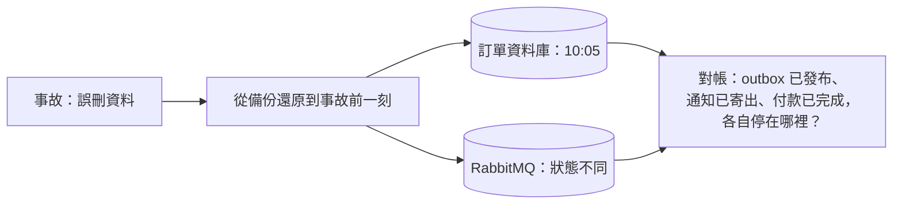

## 這是什麼

這篇談系統上線後的兩件日常工作：

- **災難復原**：資料庫被誤刪、某個區域故障、勒索軟體加密了資料，能不能在可接受的時間內、回到可接受的時間點？
- **成本**：雲端的帳單一個月比一個月高，錢花到哪裡去了？

兩者的共通點是：平常不做，出事時就來不及。

## 運作原理

**RPO** 與 **RTO** 是災難復原的兩個目標：

- **RPO**（復原點目標）：最多可以遺失多少時間的資料。RPO 5 分鐘代表最多遺失最後 5 分鐘的訂單。
- **RTO**（復原時間目標）：最多可以停機多久。RTO 1 小時代表 1 小時內要恢復服務。



電商系統的資料不只在一個地方：訂單在資料庫、事件在 RabbitMQ、付款結果在付款閘道、通知紀錄在通知服務。把資料庫還原到 10:05，其他系統卻停在 10:30，就會出現「付款閘道有扣款、資料庫裡沒有訂單」這類不一致。還原後要靠穩定的業務 ID 對帳，見 [Outbox 與 Inbox](/architecture/outbox-inbox/)。

## 常見錯誤與正確寫法

### 1. 備份成功的通知就等於能還原

備份作業每天都顯示成功，但從沒試過還原：可能還原要 6 小時（超過 RTO）、還原後缺少某些權限設定、或應用程式的設定指向舊的端點。

定期（例如每季）在隔離環境做一次完整的還原演練，並記錄：

| 項目 | 記錄 |
| --- | --- |
| 實際 RPO | 還原到的時間點與事故時間的差距 |
| 實際 RTO | 從決定還原到服務恢復的總時間（包含人的決策與溝通） |
| 一致性核對 | 訂單、outbox、Inbox、通知的筆數與狀態是否合理 |
| 發現的問題 | 缺少的權限、文件沒寫的步驟、過期的設定 |

### 2. 預算告警設了，以為會自動停止花費

GCP 的預算預設只發送通知，不會停止任何服務；要自動處理，需要另外把預算通知接到 Pub/Sub 並寫程式執行動作。AWS Budgets 可以設定預算動作（例如套用限制權限的政策），但也要事先設定。預算告警是「提醒你去看」，不是保險。

### 3. 刪除了服務，資源卻還在計費

StatefulSet 縮容或刪除後，PersistentVolumeClaim 預設不會被刪除，背後的雲端磁碟持續計費。測試環境刪掉了叢集，負載平衡器、靜態 IP、快照卻還在。定期找出沒有被使用的資源：

```bash
# GCP：沒有掛載到任何 VM 的磁碟
gcloud compute disks list --filter="-users:*" --format="table(name,zone,sizeGb,creationTimestamp)"

# AWS：狀態為 available（未掛載）的 EBS 磁碟
aws ec2 describe-volumes --filters Name=status,Values=available \
  --query 'Volumes[].{id:VolumeId,size:Size,created:CreateTime}' --output table
```

確認不需要後再刪除；需要保留資料的，先建立快照。

## 使用邊界

- **RPO／RTO 越小，成本越高。** 跨區域的即時複寫、熱備援環境都很貴；依業務真正的需求決定，而不是一律追求最高。
- 日誌與追蹤的保存期間直接影響成本。依用途分層：除錯用的詳細日誌保存數天，稽核用的保存較久並移到較便宜的儲存。
- 成本要能歸屬到服務：為雲端資源加上一致的標籤（label／tag），帳單才能依服務、環境拆分。
- 資料庫的備份與時間點還原細節，見 [讀副本與災難復原](/data-access/replication-recovery/)。

## 雲端排查

### 叢集層（GKE 與 EKS 相同）

```bash
# 沒有被任何 Pod 使用的 PVC（仍在計費）
kubectl get pvc -A
kubectl get pv -o custom-columns=NAME:.metadata.name,CLAIM:.spec.claimRef.name,POLICY:.spec.persistentVolumeReclaimPolicy,STATUS:.status.phase
```

`STATUS` 為 `Released` 且回收政策是 `Retain` 的 PV，背後的磁碟還在，要手動處理。

### 託管服務層

#### GKE

```bash
# 備份清單與最近一次的狀態
gcloud sql backups list --instance=shop-db --limit=5

# 預算設定（需要帳單帳戶的權限）
gcloud billing budgets list --billing-account=<BILLING_ACCOUNT_ID>
```

匯出帳單資料到 BigQuery，可以依標籤查出各服務的成本變化。

#### EKS

```bash
# RDS 自動備份保留期與可還原的最新時間
aws rds describe-db-instances --db-instance-identifier shop-db \
  --query 'DBInstances[0].{retention:BackupRetentionPeriod,latestRestorable:LatestRestorableTime}'

# 預算清單
aws budgets describe-budgets --account-id 111122223333
```

AWS Cost Explorer 可以依成本分配標籤拆分各服務與環境的費用。

### 應用程式層

還原演練時，用一組固定的對帳查詢（訂單數、已發布與未發布的 outbox、通知數）比較還原前後；把這組查詢放進 runbook，正式事故時可以直接使用。
