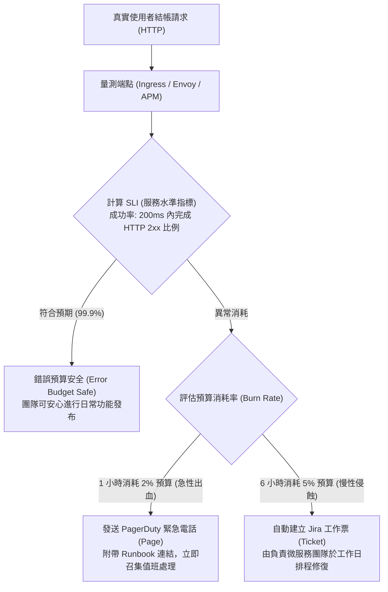

在維運高可用電商系統時，「所有 Kubernetes Pod 都在 Running」並不代表買家能順利把商品加入購物車並完成結帳。許多團隊常因過度依賴「CPU > 80%」等底層硬體指標，導致值班工程師陷入無休止的**告警疲勞（Alert Fatigue）**；而當真實的業務結帳發生嚴重故障時，監控系統卻因指標未觸發而一片死寂。Google SRE 的 **SLI/SLO** 與**錯誤預算（Error Budget）**架構，是建立精準、可行動告警的最佳實踐。

## 案發現場

某電商平台在進行雙十一晚間特賣時，爆發了嚴重的維運癱瘓事故：

1. **半夜狼來了效應（告警疲勞）**：監控群組平均每晚發出數百則「Node CPU Usage > 85%」、「單一 Pod 重啟 1 次」的警報。由於每次上去查看業務皆完全正常，維運團隊所有人將 Slack 告警頻道設為靜音，甚至關閉了手機推播。
2. **真實災難降臨卻全體靜默**：特賣開跑後，第三方金流支付閘道發生連線阻塞，所有結帳請求等待 30 秒後逾時拋出 504 錯誤，長達 85% 的訂單全數失敗。然而，由於各 Pod CPU 與記憶體均處於正常水位，監控系統「一聲不吭」。直到客服電話被憤怒的顧客打爆兩小時後，管理階層才得知全站結帳已經中斷，估計損失數百萬營收。
3. **無 Runbook 導致值班人員手足無措**：偶爾收到一則「RabbitMQ Queue Depth > 10,000」的告警，值班新手工程師完全不知道該佇列代表哪個業務、誰是負責團隊、是否應該擴容 Worker、還是底層資料庫正在發生死鎖，只能在群組胡亂標註所有人，浪費了寶貴的黃金救援時間。



## 反模式與正確解法

### 反模式一：基於原因的告警（Cause-based Alerting），忽視使用者真實體驗

傳統監控習慣針對「伺服器 CPU > 85%」、「記憶體 > 90%」或「磁碟 I/O 高」設定告警。然而：
- CPU 跑滿可能只是背景 GC 或非同步批次運算正常利用硬體，買家造訪 API 依然極速順暢。
- 反之，當下游資料庫發生死鎖時，CPU 往往極低（甚至只有 5%），但使用者結帳 100% 卡死。

#### 正確解法：轉向基於症狀的告警（Symptom-based Alerting）與 SLI/SLO 體系

1. **SLI（Service Level Indicator，服務水準指標）**：明確量測使用者能直接感受到的服務品質：

$$\text{SLI} = \frac{\text{符合成功定義的請求數 (成功且延遲} \le 200\text{ms)}}{\text{所有合法請求總數}} \times 100\%$$

2. **SLO（Service Level Objective，服務水準目標）**：團隊向業務承諾的底線。例如：在 30 天滾動窗口內，結帳 API 的 SLI 必須 $\ge 99.9\%$。
3. **錯誤預算（Error Budget）**：在 30 天內允許出現的不良請求額度。對於 $99.9\%$ 的目標，錯誤預算即為 $100\% - 99.9\% = 0.1\%$。

### 反模式二：使用單一短窗口靜態閾值告警，引發瞬時誤報或慢性失血

若規則設為「當最近 5 分鐘錯誤率 > 1% 則發送告警」：
- **瞬時毛刺誤報**：若某個買家短暫重送 5 次錯誤，在低流量時段會立刻觸發電話呼叫，造成疲勞。
- **慢速慢性失血漏報**：若錯誤率持續維持在 0.8%（低於 1% 閾值），系統永遠不告警，但整個月的錯誤預算會在短短幾天內被全部耗盡！

#### 正確解法：採用 SRE 多窗口多消耗率告警（Multi-Window Multi-Burn-Rate Alerting）

消耗率（Burn Rate = 1）代表在 30 天內剛好耗盡 100% 錯誤預算的速度。
- **急性大量失敗（Burn Rate = 14.4）**：代表在 1 小時內將消耗整月預算的 $2\%$。此時必須立刻發送 **Page（緊急呼叫）** 喚醒值班人員。
- **慢性穩定失敗（Burn Rate = 6）**：代表在 6 小時內將消耗整月預算的 $5\%$。發送 **Ticket（工單）** 由當值工程師日間修復。

Prometheus 告警規則範例（同時比對長短兩個窗口，杜絕短暫毛刺）：

```yaml
# alertmanager-rules.yaml
groups:
- name: ecommerce-order-slo
  rules:
  - alert: OrderCheckoutHighErrorBudgetBurn
    # 同時滿足 1 小時與 5 分鐘高消耗率，證明故障持續存在而非短暫毛刺
    expr: |
      (
        sum(rate(http_requests_total{route="/api/orders/checkout",status=~"5.."}[1h]))
        / sum(rate(http_requests_total{route="/api/orders/checkout"}[1h]))
      ) > (14.4 * 0.001)
      and
      (
        sum(rate(http_requests_total{route="/api/orders/checkout",status=~"5.."}[5m]))
        / sum(rate(http_requests_total{route="/api/orders/checkout"}[5m]))
      ) > (14.4 * 0.001)
    for: 2m
    labels:
      severity: page
      team: order-team
    annotations:
      summary: "訂單結帳服務錯誤預算正在以極高速度消耗！"
      description: "當前 1 小時內錯誤預算消耗率達 14.4 倍，若不處理將在數小時內耗盡整月預算。"
      runbook_url: "https://wiki.internal/ops/runbooks/order-checkout-failure"
```

### 反模式三：告警無 Runbook、無責任人，缺乏可行動性（Actionability）

值班人員半夜被叫醒，看到一條只有「Host xyz-123 is down」的通知，不知道該打給誰，也不知道標準處理 SOP。

#### 正確解法：每條告警皆具備可行動三要素

1. **清晰的業務影響描述**：明確指出「哪個微服務影響了哪些買家」。
2. **直達儀表板的 URL**：直接附帶 Grafana 觀測鏈路，點開即見出錯端點。
3. **強制附帶 Runbook（應急處置指南）**：清楚寫明「如何快速止血、如何回滾、如何降級、何時升級通報主管」。

## 踩坑與避坑指南

### 1. 錯誤預算耗盡（Error Budget Exhausted）時的團隊共識契約
若只定義了錯誤預算，但在預算耗盡時業務團隊依然強行發布新功能，SLO 將形同虛設。
- **避坑建議**：技術與產品團隊必須簽訂「錯誤預算策略契約」：**一旦本月錯誤預算歸零，立即啟動 Feature Freeze（暫停新業務發布）**，全體工程師全力投入系統穩定性優化、架構重構與自動化測試加固，直到下一個窗口恢復。

### 2. 客戶端 4xx 錯誤不應計入服務端 SLO 扣除
買家輸入錯誤密碼（HTTP 401）、商品不存在（HTTP 404）或表單格式校驗失敗（HTTP 400/422），屬於合法的業務邏輯拒絕，並非系統故障。
- **避坑建議**：SLI 計算公式中，失敗請求**僅限於 HTTP 5xx 伺服器端錯誤，或延遲超過閾值（如 P95 > 200ms）的請求**，嚴禁將 4xx 算作系統不可用。

### 3. 深夜極低流量時段的除以零防護
在清晨 04:00 流量極小時，總請求數可能只有 2 筆，若其中 1 筆失敗，錯誤率會瞬間飆升至 50%，觸發誤報。
- **避坑建議**：在 PromQL 運算式中加入最低流量過濾條件（例如 `and sum(rate(http_requests_total[5m])) > 10`），防止低流量除以零雜訊。

## 線上排查指令

針對 Prometheus 告警規則評估、Alertmanager 靜默狀態與 SLO 狀態，使用下列指令排查：

```bash
# 1. 檢查 Alertmanager 當前所有觸發中的活躍告警
amtool alert --alertmanager.url=http://alertmanager.monitoring:9093

# 2. 檢視當前已設定的告警靜默過濾（Silence List）
amtool silence query --alertmanager.url=http://alertmanager.monitoring:9093

# 3. 緊急維護時線上建立 2 小時告警靜默（防止維護期間發送無效電話）
amtool silence add alertname="OrderCheckoutHighErrorBudgetBurn" \
    --duration=2h --comment="緊急維護資料庫連線池中" --author="rayliu"

# 4. 驗證 Prometheus 告警規則語法與配置正確性
promtool check rules alertmanager-rules.yaml

# 5. 檢視特定微服務 Pod 的近期崩潰次數與重啟間隔
kubectl get pods -n ecommerce-prod -l app=order-api -o jsonpath='{range .items[*]}{.metadata.name}{"\t"}{.status.containerStatuses[*].restartCount}{"\n"}{end}'
```
