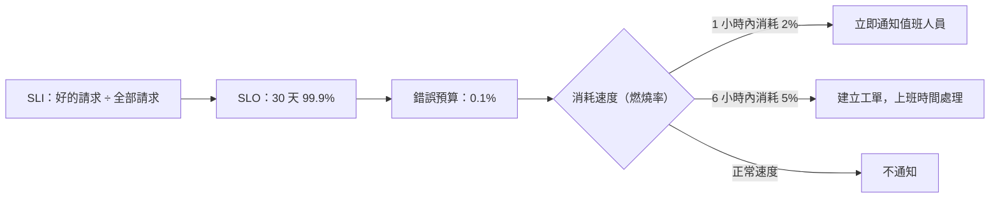

## 這是什麼

「系統正常嗎？」CPU 30%、記憶體 50%、Pod 全部 Running，看起來很正常，但買家下單一直失敗。反過來，CPU 90% 但每個請求都很快，其實不需要叫醒任何人。

**SLO**（服務水準目標）用使用者的體驗來定義「正常」：

- **SLI**（服務水準指標）：量使用者感受得到的結果。例如「商品查詢在 300 毫秒內成功的比例」。
- **SLO**：SLI 的目標。例如「30 天內 99.9% 的商品查詢在 300 毫秒內成功」。
- **錯誤預算**：SLO 容許的失敗量。99.9% 代表 30 天內可以有 0.1% 的請求失敗或太慢。

錯誤預算讓「要不要先修穩定性」有了客觀的依據：預算還很多，可以照常發布新功能；預算快用完了，就先停下來處理穩定性。

## 運作原理



**燃燒率**是錯誤預算的消耗速度。燃燒率 1 代表剛好在 30 天用完；燃燒率 14.4 代表照這個速度，約 2 天就會用完。

**多窗口告警**：只看短時間窗口（例如 5 分鐘），一點點波動就會誤報；只看長窗口（例如 1 天），等發現時預算已經燒光了。常見做法是同時要求長、短兩個窗口都超過門檻才告警：長窗口確認問題是真的，短窗口確認問題還在發生。

## 常見錯誤與正確寫法

### 1. 依原因告警，而不是依症狀

「CPU 超過 80%」「Pod 重啟」這類告警，很多時候使用者完全沒受影響，值班人員被叫醒卻什麼都不用做，久了就開始忽略告警。告警以使用者的症狀為主（錯誤率、延遲、訂單無法成立）；CPU、記憶體這類原因指標放在儀表板上，供排查時參考。

### 2. 把用戶端錯誤算進 SLO

買家輸入錯誤造成的 400、未登入造成的 401，不是服務的問題。SLI 的「失敗」通常只計算 5xx 與逾時；但如果大量 4xx 是程式錯誤造成的（例如前端送錯格式），要另外監控。

### 3. 告警沒有處理步驟

告警只寫「訂單 API 錯誤率過高」，值班人員還要從頭摸索。每個告警都連到一份 runbook：可能的原因、先看哪個儀表板、常見的處理方式、要聯絡誰。

### 4. 半夜流量很低時誤報

凌晨每分鐘只有 3 個請求，1 個失敗就是 33% 的錯誤率。告警條件加上最低請求數，或使用較長的窗口。

## 使用邊界

- **SLO 不是越高越好。** 99.99% 代表 30 天只能有約 4 分鐘的完全停機，需要的投入比 99.9% 高得多。依業務需求與實際能力決定，並先用一段時間的實際數據校準。
- 一開始只為少數關鍵的使用者旅程定 SLO：商品查詢、下單、付款結果、通知在期限內完成。
- 通知這類非同步的流程，SLI 可以是「事件在 N 分鐘內處理完成的比例」，資料來自 outbox 與 Consumer 的時間戳記。
- SLO 的數值要和容量測試的結果一致，見 [容量驗證](/data-access/load-validation/)。

## 雲端排查

### 叢集層（GKE 與 EKS 相同）

```bash
# 告警觸發時，先確認是否和部署同時發生
kubectl rollout history deployment/order-api -n shop
kubectl get events -n shop --sort-by=.lastTimestamp | tail -20
```

### 託管服務層

#### GKE

Cloud Monitoring 的 Service Monitoring 可以為服務定義 SLO（以請求成功率或延遲為 SLI），並建立依燃燒率觸發的告警政策。告警發生時，在 SLO 頁面看錯誤預算剩餘多少、從什麼時候開始加速消耗。

#### EKS

CloudWatch Application Signals 可以為服務或操作定義 SLO，並依達成率與錯誤預算建立 CloudWatch 告警。未啟用 Application Signals 時，以 ALB 的 `HTTPCode_Target_5XX_Count` 與 `RequestCount` 用 metric math 計算錯誤率，再建立告警。

### 應用程式層

為每個告警記錄「是否需要人處理」。一個月後回顧：觸發後沒做任何事的告警就調整或移除，處理後才發現使用者早已受影響的情況，就補上對應的症狀告警。
