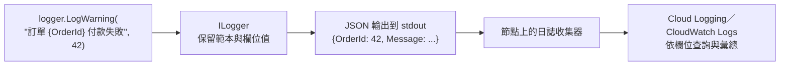

## 這是什麼

一筆日誌寫成 `"訂單 42 付款失敗，金額 1200"`，人看得懂，但要回答「過去一小時有幾筆付款失敗、總金額多少、集中在哪個付款方式」，就只能用文字比對去猜。

**結構化日誌**把每筆日誌記成「訊息 + 具名欄位」：`OrderId = 42`、`Amount = 1200`、`PaymentMethod = credit_card`。日誌服務可以直接依欄位篩選、彙總，就像查資料庫一樣。

.NET 的 `ILogger` 原生支援結構化日誌，關鍵在於寫法：用**訊息範本**，而不是自己把值拼進字串。

## 運作原理



訊息範本中的 `{OrderId}` 是**具名的佔位符**。`ILogger` 會同時保留原始範本與每個欄位的值，輸出成 JSON 時，欄位成為可以查詢的屬性。所有「訂單付款失敗」的日誌共用同一個範本，日誌服務也能依範本分組統計。

在 Kubernetes 上，應用程式把日誌寫到標準輸出（stdout），節點上的收集器把它送到雲端的日誌服務。輸出成 JSON，雲端服務才能解析出欄位。

## 常見錯誤與正確寫法

### 1. 用字串插值寫日誌

```csharp
// 錯：值被拼進字串，欄位資訊消失；就算這個等級沒有被輸出，字串也已經被建立
logger.LogWarning($"訂單 {order.Id} 付款失敗，金額 {order.Total}");

// 對：訊息範本，欄位保留為結構化資料
logger.LogWarning("訂單 {OrderId} 付款失敗，金額 {Amount}", order.Id, order.Total);
```

熱門路徑上用來源產生器，在編譯時產生不需要額外配置的記錄方法：

```csharp
internal static partial class PaymentLog
{
    [LoggerMessage(Level = LogLevel.Warning, Message = "訂單 {OrderId} 付款失敗，金額 {Amount}，原因 {Reason}")]
    public static partial void PaymentFailed(ILogger logger, Guid orderId, decimal amount, string reason);
}

PaymentLog.PaymentFailed(logger, order.Id, order.Total, result.Reason);
```

### 2. 在容器中輸出給人看的純文字

預設的主控台格式是多行的純文字，雲端日誌服務只能把它當成一段字串。改成 JSON：

```csharp
builder.Logging.AddJsonConsole(options =>
{
    options.IncludeScopes = true;                         // 範圍中的欄位（例如 TraceId）一起輸出
    options.TimestampFormat = "yyyy-MM-ddTHH:mm:ss.fffZ";
    options.UseUtcTimestamp = true;
});
builder.Logging.Configure(o => o.ActivityTrackingOptions =
    ActivityTrackingOptions.TraceId | ActivityTrackingOptions.SpanId); // 每筆日誌帶上目前的 trace
```

帶上 trace ID 後，從一筆錯誤日誌就能跳到完整的分散式追蹤，見 [指標與追蹤](/engineering/metrics-tracing/)。

### 3. 日誌裡出現個資或機密

記錄整個請求物件，把買家的電話、地址、信用卡末四碼、甚至密碼一起寫進日誌；日誌通常保存很久、很多人看得到。只記錄需要的欄位；需要記錄敏感欄位時，使用 .NET 的資料遮蔽功能（`Microsoft.Extensions.Compliance.Redaction`）在輸出前遮罩，連線字串與 token 永遠不要記錄。

### 4. 等級亂用

所有東西都用 `Information`，正式環境的日誌量爆增、成本升高，真正的錯誤被淹沒。依「需要誰採取什麼行動」選等級：`Error` 代表需要處理的失敗；`Warning` 代表異常但系統已經處理（例如重試成功）；`Information` 只記錄重要的業務事件；`Debug` 只在除錯時開啟。

## 使用邊界

- **日誌不是指標。** 「每分鐘付款失敗幾次」用指標計數，便宜且即時；日誌用來看單一事件的細節，見 [指標與追蹤](/engineering/metrics-tracing/)。
- 日誌量直接影響雲端成本。設定保存期間、對高頻的 Debug 日誌取樣或在正式環境關閉，見 [還原演練與成本](/engineering/recovery-cost/)。
- 也可以用 OpenTelemetry 匯出日誌，與追蹤和指標走同一條管線，由 Collector 轉送到各雲端。

## 雲端排查

### 叢集層（GKE 與 EKS 相同）

```bash
# 確認容器輸出的是單行 JSON（每一行都是一個 JSON 物件）
kubectl logs -n shop deployment/order-api --tail=3
```

### 託管服務層

#### GKE

Cloud Logging 會解析 stdout 中的 JSON，把欄位放進 `jsonPayload`，可以直接依欄位查詢：

```bash
gcloud logging read 'resource.type="k8s_container" AND resource.labels.namespace_name="shop" AND jsonPayload.State.OrderId="42"' \
  --freshness=1d --limit=20
```

Cloud Logging 只認得特定的欄位名稱（例如 `severity`）來設定日誌的嚴重程度；.NET 內建 JSON 格式的等級欄位名稱是 `LogLevel`，不會自動對應。要在 Cloud Logging 依嚴重程度篩選，使用自訂的格式器輸出 `severity`，或透過 OpenTelemetry Collector 轉換。

#### EKS

Container Insights 會把容器日誌送到 CloudWatch Logs（應用程式日誌群組），Logs Insights 會自動解析 JSON 欄位：

```text
fields @timestamp, log_processed.LogLevel, log_processed.State.OrderId, log_processed.Message
| filter kubernetes.namespace_name = "shop" and log_processed.LogLevel = "Warning"
| stats count(*) by log_processed.State.Reason
```

實際的欄位路徑取決於收集器的設定，先用 `fields @message | limit 5` 看一筆原始紀錄的結構。

### 應用程式層

為重要的業務事件（付款失敗、庫存不足）固定使用同一個範本或同一個 `EventId`，查詢時就能精準地找到同一類事件，而不受訊息文字修改的影響。
